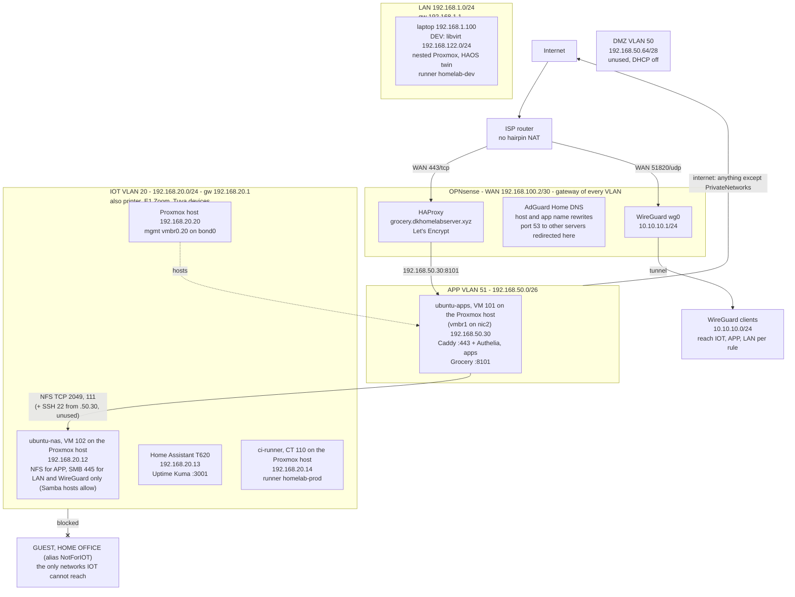
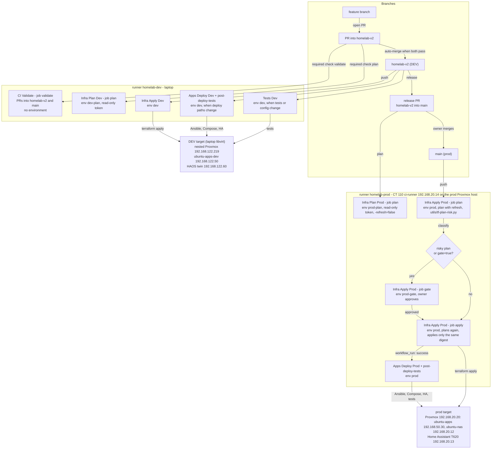
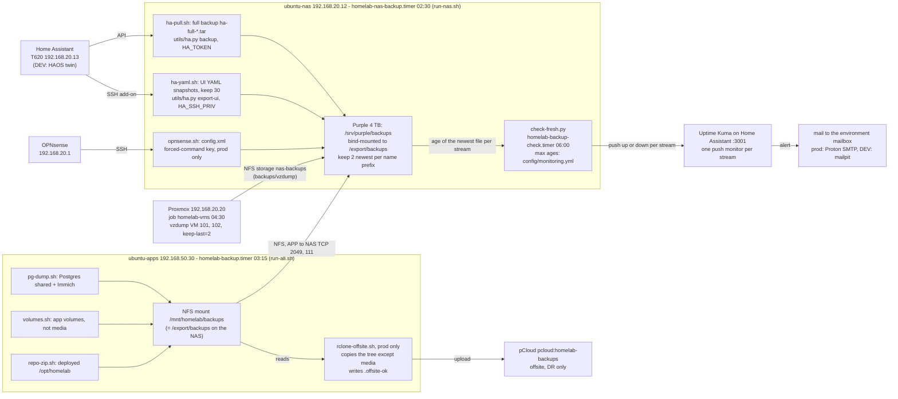

# Homelab v2

Self-hosted homelab as code: Terraform creates the guests on Proxmox, Ansible configures them, Docker
Compose runs the apps, GitHub Actions deploys through two self-hosted runners. prod (branch `main`) is
one physical Proxmox host behind an OPNsense router, with Home Assistant OS on an HP T620. DEV (branch
`homelab-v2`) runs the same code on a laptop: a nested Proxmox in libvirt and a HAOS VM twin.

The repository is public: secret values never enter it, only their names
([`docs/secrets-inventory.md`](docs/secrets-inventory.md)). Operator documentation is in
[`knowledge/`](knowledge/README.md); agents start with [`AGENTS.md`](AGENTS.md) and
[`PROJECT-CONTEXT.md`](PROJECT-CONTEXT.md).

## How it is built

| Guest | prod | DEV |
| --- | --- | --- |
| Proxmox host | `192.168.20.20`, node `proxmox` | libvirt VM `Proxmox`, `192.168.122.219`, node `dev` |
| `ubuntu-apps`, VM 101: Docker, every app | `192.168.50.30`, APP VLAN 51 | `ubuntu-apps-dev`, `192.168.122.50` |
| `ubuntu-nas`, VM 102: NFS, Samba, backup disk | `192.168.20.12`, IOT VLAN 20 | none: loopback NFS and Samba on `ubuntu-apps-dev` |
| `ci-runner`, CT 110: runner `homelab-prod` | `192.168.20.14`, IOT VLAN 20 | runner `homelab-dev` on the laptop |
| Home Assistant OS | HP T620, `192.168.20.13` | HAOS VM, `192.168.122.60` |

Terraform state lives in HCP Terraform (workspaces `homelab`, `homelab-dev`). CT 110 is built by
`utils/pve-ci-runner-lxc.sh`, outside Terraform, so an apply never replaces its own runner. OPNsense
is the gateway of every VLAN and runs AdGuard Home (DNS, host and app names), HAProxy (public
Grocery) and WireGuard; the WAN passes only 443/tcp and 51820/udp. Details:
[architecture](knowledge/architecture.md), [infrastructure](knowledge/infrastructure.md),
[`docs/network.md`](docs/network.md) (addresses, firewall), [networking](knowledge/networking.md).



## Where to start

- DEV from scratch: [rebuild](knowledge/rebuild.md), [`docs/dev-proxmox.md`](docs/dev-proxmox.md);
  `utils/setup-github-runner.sh --label homelab-dev`, `utils/ensure-dev-proxmox.sh`,
  `utils/bootstrap-dev-proxmox.sh`, `utils/dev-haos-vm.sh`. Laptop tools: `git`, `gh`, `terraform`,
  `ansible`, `ansible-lint`, `docker`, `virsh`, `virt-install`, `openssl`.
- prod: [`docs/f3-proxmox.md`](docs/f3-proxmox.md), [prod-target](knowledge/prod-target.md),
  [storage](knowledge/storage.md). Prod changes only through the release flow below.
- First reads: [deployment](knowledge/deployment.md), [operations](knowledge/operations.md); before
  debugging, [troubleshooting](knowledge/troubleshooting.md) and [lessons-learned](knowledge/lessons-learned.md).
- Secrets: `utils/gen-app-credentials.sh` writes a value to the GitHub environment,
  `~/.homelab-secrets/<env>/` and Bitwarden (`homelab/<NAME>/<env>`) in one run
  ([security](knowledge/security.md)).

Checks ([`PROJECT-CONTEXT.md`](PROJECT-CONTEXT.md) section 4 has the full list):

```bash
utils/run-tests.sh --env dev --suite all     # smoke infra net config storage ha; restore is opt-in
terraform fmt -check -recursive              # in terraform/
ansible-lint ansible/playbooks/
python3 utils/tf-plan-risk.py --self-test    # one of the script self-tests CI Validate runs
```

## Change flow

1. A feature branch opens a PR into `homelab-v2`. It merges itself when the required checks
   `validate` (CI Validate) and `plan` (Infra Plan Dev) pass; the ruleset has no bypass.
2. The push to `homelab-v2` runs Infra Apply Dev, Apps Deploy Dev with post-deploy tests and Tests
   Dev against DEV.
3. A release is a PR `homelab-v2` -> `main` (CI Validate, Infra Plan Prod); the owner merges it.
4. Infra Apply Prod asks once, on its first job (`prod-approve`). It then plans with refresh and
   classifies the plan with `utils/tf-plan-risk.py`. A safe plan with `gate` false skips `prod-gate`
   and the apply job runs without a second click. A risky plan, or a manual run with `gate=true`,
   waits in `prod-gate`. The apply job applies only a plan with the same digest.
5. Apps Deploy Prod follows a successful Infra Apply Prod with no second click, and ends with
   the post-deploy tests. A manual run of this workflow asks once (`prod-approve`).

No direct pushes to `homelab-v2` or `main`. Decision
[0004](knowledge/decisions/0004-ci-autonomy-and-prod-risk-gate.md); settings in
[`docs/manual-setup.md`](docs/manual-setup.md) "CI autonomy"; fork PRs, SHA pinning and environments
in [security](knowledge/security.md).



| Workflow | Trigger | Runner | Environment |
| --- | --- | --- | --- |
| CI Validate (`ci-validate.yml`) | push `homelab-v2`; PR into `homelab-v2` or `main` | `homelab-dev` | - |
| Infra Plan Dev (`infra-plan-dev.yml`) | PR into `homelab-v2`; manual | `homelab-dev` | `dev-plan` |
| Infra Apply Dev (`infra-apply-dev.yml`) | push `homelab-v2`; manual | `homelab-dev` | `dev` |
| Apps Deploy Dev (`apps-deploy-dev.yml`) | push `homelab-v2` on deploy paths (compose, Ansible, HA, storage and identity config); manual | `homelab-dev` | `dev` |
| Tests Dev (`tests-dev.yml`) | push `homelab-v2` on tests or config; manual | `homelab-dev` | `dev` |
| Infra Plan Prod (`infra-plan.yml`) | PR into `main` | `homelab-prod` | `prod-plan` |
| Infra Apply Prod (`infra-apply-prod.yml`) | push `main`; manual, input `gate` | `homelab-prod` | `prod`; `prod-gate` for a risky plan |
| Apps Deploy Prod (`apps-deploy-prod.yml`) | Infra Apply Prod succeeded on `main`; manual | `homelab-prod` | `prod` |

## Applications

Every service is declared once in [`config/services.yml`](config/services.yml) (port, health check,
profile, name, Authelia exceptions), accounts in [`config/identities.yml`](config/identities.yml),
one page per app in [`knowledge/apps/`](knowledge/apps/). Caddy (profile `proxy`) serves each app as
`<app>.<domain>` behind Authelia (`auth.<domain>`), configured by `utils/gen-proxy-config.py`:
`dkhomelabserver.xyz` on prod (Let's Encrypt through the Cloudflare DNS challenge),
`dev.dkhomelabserver.xyz` on DEV (Caddy's internal CA); AdGuard rewrites resolve the names. Prod
enables `auth` and `proxy` only when `CLOUDFLARE_API_TOKEN` is in environment `prod`; without it the
apps answer on `192.168.50.30:<port>`. Decision [0007](knowledge/decisions/0007-app-names-caddy-authelia.md).

| Group | Names |
| --- | --- |
| infra | `portainer`, `pgadmin`, `homarr`, `dozzle`, `beszel`; DEV only: `mailpit` |
| apps | `trilium`, `actual`, `linkwarden`, `syncthing` |
| tools | `omni-tools`, `it-tools`, `networking-toolbox`, `bentopdf` |
| media | `navidrome`; profile `media`: `jellyfin`, `immich` |
| no name | Grocery (public `https://grocery.dkhomelabserver.xyz` through the OPNsense HAProxy), Postgres, Diun, Beszel agent |

## Backups and monitoring

Every stream lands in `/srv/purple/backups` on the NAS Purple disk, bind-mounted to `/export/backups`
and seen by the apps host as the NFS mount `/mnt/homelab/backups`. The NAS pulls the Home Assistant
backup, its UI YAML and the OPNsense config at 02:30; the apps host dumps Postgres, app volumes and
the deployed repo at 03:15 and copies the tree to pCloud; Proxmox dumps VMs 101 and 102 at 04:30.
Retention is the 2 newest files per name prefix (UI YAML: 30); media and the Samba share are not included. On DEV
one guest is NAS and apps host, offsite is off. [backup](knowledge/backup.md), [dr](knowledge/dr.md)



Uptime Kuma, an add-on on Home Assistant, checks every service, the Proxmox host, the NAS, the router
and public Grocery, and alerts when a backup stream's push from `check-fresh.py` (NAS, 06:00) is stale
or missing; `utils/kuma-sync.py` keeps it equal to [`config/monitoring.yml`](config/monitoring.yml).
Beszel watches disk, RAM and CPU, Diun reports new image tags. Mail goes out through Proton SMTP on
prod and into mailpit on DEV. A dead T620, router or uplink sends nothing (decision
[0006](knowledge/decisions/0006-alerts-kuma-proton-smtp.md)). [monitoring](knowledge/monitoring.md)

## Repository layout

```
.github/workflows/  CI and deploy workflows
agents/             agent role definitions (AGENTS.md section 13)
ansible/            playbooks and inventories per environment
compose/            Docker Compose: core stack, Grocery
config/             single sources: services, identities, storage, monitoring, Proxmox network
docs/               setup notes, network map, secret names, diagrams, audits; plan/ in Polish
homeassistant/      Home Assistant packages deployed by utils/ha.py
knowledge/          operator knowledge base - start here
opnsense/           router baseline and restore notes
prompts/ rules/     agent prompt templates and rules read on demand
scripts/            agent kit sync and check
terraform/          Proxmox guests; environments dev and prod
tests/              suites run by utils/run-tests.sh
utils/              bootstrap, deploy, backup, router and secret scripts
```

## Status (2026-10-22)

Prod has been running since release #75 (VMs 101 and 102, CT 110). What is still
open is the frontmatter of [`docs/plan/greenfield-plan.md`](docs/plan/greenfield-plan.md).

## Diagrams

Each mermaid block above is also a draw.io file (app.diagrams.net or draw.io desktop):
[change-flow](docs/diagrams/change-flow.drawio), [network](docs/diagrams/network.drawio),
[backups](docs/diagrams/backups.drawio). Change both together.

## License

[MIT](LICENSE)
