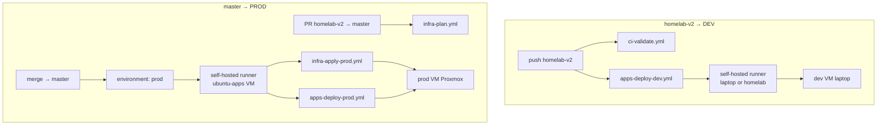
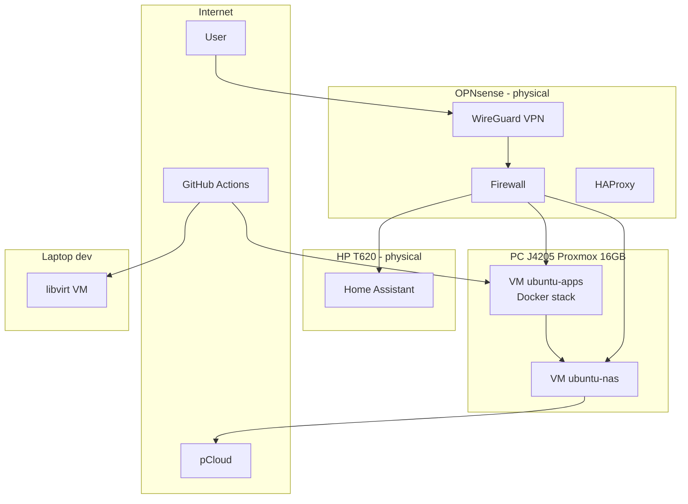

# Greenfield notes

This file is not a procedure and not the backlog. The open backlog is the frontmatter of
[`greenfield-plan.md`](greenfield-plan.md). Completed items are in
[`greenfield-completed.md`](greenfield-completed.md). The notes below are the June and July 2026 write-up, unshortened.


# Homelab — greenfield plan (dummy)

> **Status:** working draft — fill in the *Assumptions* and *Problems* sections as decisions are made.
> **Backlog:** the open todos in the frontmatter of [`greenfield-plan.md`](greenfield-plan.md) are the single source of truth (do not duplicate them in separate plans). Completed items are in [`greenfield-completed.md`](greenfield-completed.md).
> **Working branch:** `homelab-v2` — **entirely new, clean code**. Until the merge, `main` stays legacy (read-only); after the merge **`main` = v2 contents only** — the old code disappears from the default branch (history under the tag `legacy-pre-v2`).

### Todos — status (2026-10-18, takeover audit)

Details and evidence: `docs/audit/2026-10-18-plan-audit.md`. Order: `knowledge/decisions/0001-restore-ci-and-dev-before-f3-metal.md`.

| ID | Status | What is left |
|----|--------|------------|
| `gha-cleanup-secrets`, `apps-*`, `backup-dr`, `phases`, `manual-setup-f0`, `preflight`, `secrets-*`, `security`, `branch-v2` | ✅ | — |
| `readme-docs`, `identities`, `knowledge-base` | ✅ | — |
| `gha-pipelines` | ✅ | — |
| `gha-runner-bootstrap` | 🔄 | dev ✅ (systemd service); prod after F3 |
| `config-as-code`, `tests-auto` | 🔄 | verification on a working DEV → **R2** |
| `rebuild-runbook`, `audit-final` | 🔄 | drill and the F9 gate on the DEV side → **R3** |
| `restore-ci`, `restore-dev` | ✅ | iteration #4 (2026-10-18) |
| `f9-gate-dev` | 🔄 | rebuild DEV from the repo + vault, run `--suite restore` again; bootstrap of 2 apps → #14 |
| `hardware`, `implement` | 🔄 | F3 metal, F5 prod |
| `monitoring-alerts`, `ai-log-analysis` | ⏳ | F10, after prod |

---

## Git strategy — branch `homelab-v2`

**Decision:** `homelab-v2` is **greenfield** — a new repo structure (Compose, workflows, TF, docs), **without** keeping legacy files. Not an in-place refactor on `dev`, and not a gradual merge with the old `master`.

**Merge decision:** after prod verification, **`homelab-v2` replaces `master`** — the merge is a **tree replacement**, not an integration of two versions. The old `master` contents **do not remain** on the default branch after the merge.

### Steps (one time, before F1)

**0. Clean out the old Actions secrets and variables** (legacy test pipeline) — see the **GH secrets/variables cleanup** section below. Do this **before** uploading the new values for v2.

```bash
git fetch origin
git checkout master          # if the default branch is main: git checkout main
git pull
git checkout -b homelab-v2
git push -u origin homelab-v2
```


| Branch                 | Role                                                                                                       |
| --------------------- | ---------------------------------------------------------------------------------------------------------- |
| `master` (or `main`) | **Until the merge:** legacy, frozen — **zero** v2 commits. **After the merge:** identical to `homelab-v2` (v2 only) |
| `dev`                 | Old test pipeline — **frozen**; after the v2 merge: **delete** or archive with a tag                   |
| **`homelab-v2`**      | **Single source of truth** for the duration of the build: clean greenfield code — commits go here                                |


### Rules on `homelab-v2`

- Commits **only** on `homelab-v2`; a PR → `master` only when prod works and the F0→F1 gate is closed.
- **Push `homelab-v2`** → Actions deploy **dev** (test). **Merge / push `master`** → Actions deploy **prod** — never the other way around.
- On v2 **remove** legacy from the tree (the old `[setup-proxmox-node-vms.yml](.github/workflows/setup-proxmox-node-vms.yml)`, old playbooks, old layout) — target files **only** from v2; the merge must produce a clean state, not "v2 + leftovers from master".
- **GitHub Environments** `dev` / `prod`: the dev workflow on **`homelab-v2`**; the prod workflow only on **`master`**.
- **Terraform Cloud:** workspace **`homelab`** (org `dkhomelabserver`) — **no** import of the old tfstate.

### Merge v2 → master (replacement, not integration)

**Goal:** after the merge `git ls-tree master` = `git ls-tree homelab-v2` — **zero** legacy files on the default branch.


| Step | Action                                                                                                            |
| ---- | ---------------------------------------------------------------------------------------------------------------- |
| 1    | Tag **`legacy-pre-v2`** on the last `master` commit **before** the merge (so the old code can be restored)               |
| 2    | PR `homelab-v2` → `master` — review: the diff shows **deletion** of legacy + **new** v2 files                      |
| 3    | Merge the PR (merge commit or squash — both OK, as long as the tree = v2)                                                   |
| 4    | Verification: on `master` the old paths are **gone** (`setup-proxmox-node-vms.yml`, the old `ansible/` layout, and so on) |
| 5    | Optional: branch `dev` — delete the remote / tag `legacy-dev`                                                      |
| 6    | `homelab-v2` can be kept or deleted after the merge — **`master` is the only prod branch from then on**                   |
| 7    | **`README.md` complete** — full documentation (section *README documentation*); required before the merge              |


**If an ordinary merge would leave files that exist only on master** (edge case):

```bash
git fetch origin
git checkout master
git merge -s ours -m "Replace master with homelab-v2" homelab-v2   # keep the merge point
git checkout homelab-v2 -- .
git commit -m "Replace tree with homelab-v2 greenfield"
git push origin master
```

Alternative (after the tag `legacy-pre-v2`): `git reset --hard origin/homelab-v2` + `git push --force-with-lease origin master` — only when a PR/merge does not produce a clean tree.


---

## CI/CD — deployment through GitHub Actions

**Decision:** all infra and application deploys go through the **pipeline in GitHub Actions** (`[.github/workflows/](.github/workflows/)`) — **not** a manual `ansible-playbook` / `terraform apply` from the laptop as the target path (exception: OPNsense bootstrap, one-shot SSH).

**Branch → environment decision:**


| Branch                            | Environment | Effect                                                                                   |
| -------------------------------- | ---------- | --------------------------------------------------------------------------------------- |
| **`homelab-v2`** (commit / push) | **dev**    | Validation + deploy to the **dev VM** (laptop libvirt) — **zero changes on prod**              |
| **`master`** (merge / push)      | **prod**   | Terraform apply + application deploy to **prod** — **zero automatic deploy to dev** |


You commit and test on **`homelab-v2`** → the pipeline touches only **dev**. Only a **merge to `master`** starts the **prod** pipeline (with approval in the GitHub Environment).

### Rules


| Rule                | Details                                                                                                                                               |
| --------------------- | ------------------------------------------------------------------------------------------------------------------------------------------------------- |
| **Runner**            | **Two self-hosted:** **dev** on the **laptop** (`homelab-dev`); **prod** on **`ubuntu-apps`** (`homelab-prod`); **no** GitHub-hosted / **no Tailscale** |
| **Dev branch**         | **`homelab-v2`** — the only branch that triggers a **dev** deploy                                                                                              |
| **Prod branch**        | **`master`** — the only branch that triggers a **prod** deploy (after the v2 merge)                                                                                   |
| **Environments**      | GitHub **`dev`** and **`prod`** — secrets via `gh`; **approval required on prod**                                                                    |
| **Access to the homelab** | Runner on the LAN — direct SSH/Ansible/Proxmox API; bootstrap: `utils/setup-github-runner.sh`                                                           |
| **Source of truth**     | **Hybrid:** core infra in the repo (`compose/core`, Ansible, TF); apps from **separate repos** via **Portainer** (see B1)                                    |
| **Isolation**          | The prod workflow does **not** run on a push to `homelab-v2`; dev does **not** run on a push to `master`                                                                                |


### Pipeline — target workflows (sketch)




| Workflow file          | Trigger                             | Runner      | Action                                                         |
| ---------------------- | ----------------------------------- | ----------- | ------------------------------------------------------------- |
| `ci-validate.yml`      | push/PR `homelab-v2`, PR → `master` | self-hosted | `terraform validate`, `ansible-lint`, `docker compose config` |
| `apps-deploy-dev.yml`  | push `homelab-v2`                   | self-hosted | Ansible + deploy core compose / Portainer stacks → **dev VM** |
| `infra-plan.yml`       | PR `homelab-v2` → `master`          | self-hosted | `terraform plan` (TFC) — no apply                            |
| `infra-apply-prod.yml` | push `master` / `workflow_dispatch` | self-hosted | `terraform apply` — env **prod**, approval                    |
| `apps-deploy-prod.yml` | push `master` / `workflow_dispatch` | self-hosted | Ansible + core compose + Portainer → **prod VM**, approval    |

### Self-hosted runner (B5 — ✅)

**Decision:** a **self-hosted GitHub Actions runner** on the LAN — **rejected:** a GitHub-hosted runner, **Tailscale**, and a manual-only deploy.


| Element              | Decision                                                                                                                                     |
| -------------------- | --------------------------------------------------------------------------------------------------------------------------------------------- |
| **Prod location** | VM **`ubuntu-apps`** — prod runner (`homelab-prod`); the same host as the Docker/Ansible target                                                    |
| **Dev location**  | **Laptop** — dev runner (`homelab-dev`); Actions from the laptop on a push to `homelab-v2`; CI fails when the laptop is off                            |
| **Bootstrap**        | Script **`utils/setup-github-runner.sh`** — registration in GitHub (token from `gh`/PAT), service install, labels `homelab-dev` / `homelab-prod` |
| **Workflow**         | `runs-on: [self-hosted, homelab-prod]` (prod) / `[self-hosted, homelab-dev]` (dev)                                                            |
| **F0 legacy**        | Remove the **old** runner (if there was one); **two new** runners — part of **F1** (prod on the VM, dev on the laptop)                                        |


**After the v2 → master merge:** the dev working branch is **`homelab-v2` short term** ✅; after the first successful prod merge → **a new `develop` branch** (option B) — *git-post-merge decision*.

**Legacy to remove on v2:** the monolithic `[setup-proxmox-node-vms.yml](.github/workflows/setup-proxmox-node-vms.yml)` — replaced by split workflows + the new runner.

### What does **not** go through Actions


| Element                               | Why                                               |
| ------------------------------------- | ------------------------------------------------------ |
| OPNsense first bootstrap           | One-shot SSH from the laptop; after that, config backup only      |
| Flash HAOS on the HP620                   | Physical                                              |
| `gh secret set` / Bitwarden           | Locally, before the pipeline                               |
| First `git checkout -b homelab-v2` | Locally                                               |
| **First runner registration**      | `utils/setup-github-runner.sh` — locally / on the VM (F1) |


~~### Open within the pipeline (B5)~~ — **closed:** self-hosted runner (above).

### GH secrets/variables cleanup (F0 — before F1)

**Decision:** at the start of greenfield **we delete** the old secrets and variables from the previous test pipeline (`[setup-proxmox-node-vms.yml](.github/workflows/setup-proxmox-node-vms.yml)`), so names are not mixed, dead credentials are not kept, and there is no collision with the new v2 inventory.


| Level                 | What to clear                                                                                         |
| ---------------------- | ---------------------------------------------------------------------------------------------------- |
| **Repository**         | Secrets/variables at repo level (if any)                                                      |
| **Environment `dev`**  | All legacy entries                                                                               |
| **Environment `prod`** | All legacy entries                                                                               |
| **After cleanup**     | New names per `docs/secrets-inventory.md` — values only through `gh secret set` + a copy in Bitwarden |


**Legacy inventory to delete** (from the current workflow — verify with `gh secret list` / `gh variable list`):


| Name                               | Type      | Note                                                  |
| ----------------------------------- | -------- | ------------------------------------------------------ |
| `PROXMOX_API_URL`                   | variable | old Proxmox test                                     |
| `PROXMOX_API_TOKEN_ID`              | variable |                                                        |
| `PROXMOX_API_TOKEN_SECRET`          | secret   |                                                        |
| `PROXMOX_SSH_USERNAME`              | variable |                                                        |
| `PROXMOX_SSH_PASSWORD`              | secret   |                                                        |
| `SSL_CERT`, `SSL_CHAIN`, `SSL_PKEY` | secret   | certificates — if needed, keep a copy in Bitwarden before delete |
| `UBUNTU_DOCKER_SSH_PUB`             | variable |                                                        |
| `UBUNTU_DOCKER_PASSWORD`            | secret   |                                                        |
| `POSTGRES_PASSWORD`                 | secret   | generate a new password on v2                           |


**Procedure (locally, `gh auth login`):**

```bash
# 1. Audit — save the list of names (you cannot read secret values anyway)
gh secret list
gh secret list --env dev
gh secret list --env prod
gh variable list
gh variable list --env dev
gh variable list --env prod

# 2. Delete one by one (repo-level — without --env)
gh secret delete NAME
gh variable delete NAME

# 3. Environment-scoped
gh secret delete NAME --env dev
gh variable delete NAME --env prod

# 4. After cleanup: new secrets per the v2 inventory (Bitwarden → gh secret set)
```

**Notes:**

- **Self-hosted runner** (if one was attached to the repo) — disconnect / remove it in Settings → Actions → Runners.
- Secret values from GH **cannot be recovered** — if something from legacy is still needed (certificates, keys), copy it from Bitwarden / local files **before** `delete`.
- After the merge **`master` = the v2 tree** — legacy workflows are not on the default branch; GH secrets cleanup is **at the start of F0**, do not wait for the merge.

---

## Goal

Self-hosted homelab prod (+ dev on the laptop): applications in Docker, a central Postgres, secure access (VPN + SSO), backups to the NAS and pCloud, easy recovery after a failure. **Deploy only through the GitHub Actions pipeline** (branch `homelab-v2` → then `master`) on a **self-hosted runner** on the LAN.

---

## User decisions (TBD → closed)

> **Date:** 2026-06-11 — AskQuestion session; plan updated, **no implementation**.


| ID      | Topic                | Decision                                                                                                                                                              | Status                   |
| ------- | -------------------- | -------------------------------------------------------------------------------------------------------------------------------------------------------------------- | ------------------------ |
| **B1**  | Proxmox containers    | **VM `ubuntu-apps` + Docker** (not LXC) + **Portainer** — apps from **different repos**, not one monolithic compose                                               | ✅                        |
| **B1b** | Deploy source of truth | **Hybrid:** core infra (Postgres, Homarr, proxy client, Authelia) in the repo `compose/`; **per-app stacks** from separate repos through Portainer / `compose/apps/<name>/`    | ✅                        |
| **B2**  | Reverse proxy        | **OPNsense: HAProxy** (built in) — **os-traefik-maxit rejected**                                                                                                   | ✅                        |
| **B3**  | Access               | **WireGuard** as the default access to the LAN + **public HTTPS only for selected apps** (at the start: **ToDo Grocery**; the rest **VPN-only**, unless you change it later) | ✅                        |
| **B4**  | SSO + exposure       | **ToDo Grocery — public**; **the other apps — VPN only**; **SSO (Authelia) on everything** where possible                                                              | ✅ Authelia recommended |
| **B5**  | CI → homelab         | **Self-hosted runner** + script `utils/setup-github-runner.sh`; **dev runner on the laptop**, **prod runner on ubuntu-apps**; ❌ Tailscale, GitHub-hosted               | ✅                        |
| **B6**  | Storage              | **B+C ✅:** SA500→NAS VM (NFS, Immich/media); Purple→backups; **Postgres/cache locally** on the apps VM; per-app volumes ⏳ TBD                                           | ✅ partial              |
| **B7**  | VM RAM               | **`ubuntu-apps` 8 GB** + **`ubuntu-nas` 4 GB**                                                                                                                       | ✅                        |
| **B14** | LUKS                 | **No LUKS at the start** ✅; LUKS+clevis/TPM → **backlog / distant TODO**                                                                                                | ✅                        |
| **B15** | Vault                | **Bitwarden Cloud**                                                                                                                                                  | ✅                        |
| **B16** | Offsite backup       | **rclone → pCloud**                                                                                                                                                  | ✅                        |
| **B17** | Portainer            | **Yes, P0** — managing multi-repo stacks (earlier: "not at the start")                                                                                               | ✅                        |
| **P0**  | Starting scope      | **✅ P0/P1/P2 defined** — see the section *User decisions — iteration #2*                                                                                       | ✅                        |


### B2 — HAProxy vs os-traefik-maxit (OPNsense)


| Criterion              | **HAProxy** (built in)                       | **os-traefik-maxit** (plugin)            |
| ---------------------- | --------------------------------------------- | ---------------------------------------- |
| Installation             | Already in OPNsense                                | Plugin from the OPNsense repository           |
| UI / learning curve    | OPNsense GUI, many homelab tutorials          | Traefik-like, less typical on a router   |
| Let's Encrypt certificates    | ACME via HAProxy / the OPNsense cert plugin       | Depends on the plugin                        |
| Dynamic routing        | Manual frontends/backends                     | Closer to Traefik (labels/routes)           |
| **Plan recommendation** | **Start here** — simpler, native, stable | If HAProxy is too rigid — F2 fallback |


**NPM / Traefik on the apps VM:** rejected in favour of the proxy **on OPNsense** (router performance is OK — outside sizing).

**Iteration #2 decision:** **HAProxy** ✅ — os-traefik-maxit **rejected**.

### B4 — access model per app


| App                 | VPN                 | Public HTTPS | SSO                    |
| ------------------- | ------------------- | ------------ | ---------------------- |
| **ToDo Grocery**    | optional         | **Yes**      | Authelia               |
| **The other P0/P1** | **Yes** (default) | No          | Authelia               |
| **pgAdmin**         | **Yes only**        | No          | Authelia + a strong password |


---

## User decisions — iteration #2 (2026-06-11)

> **Status:** decision session closed (plan only, no implementation).
> Consolidated decisions below; option details in the section *Decision iteration #2*.

### Network [A4] ✅ — option C (existing VLANs)


| VLAN / name        | Gateway               | DHCP range | Tag / notes                      |
| ------------------- | ------------------- | ---------- | -------------------------------- |
| **LAN**             | 192.168.1.1         | .100–.200  |                                  |
| **HOMEOFFICE**      | 192.168.10.1        | .100–.200  |                                  |
| **IOT**             | 192.168.20.1        | .100–.200  | **Proxmox host + HP T620 HA**    |
| **GUEST**           | 192.168.30.1        | .100–.200  | guest WiFi                      |
| **DMZ**             | 192.168.50.1        | .7–.14     | **unused at the start** (A5)     |
| **APP**             | **192.168.50.50/26** (QinQ) | .30–.62    | **Docker/apps**; VLAN **tag 51** |
| **VPN (WireGuard)** | **10.10.10.1** (`wg0`)      | peers      | As-built; not `10.0.0.0/24`      |


**✅ A5 (as-built 2026-06-30):** Proxmox **`.20.20`**; APP gw **`.50.50`**; NAS **`.20.12`**, HA **`.20.13`**, apps **`.50.30`**; WG **`10.10.10.0/24`**.

### Static IPs [A5] ✅ — DHCP reservation in OPNsense (IPs fixed; MAC placeholder)

**Decision:** MAC→IP reservation in OPNsense (DHCP reservation).

**A5 decisions (as-built 2026-06-30; DHCP decision 2026-06-11):**

| Topic | Decision |
|-------|---------|
| **APP vs DMZ** | **Simplification:** only **APP QinQ tag 51** `192.168.50.0/26` (DHCP `.30`–`.62`); **DMZ (tag 50) unused** at the start |
| **APP gateway** | **192.168.50.50/26** (as-built OPNsense QinQ) — **not** `.50.1` |
| **ubuntu-nas** | **IOT VLAN 20** — `192.168.20.12` (NFS); NFS traffic **APP → IOT** (firewall F2: APP net → `.20.12:2049`) |
| **ubuntu-apps** | **APP VLAN 51** — `192.168.50.30` |
| **MAC** | Placeholder in the plan — you fill in the real values before F3 (OPNsense DHCP reservation) |

**Domain (A6 ✅ 2026-06-11):** zone **`dkhomelabserver.xyz`** (legacy: `router.dkhomelabserver.xyz` in the old TF). Publicly only **`grocery.dkhomelabserver.xyz`** → HAProxy ACME (F2).


| Host / role            | VLAN | Tag | Target IP      | MAC (placeholder)   |
| ---------------------- | ---- | --- | ---------------- | ------------------- |
| OPNsense IOT           | IOT  | 20  | 192.168.20.1     | (router interface) |
| OPNsense APP           | APP  | 51  | **192.168.50.50** | (QinQ as-built)     |
| Proxmox host (NIC1)    | IOT  | 20  | **192.168.20.20** | `<MAC>` ✅ |
| HP T620 HA             | IOT  | 20  | **192.168.20.13** | F5 (MAC TBD)        |
| `ubuntu-nas` (NFS)     | IOT  | 20  | **192.168.20.12** | F3 (MAC TBD)        |
| `ubuntu-apps` (Docker) | APP  | 51  | **192.168.50.30** | F3 (MAC TBD)        |


**Split of 3× 1 Gb/s NICs (Proxmox) — ✅ confirmed in A5:**


| NIC      | Role                                       | VLAN / IP                          |
| -------- | ------------------------------------------ | ---------------------------------- |
| **NIC1** | IOT / mgmt — Proxmox **`.20.20`** + IOT VM trunk  | tag 20                             |
| **NIC2** | Pass-through **SA500 + Purple** to the NAS VM  | no IP (disks only)              |
| **NIC3** | APP / Docker — APP VM trunk                | tag 51 → `ubuntu-apps` `.50.30`  |


**VM network:** `ubuntu-nas` — 1× NIC on **vmbr0 tag 20** (IOT); `ubuntu-apps` — 1× NIC on **vmbr0 tag 51** (APP). NFS: apps mount `192.168.20.12:/export/...` (firewall: APP → IOT port 2049).

**Dev (laptop libvirt):** unchanged — `192.168.122.0/24`; dev `ubuntu-docker` e.g. `.221` (legacy).

**OPNsense DHCP reservation table (to be configured in F2):**


| Device     | IP              | MAC placeholder     | VLAN |
| -------------- | --------------- | ------------------- | ---- |
| Proxmox host   | 192.168.20.20   | ✅ on the router       | 20   |
| HP T620 HA     | 192.168.20.13   | F5                  | 20   |
| `ubuntu-nas`   | 192.168.20.12   | F3                  | 20   |
| `ubuntu-apps`  | 192.168.50.30   | F3                  | 51   |

**Definition of done A5:** IP + VLAN + NIC role ✅; MAC placeholder ✅; replace the MAC with the real one before F3 → check off `[x]` in the gate.


### DNS + certificates [A6] ✅ — option B + a concrete name

**Decision:** a **separate public subdomain only for ToDo Grocery** — **not** a wildcard for the whole homelab domain.

| Element | Value |
|---------|---------|
| **DNS zone** | `dkhomelabserver.xyz` |
| **OPNsense / router (legacy)** | `router.dkhomelabserver.xyz` |
| **Grocery (public HTTPS)** | **`grocery.dkhomelabserver.xyz`** |
| **The rest of the services** | VPN-only; internally `/etc/hosts` or LAN split-DNS (*TBD* F2) |
| **Certificate** | ACME Let's Encrypt — a dedicated cert for `grocery.dkhomelabserver.xyz` in HAProxy (F2) |

### Terraform Cloud [A8] ✅ — org `dkhomelabserver`, workspace `homelab`

**Decision (2026-06-11):**

| Element | Value |
|---------|---------|
| **TFC org** | **`dkhomelabserver`** |
| **Prod workspace** | **`homelab`** (empty state, `resource-count: 0`, auto-apply OFF) |
| **Dev workspace** | **none** — dev TF locally on the laptop |
| **TF version (workspace)** | 1.15.7 |
| **Execution mode** | **remote** (TFC) — in **F1** switch to **Local** for the self-hosted runner on the LAN |
| **GH secret `TF_API_TOKEN`** | env **prod** — **F1** |

**Definition of done A8:**

- [x] TFC account + org `dkhomelabserver`
- [x] Workspace **`homelab`** (empty state)
- [x] `terraform login` — `credentials.tfrc.json` OK (2026-06-11)
- [ ] Token in Bitwarden (`homelab/TF_API_TOKEN/prod`) — user
- [x] The API returns the workspace — verified
- [x] A8 gate `[x]`

### Phase scope [P0] ✅


| Phase   | Applications                                                                                                                                                           |
| ------ | ------------------------------------------------------------------------------------------------------------------------------------------------------------------- |
| **P0** | PostgreSQL, pgAdmin, Homarr, **Trillium** (notes), **Actual Budget**, Linkwarden, Authelia, omni-tools, DumbWhoIs, Portainer, **Bentoo PDF**, ToDo Grocery (public) |
| **P1** | Immich, Syncthing, **Navidrome** (streamer), **Jellyfin** (Direct Play / no transcode)                                                                             |
| **P2** | The rest (Beszel, Dozzle, Diun, Zotify deferred, Authentik?, and so on)                                                                                                       |


### Other iteration #2 decisions (summary)


| ID                 | Decision                                                                                                      | Status      |
| ------------------ | ------------------------------------------------------------------------------------------------------------ | ----------- |
| **B2**             | **HAProxy** on OPNsense (not os-traefik-maxit)                                                               | ✅           |
| **B6+A1-TF**       | NFS from the NAS VM (media/Immich) + local Docker volumes on the apps VM (Postgres/cache); per-app volumes ⏳         | ✅ partial |
| **B14**            | **No LUKS at the start**; auto-unlock (clevis/TPM) → backlog                                                    | ✅           |
| **A11**            | ToDo Grocery: **Portainer Git deploy** (compose from the Grocery repo)                                              | ✅           |
| **A13**            | **Dev runner on the laptop**; Actions always from the laptop for dev                                                | ✅           |
| **B8**             | Syncthing **yes** → **P1**                                                                                   | ✅           |
| **B9**             | **Actual Budget** → **P0**                                                                                   | ✅           |
| **B10**            | **Trillium** → **P0**                                                                                        | ✅           |
| **B11**            | **Navidrome** → **P1**                                                                                       | ✅           |
| **B12**            | Jellyfin video **Direct Play only** (no transcode) → **P1**                                                 | ✅           |
| **B13**            | **Zotify deferred** (backlog)                                                                                | ✅           |
| **B18**            | Dev: **full test stack** (parity with prod P0), not a minimal subset                                           | ✅           |
| **A14**            | HA on the T620: **greenfield** (fresh install)                                                                 | ✅           |
| **A15**            | Retention: **keep the 2 newest backups**; on the 3rd, delete the oldest                                          | ✅           |
| **secrets**        | Template `docs/secrets-inventory.md` in F0-10 (names only)                                                    | ✅           |
| **B19**            | **Beszel** (not Prometheus+Grafana)                                                                          | ✅           |
| **B20**            | **Diun** in F6; **Trivy deferred** until P0 is stable                                                           | ✅           |
| **B21**            | DumbWhoIs + omni-tools → **P0** (scope); optional future split P0–P6                                   | ✅           |
| **git-post-merge** | Short term **`homelab-v2`** as dev; after the first prod merge → **`develop`**                           | ✅           |
| **proxmox-host**   | **Cleanup of legacy VMs** (not a fresh install) + **TODO:** tidy SSH keys and Proxmox API tokens for deploy | ✅           |


### CI/CD — dual runners ✅


| Runner   | Host             | Label          | Workflow                               |
| -------- | ---------------- | -------------- | -------------------------------------- |
| **Dev**  | Laptop           | `homelab-dev`  | push `homelab-v2` → deploy dev VM      |
| **Prod** | `ubuntu-apps` VM | `homelab-prod` | push/merge `master` → TF + deploy prod |


**Note:** an earlier plan suggested one runner on ubuntu-apps — **corrected:** dev **laptop only**, prod **ubuntu-apps** (or the Proxmox host — a runner on the apps VM is enough).

---

## Decision iteration #2 (archive of options + consequences)

> **Date:** 2026-06-11 — plan iteration #2; **no implementation**.
> Format: options + effects (complexity, RAM, security, maintenance, CI, DR).
> **Closed ✅** — not repeated (B1, B3, B4, B5, B7, B15, B16, B17, Bitwarden, Portainer, rclone, self-hosted runner).
> **User decisions:** see the section *User decisions — iteration #2* above.

### 🔴 Blocking F1 / F2 / F3

#### [A4] Network map (VLAN, CIDR, trunk) — ✅ **decision: option C**

**Context:** Without segmentation there is no sensible way to write the OPNsense baseline, the TF firewall, or the Ansible inventory.


| Option                                                 | Consequences (summary)                                                                    |
| ----------------------------------------------------- | --------------------------------------------------------------------------------------- |
| A — **Flat LAN** (one VLAN, e.g. `192.168.1.0/24`) | Simplest TF/Ansible; less isolation; HA + Proxmox + Docker in one broadcast domain |
| B — **2 VLANs** (LAN + mgmt/Proxmox, e.g. 10/20)      | Better mgmt separation; more OPNsense rules and a trunk on the switch                         |
| C — **3+ VLANs** (LAN, mgmt, IoT/HA, guest if needed)   | Safest; highest configuration and debugging complexity                      |
| **Recommendation (the easier one)**                            | ~~**B**~~ → **✅ C** (existing VLANs — see the table in the iteration #2 section)                |


#### [A5] Target static IPs — ✅ **as-built 2026-06-30** (MAC placeholder → F3)

**Context:** Ansible, TF, and the `docs/network.md` documentation need stable addressing for hosts and VMs.


| Option                                           | Consequences (summary)                                                                     |
| ----------------------------------------------- | ---------------------------------------------------------------------------------------- |
| A — **DHCP reservation** (MAC → IP on OPNsense) | Less manual work on reinstall; dependency on the router; TF must know the range         |
| B — **Static IP in the OS** (Proxmox, VM, T620)   | Predictable without DHCP; more steps on rebuild; easier for TF cloud-init         |
| C — **Mix** (infra static, the rest DHCP)     | Flexible; risk of inconsistent documentation                                             |
| **Recommendation (the easier one)**                      | **✅ DHCP reservation** + split across 3× NICs; as-built IPs: `.20.20`/`.12`/`.13`/`.50.30`, APP gw `.50.50`, WG `10.10.10.0/24` |


#### [A6] DNS domain + certificates (wildcard) — ✅ **decision: option B**

**Context:** Public **ToDo Grocery**, Homarr, and the reverse proxy (B2) need FQDN names and ACME.


| Option                                                          | Consequences (summary)                                                 |
| -------------------------------------------------------------- | -------------------------------------------------------------------- |
| A — **One domain + wildcard** (`*.homelab.example`)          | One ACME cert; simpler HAProxy; every subdomain under control  |
| B — **A separate subdomain only for Grocery** (`grocery.example`) | Smaller public footprint; the rest with no public DNS                  |
| C — **DuckDNS / dynamic DNS**                                  | Cheap/fast; less professional; limits with a wildcard       |
| **Recommendation (the easier one)**                                     | ~~**A** wildcard~~ → **✅ B** — a separate subdomain, only Grocery public |


#### [B2] OPNsense reverse proxy: HAProxy vs os-traefik-maxit — ✅ **decision: option A (HAProxy)**

**Context:** The choice at **F2** — every HTTPS service goes through the router (not NPM/Traefik on the VM).


| Option                             | Consequences (summary)                                                            |
| --------------------------------- | ------------------------------------------------------------------------------- |
| A — **HAProxy** (built in)       | Native OPNsense UI; many tutorials; manual frontends/backends; a stable start  |
| B — **os-traefik-maxit** (plugin) | Closer to the Traefik model; an extra plugin to maintain; less typical on a router |
| **Recommendation (the easier one)**        | **✅ A (HAProxy)** — os-traefik-maxit rejected                                  |


#### [B6 + A1-TF] Disk map in TF + per-app storage — ✅ **decision: B + C (partial)**

**Context:** SA500/Purple ✅ as to role; missing the mount/LVM in TF and the local vs NFS rule per app (blocks F3 TF and F4 Compose).


| Option                                                                     | Consequences (summary)                                                                      |
| ------------------------------------------------------------------------- | ----------------------------------------------------------------------------------------- |
| A — **All app volumes → NFS (SA500)**                              | One backup point for media; slower I/O for DB/cache; less space on the VM root         |
| B — **DB/cache local (256 GB SSD on the apps VM), media → NFS**                  | Better performance for Postgres/Immich cache; more complex Compose; needs root disk sizing |
| C — **A separate disk in Proxmox per VM** (pass-through SA500 only to the NAS VM) | Clean separation; the current plan ✅; only the guest mount points still need to be pinned down                   |
| **Recommendation (the easier one)**                                                | **✅ B + C** — per-app volumes ⏳ TBD                                                       |


#### [B14] LUKS on data disks (F3 gate) — ✅ **decision: option A (no LUKS)**

**Context:** Encryption at rest only if a Proxmox reboot does **not** need a manual password (a condition from the plan).


| Option                                           | Consequences (summary)                                                                  |
| ----------------------------------------------- | ------------------------------------------------------------------------------------- |
| A — **No LUKS at the start**                       | Simpler DR (vzdump restore); weaker protection if someone has physical access to Purple/SA500 |
| B — **LUKS + clevis/TPM/keyfile** (auto-unlock) | Better security; complex initramfs setup; recovery keys in Bitwarden           |
| C — **LUKS on Purple only (backups)**             | Compromise; backup restore is harder; SA500 hot data unencrypted                 |
| **Recommendation (the easier one)**                      | **✅ A** at the start; **B** (auto-unlock) → backlog                                       |


#### [P0] Starting application scope (F4) — ✅ **defined by the user**

**Context:** Section E is the agent's proposal — without your P0, F4 can grow for months (scope creep).


| Option                                                                     | Consequences (summary)                                                  |
| ------------------------------------------------------------------------- | --------------------------------------------------------------------- |
| A — **Lean P0** (Postgres, pgAdmin, Homarr, Portainer, Authelia, Grocery) | ~6 services; Immich → P1; less RAM; a faster F4                       |
| B — **P0 with Immich** (+ items from proposal E)                            | More RAM/I/O on the J4205; a longer F4; the NAS is critical immediately           |
| C — **Infra P0 only** (Postgres, Authelia, proxy, CI) — apps in P1         | Fastest prod gate; public Grocery postponed                      |
| **Recommendation (the easier one)**                                                | ~~**A** lean~~ → **✅ the user's scope** (P0/P1/P2 in the iteration #2 section) |


#### [A11 + deploy] ToDo Grocery — ✅ **decision: option A (Portainer Git deploy)**

**Context:** An app from a separate repo (B1); public HTTPS needs a ready image/stack before F4.


| Option                                                           | Consequences (summary)                                                  |
| --------------------------------------------------------------- | --------------------------------------------------------------------- |
| A — **Portainer Git deploy** (compose from the Grocery repo)           | Webhook after a push; homelab CI does not build the app; a simpler homelab pipeline |
| B — **GHCR image** (build in the Grocery repo, Portainer pulls the image) | Faster VM deploy; a separate CI in the app repo; image versioning        |
| C — **Submodule / a copy of the compose in homelab**                     | One deploy branch; duplicated configuration; a worse multi-repo setup        |
| **Recommendation (the easier one)**                                      | **✅ A** — Portainer Git deploy from the Grocery repo                         |


#### [A13 + B5-dev] Dev runner + laptop libvirt — ✅ **decision: option A (runner on the laptop)**

**Context:** Prod runner ✅ on `ubuntu-apps`; the dev workflow needs a decision on whether the laptop is always online.


| Option                                                       | Consequences (summary)                                                         |
| ----------------------------------------------------------- | ---------------------------------------------------------------------------- |
| A — **Runner on the laptop** (`homelab-dev`)                  | Dev/prod isolation; a push to `homelab-v2` fails when the laptop is off            |
| B — **The same prod runner + SSH to the dev VM**                 | Dev deploy always available; risk of mixing up prod/dev; simpler runner infra |
| C — **`workflow_dispatch` only on dev** (no auto on push) | No CI failures; a slower dev loop                                         |
| **Recommendation (the easier one)**                                  | **✅ A** — dev runner on the laptop; prod runner on ubuntu-apps                         |


---

### 🟡 Important (F4–F5) — ✅ closed in iteration #2

#### [B8] Syncthing — ✅ **A → P1**

**Context:** Phone ↔ laptop sync on the LAN; does not need the internet after the first configuration.


| Option                                    | Consequences (summary)                                    |
| ---------------------------------------- | ------------------------------------------------------- |
| A — **Yes, a container on the apps VM**         | Low RAM; another port/VPN; folder backup optional |
| B — **No — cloud only (Immich, etc.)** | Fewer services; no sync of general files                  |
| **Recommendation (the easier one)**               | **A** if you regularly sync files other than photos   |


#### [B10] Notes — ✅ **A Trillium → P0**

**Context:** Markdown, "connecting the dots"; phase ? in the inventory.


| Option                       | Consequences (summary)                              |
| --------------------------- | ------------------------------------------------- |
| A — **Trillium**            | Tree + links; its own file storage; medium RAM |
| B — **Joplin Server**       | A familiar model; Postgres; mobile sync               |
| C — **Outline / BookStack** | Wiki-style; less of a "graph"; Postgres               |
| D — **Defer (P2)**        | Zero cost now; notes outside the homelab           |
| **Recommendation (the easier one)**  | **A** if the graph is the priority; **D** if P0 is lean |


#### [B9] Budget — ✅ **A Actual Budget → P0**

**Context:** Both on Postgres; phase ? — does not block F1.


| Option                      | Consequences (summary)                                  |
| -------------------------- | ----------------------------------------------------- |
| A — **Actual Budget**      | Lighter UI; budget-file sync; a smaller community |
| B — **Firefly III**        | Richer API/rules; heavier; a mature ecosystem      |
| C — **P2 / skip**       | No RAM cost now                                 |
| **Recommendation (the easier one)** | **A** if you prefer simplicity; **C** with a lean P0       |


#### [B11] Music streamer — ✅ **A Navidrome → P1**

**Context:** LAN streaming + a possible integration with Zotify (P1).


| Option                                   | Consequences (summary)                         |
| --------------------------------------- | -------------------------------------------- |
| A — **Navidrome**                       | Light on a Celeron; audio only; Subsonic API  |
| B — **Jellyfin (audio)**                | One app together with video; heavier than Navidrome     |
| C — **No dedicated streamer (P2)** | Zotify with no streaming UI at the start            |
| **Recommendation (the easier one)**              | **A** when music is in scope; **C** with a lean P0 |


#### [B12] Jellyfin video — ✅ **B Direct Play only → P1**

**Context:** J4205 + iGPU — Direct Play is OK, transcoding practically is not.


| Option                                     | Consequences (summary)                               |
| ----------------------------------------- | -------------------------------------------------- |
| A — **Skip video**                     | Saves RAM/CPU; media is Immich + audio only    |
| B — **Jellyfin Direct Play only (P1/P2)** | Large files on the NAS; OK without transcode; UX monitoring |
| C — **Jellyfin P0 with transcode**           | High risk of lag; not recommended on the J4205         |
| **Recommendation (the easier one)**                | **A** or **B** without transcode                      |


#### [B13] Zotify — ✅ **C deferred (backlog)**

**Context:** P1 in the plan; a grey area of the Spotify ToS — a conscious decision, LAN only.


| Option                               | Consequences (summary)                             |
| ----------------------------------- | ------------------------------------------------ |
| A — **Zotify P1 + a Homarr tile** | Low UI cost; legal/ToS is on your side      |
| B — **Zotify without a panel**           | Less maintenance; started by hand            |
| C — **Skip Zotify**              | No ToS risk; music only from legal sources |
| **Recommendation (the easier one)**          | **A** if you accept the ToS; otherwise **C**       |


#### [B18] Dev subset — ✅ **B full test stack (P0 parity)**

**Context:** The dev laptop does not have to mirror all of prod (Immich, NAS).


| Option                                                | Consequences (summary)                            |
| ---------------------------------------------------- | ----------------------------------------------- |
| A — **Core only** (Postgres, Authelia, Grocery stub) | Fast CI; no Immich tests on dev            |
| B — **Parity with prod P0**                             | A slower laptop; more reliable tests before merge |
| **Recommendation (the easier one)**                           | **A** — test Immich/NAS on prod in P1        |


#### [A14] Home Assistant — ✅ **A greenfield**

**Context:** Greenfield HA vs restore; affects F5 and the USB/cloud list.


| Option                                   | Consequences (summary)                                |
| --------------------------------------- | --------------------------------------------------- |
| A — **Greenfield HA** (fresh install) | A simpler start; integrations reconfigured by hand    |
| B — **Restore from a `.tar` backup**         | Fast recovery; migration from the old environment |
| C — **Hybrid** (restore + cleanup) | Medium effort; risk of old junk in the config      |
| **Recommendation (the easier one)**              | **B** if you have a working backup; otherwise **A**   |


#### [A15 + DR] — ✅ **A + retention of 2 backups**

**Context:** Size of SA500/Purple and the pCloud cost; vzdump/pg_dump schedule.


| Option                                                    | Consequences (summary)                                                |
| -------------------------------------------------------- | ------------------------------------------------------------------- |
| A — **Short retention** (7–14 days local, 30 days pCloud) | Smaller pCloud; a smaller recovery window                             |
| B — **Long retention** (30+ local, 90+ pCloud)          | Larger Purple/pCloud; better historical DR                        |
| C — **Immich large (>500 GB)**                            | SA500 fills up fast; an earlier upgrade/archive                   |
| **Recommendation (the easier one)**                               | Provide GB estimates — without them, default to **A** + usage monitoring |

**A15 decisions (closed):**

| Element | Value |
| ------- | ------- |
| **Local retention (Purple)** | **2 newest** copies **per backup stream**; on the 3rd run, delete the oldest |
| **Streams covered by retention** | `vzdump` (apps + NAS VM), `pg_dump`, HA `.tar`, OPNsense `config.xml` |
| **Offsite retention (pCloud)** | *TBD in F5* — recommendation: **the same 2-copy rule** for DR streams (not full media) |
| **Live media (SA500)** | No retention rotation — size grows with the library; usage monitoring in F5 |
| **Full offsite media backup** | **❌ outside homelab rclone** — multimedia is already on pCloud separately; homelab → pCloud is DR only (vzdump, configs, `pg_dump`, repo zip) |
| **Dev (libvirt VM)** | Test media **a few MB each** — functional only, not prod sizing |

**GB estimates (2026-06-11 — prod caps from the user; dev = a few MB):**

| Category | Disk / location | Formula | Prod value | % of capacity | Status |
| --------- | -------------- | ------- | ------------ | ------------ | ------ |
| **Immich** (originals + thumbnails ~15%) | SA500 NFS | `IMMICH_GB × 1.15` | **60 GB → 69 GB** | ~3% of 2 TB | ✅ cap 60 GB |
| **Music** (Navidrome P1) | SA500 NFS | `MUSIC_GB` | **150 GB** | +8% | ✅ cap 150 GB |
| **Video** (Jellyfin P1) | SA500 NFS | `VIDEO_GB` | **400 GB** | +20% | ✅ cap 400 GB |
| **Syncthing** (P1, general files) | SA500 NFS | `SYNC_GB` | **20 GB** | +1% | placeholder |
| **NFS / misc** (overhead, staging) | SA500 | fixed | **100 GB** buffer | +5% | plan estimate |
| **Σ SA500 (hot media)** | **SA500 2 TB** | sum of the above | **~739 GB** | **~37%** | ✅ OK (< 1.5 TB) |
| **Postgres + Docker cache** | SSD 256 GB (apps VM, local) | `30 + DB_GB` | **~40 GB** | ~16% of the VM root | grows with P0 |
| **vzdump `ubuntu-apps` × 2** | Purple | `2 × ~45 GB` compressed | **~90 GB** | 2% of 4 TB | formula; F5 will measure |
| **vzdump `ubuntu-nas` × 2** (VM root only, without pass-through SA500/Purple) | Purple | `2 × ~15 GB` | **~30 GB** | +1% | formula; F5 will measure |
| **pg_dump × 2** | Purple | `2 × PG_GB` | **~10 GB** (`PG_GB≈5`) | <1% | formula |
| **HA backup × 2** | Purple | `2 × ~1 GB` | **~2 GB** | <1% | formula |
| **OPNsense config × 2** | Purple | negligible | **<0.1 GB** | — | formula |
| **Purple buffer (sudden growth, rsync)** | Purple | `20%` over Σ of backups | **~30 GB** | +1% | plan estimate |
| **Σ Purple (2 DR generations)** | **Purple 4 TB** | sum of backups + buffer | **~158 GB** | **~4%** | large headroom |
| **pCloud offsite (DR only — homelab rclone)** | pCloud | `vzdump + pg_dump + HA + OPNsense + repo zip` × 2 | **~160 GB** | **500 GB free** ✅ | **without** the full media libraries (already on pCloud separately) |
| ~~full pCloud media via homelab~~ | — | — | — | — | **❌ out of scope** — media is already backed up to pCloud independently |

**Σ SA500 formula:** `(60 × 1.15) + 150 + 400 + 20 + 100 = **739 GB**` (~37% of 2 TB).

**Conclusion (2026-06-11):** the current hardware (**SA500 2 TB + Purple 4 TB**) is enough, with a large margin. **pCloud:** the user confirmed **500 GB free** — homelab DR **~160 GB** (backup-only) fits with margin; multimedia is outside the homelab rclone scope (already on pCloud separately).

Details and verification steps: `docs/manual-setup.md` → [Reference — A15 Storage sizing](#reference--a15-storage-sizing-f3f5).

#### [secrets] — ✅ **A, the F0-10 template**

**Context:** Bitwarden ✅; a formal table of secret names is missing before F1 `gh secret set`.


| Option                                     | Consequences (summary)                              |
| ----------------------------------------- | ------------------------------------------------- |
| A — **Template in F0-10** (names only)     | The F1 gate is met; rotation is documented         |
| B — **A full per-app table only in F4** | A faster F0; risk of missing secrets in CI      |
| **Recommendation (the easier one)**                | **A** — core secrets (Postgres, SSH, rclone) in F1 |


---

### 🟢 Later (F5 / F6) — ✅ closed in iteration #2

#### [B19] Metrics — ✅ **A Beszel**

**Context:** P2; the J4205 has limited RAM.


| Option                                          | Consequences (summary)                             |
| ---------------------------------------------- | ------------------------------------------------ |
| A — **Beszel**                                 | Very light; fewer dashboards                  |
| B — **Prometheus + Grafana**                   | A full stack; +512 MB–1 GB RAM; more maintenance |
| C — **No dedicated metrics (Dozzle only)** | Zero cost; no historical alerts          |
| **Recommendation (the easier one)**                     | **A** on this hardware                            |


#### [B20] Diun + audits — ✅ **A Diun (F6); Trivy deferred until P0 is stable**

**Context:** Periodic security hygiene — does not block the prod start.


| Option                                        | Consequences (summary)                          |
| -------------------------------------------- | --------------------------------------------- |
| A — **Diun + Trivy in CI** (scan on deploy) | Finds CVEs in the pipeline; a slower build      |
| B — **Trivy cron on the VM**                     | Independent of GHA; another cron to maintain |
| C — **Defer**                              | A faster F4–F5; manual `docker pull` updates   |
| **Recommendation (the easier one)**                   | **c**                                         |


#### [B21] DumbWhoIs, omni-tools — ✅ **P0** (scope); optional future split P0–P6

**Context:** Small VPN-only tools; low impact on the architecture.


| Option                      | Consequences (summary)                    |
| -------------------------- | --------------------------------------- |
| A — **P1** (right after P0)   | More Homarr shortcuts; marginal RAM |
| B — **P2**                 | A smaller F4 backlog                     |
| **Recommendation (the easier one)** | **B** with a lean P0                      |


#### [git-post-merge] — ✅ **A short term; B after the first prod merge**

**Context:** After the tree replacement — where dev deploy commits come from.


| Option                                        | Consequences (summary)                                        |
| -------------------------------------------- | ----------------------------------------------------------- |
| A — **Keep `homelab-v2`** as the dev branch | Two known flows; possible confusion                           |
| B — **A new `develop` branch after the merge**        | Cleaner semantics; a one-time workflow migration           |
| C — **Feature branches → master only**      | Simple; no long-lived dev branch                             |
| **Recommendation (the easier one)**                   | **A** short term; **B** after the first successful prod merge |


#### [proxmox-host] — ✅ **B cleanup of legacy VMs** + TODO SSH keys / Proxmox API tokens

**Context:** Greenfield TF = a new state; the old metal may have test VMs.


| Option                                  | Consequences (summary)                                              |
| -------------------------------------- | ----------------------------------------------------------------- |
| A — **Fresh Proxmox install**         | Clean TF; downtime; loss of the old VMs                            |
| B — **Manual cleanup + greenfield TF** | Faster; risk of leftover config                               |
| **Recommendation (the easier one)**             | **A** if the legacy VMs are not needed; **B** if the host is already stable |


---

### Data to supply (A0–A16 — status)


| ID      | Topic                                          | Blocks  | Status                                         |
| ------- | ---------------------------------------------- | -------- | ---------------------------------------------- |
| **A0**  | Audit + delete legacy GH secrets/variables     | F0 → F1  | [x] ✅ 2026-06-11 — dev/prod/repo empty |
| **A1**  | Disk map in TF (mount SA500/Purple in the NAS VM) | F3       | [x] spec; [ ] TF                               |
| **A4**  | VLAN, CIDR, trunk                              | F1/F2/F3 | [x] ✅ iteration #2 — option C                       |
| **A5**  | Static IPs (OPNsense, Proxmox, VM, T620)     | F1/F3    | [~] ✅ as-built 2026-06-30; MAC placeholder until F3 |
| **A6**  | Domain + wildcard DNS                          | F2/F4    | [x] ✅ **`grocery.dkhomelabserver.xyz`** |
| **A7**  | GitHub repo + Environments dev/prod            | F1       | [x] ✅ 2026-06-11 — prod approval, branch `main` |
| **A8**  | Terraform Cloud workspace                      | F1       | [x] ✅ org **`dkhomelabserver`**, workspace **`homelab`**, `terraform login` OK |
| **A9**  | pCloud + rclone auth                           | F5       | [~] ⏳ 2026-06-11 — pCloud account ✅ (**500 GB free**); no `rclone` OAuth remote; see F0-04d |
| **A10** | Bitwarden vault ready (2FA)                   | F0/F1    | [x] ✅ 2026-06-11 — Password Manager, folder `homelab`, `TF_API_TOKEN/prod` |
| **A11** | ToDo Grocery repo + Dockerfile/stack           | F4       | [x] ✅ Portainer Git deploy                     |
| **A13** | Laptop libvirt + dev runner policy           | F1       | [x] ✅ dev runner on the laptop                   |
| **A14** | HA integration list (T620)                     | F5       | [x] ✅ greenfield HA                            |
| **A15** | GB estimates (Immich, music) + retention       | F3/F5    | [x] ✅ 2026-06-11 — Σ SA500 **739 GB**; Purple **~158 GB**; pCloud DR **~160 GB** (backup-only) |
| **A16** | GitHub / repo-source verification per app (P0/P1/P2) | F4/F6 | [x] ✅ 2026-06-11 — **20/20** confirmed; see `docs/apps-sources.md` |


**Iteration #2 checklist:** ... the remaining item is **A9 partial** (A8 ✅ A10 ✅).

---

## Physical hardware (3 machines)


| #   | Device                     | Role                                                         | Notes                             |
| --- | ------------------------------ | ------------------------------------------------------------ | --------------------------------- |
| 1   | **OPNsense**                   | Router, firewall, **WireGuard**, **reverse proxy (HAProxy)** | Outside resource sizing            |
| 2   | **HP T620**                    | **Home Assistant** (HAOS, flash)                             | Outside Proxmox; git + `.tar` backup |
| 3   | **PC Proxmox** (Celeron J4205) | **Proxmox** on the metal                                        | **2 VMs:** NAS + applications/Docker  |


### HP T620 — Home Assistant


| Parameter  | Value                                                        |
| --------- | -------------------------------------------------------------- |
| **Model** | HP T620 thin client                                            |
| **CPU**   | AMD GX-415GA (4× ~1.5 GHz, x86_64)                             |
| **RAM**   | 16 GB DDR3L                                                    |
| **Disk**  | SSD 128 GB                                                     |
| **Network**  | 1× NIC 1 Gb/s — **IOT VLAN tag 20**                            |
| **Role**  | HAOS (flash) — enough resources for HA + typical integrations |


**HAOS:** architecture **x86_64** — the standard image. A 128 GB SSD is OK for the system + logs; HA data lives mainly in the `.tar` backup.

### PC Proxmox — application host + NAS (VM)


| Parameter         | Value                                                                                   |
| ---------------- | ----------------------------------------------------------------------------------------- |
| **CPU**          | Intel **Celeron J4205** (4 cores, ~2.0 GHz, TDP 10 W)                                   |
| **iGPU**         | Intel HD Graphics 505 — Direct Play in Jellyfin is possible; **transcoding is limited**    |
| **Physical RAM** | **16 GB** — VM split **8+4 GB** ✅ (B7)                                                  |
| **Network**         | **3× NIC 1 Gb/s** — ✅ **NIC1 IOT/mgmt `.20.20`, NIC2 disks, NIC3 APP** (as-built A5 2026-06-30) |


**Disks:**


| Disk      | Capacity  | Type                  | Planned use (*TBD* in TF)                                     |
| --------- | ---------- | -------------------- | ----------------------------------------------------------------- |
| System    | **256 GB** | SSD                  | Proxmox VE, VM system disks (`ubuntu-apps`, `ubuntu-nas` root) |
| Data fast | **2 TB**   | SSD WD Red **SA500** | ✅ NAS VM: NFS, Immich/media (hot)                                 |
| Data bulk | **4 TB**   | HDD WD **Purple**    | ✅ Local backups, vzdump, archive                               |


**Planning notes (16 GB RAM):**

- Proxmox host ~1–2 GB; about **~14 GB** left for both VMs combined.
- Initial split **B7 ✅:** **apps 8 GB + NAS 4 GB** (~4 GB buffer for the host + Proxmox).
- Immich + Postgres + several containers on a Celeron — **P0 without Immich** (Immich is P1); swap monitoring in F4.

### VMs on Proxmox (planned)


| VM            | Role                   | System             | RAM (proposal → B7) | Disk                                                    |
| ------------- | ---------------------- | ------------------ | --------------------- | ------------------------------------------------------- |
| `ubuntu-apps` | Docker + **Portainer** | Ubuntu 24.04 cloud | **8 GB** ✅            | root 256 GB SSD; app volumes *TBD* (local vs NFS)      |
| `ubuntu-nas`  | NFS/SMB, backups       | Ubuntu 24.04 cloud | **4 GB** ✅            | root SSD; **SA500** + **Purple** (*TBD* mount/LVM in TF) |


**B6 — per-app storage ✅ (B+C):** Postgres + cache **locally** on `ubuntu-apps`; media/Immich → **NFS** from the NAS VM; extra per-app volumes ⏳ TBD at F4.

### Dev (outside prod)


| Host             | Role                                                                  |
| ---------------- | --------------------------------------------------------------------- |
| Laptop + libvirt | Test VM (`192.168.122.x`) — the same stack as prod, smaller resources |


### Resource planning scope (RAM / CPU / disk)


| Machine        | Included in sizing?     | Notes                                                                                                                              |
| -------------- | --------------------------- | ---------------------------------------------------------------------------------------------------------------------------------- |
| **OPNsense**   | **No**                     | User decision: the router has enough power; HAProxy, WireGuard, and any extras on OPNsense are **not** a constraint in the plan |
| **HP T620**    | Yes (for information)         | 16 GB — more than HA needs; no RAM tuning                                                                          |
| **PC Proxmox** | **Yes (the main bottleneck)** | 16 GB RAM, J4205 — limits on VMs, Compose, Immich                                                                                      |
| **Dev laptop** | Separately                      | A smaller test stack                                                                                                             |


---

## Architectural decision: Docker in a VM vs LXC

**Decision B1 ✅:** **VM `ubuntu-apps` + Docker** (not LXC).

### Portainer + multi-repo (B1 + B17 ✅)

Apps come from **different repositories** (for example ToDo Grocery) — **not** one monolithic `docker-compose.yml` for everything.


| Layer        | Where                            | What                                                                           |
| -------------- | -------------------------------- | ---------------------------------------------------------------------------- |
| **Core infra** | Repo `homelab` → `compose/core/` | Postgres, pgAdmin, Homarr, Authelia, Dozzle (later) — **Compose in git**    |
| **Per-app**    | A separate repo / GitHub             | Stack deployed through **Portainer** (Git deploy, webhook) or an Ansible pull |
| **Portainer**  | A container on `ubuntu-apps`        | UI for managing stacks from many sources; **P0**                              |


**CI/CD:** Ansible deploys the **core compose**; Portainer stacks are separate (a webhook after a push in the app repo *or* manual in P0).

- [x] **VM + Docker + Portainer** — confirmed
- [ ] LXC — rejected

---

## Strategy for generating secrets and variables

### Rules


| Type                          | How to generate                                        | Where to keep                                  | In the repo              |
| ---------------------------- | ---------------------------------------------------- | ---------------------------------------------- | ------------------- |
| DB passwords, API keys, tokens   | `openssl rand -base64 32` or `openssl rand -hex 32` | `gh secret set --env prod/dev`                 | `*.example` only   |
| SSH keys                   | `ssh-keygen -t ed25519`                              | `gh secret` (private), `gh variable` (public)  | never               |
| APP_KEY / NEXTAUTH / JWT     | `openssl rand -base64 32` per app                    | GH Secret → Ansible → `/opt/secrets/<app>.env` | never               |
| Application user passwords | generated on the first deploy                      | secrets + documentation in the personal vault       | never               |
| Non-secret URLs, IPs, ports   | by hand / tfvars                                     | `gh variable set` + the Ansible inventory          | tfvars without passwords is OK |


### Flow

1. **Generate locally** in a terminal (not in chat, not in the repo).
2. **Save a copy in the personal vault** (Bitwarden / another) — **before** uploading to GitHub (see below).
3. **Upload with `gh secret set` / `gh variable set`** (see the Secrets section).
4. **Deploy:** Ansible templating → `.env` files on the VM (`mode 0600`).
5. **Rotation:** new secret → vault → GH → redeploy — the rotation date goes in the vault.

### GitHub secret visibility — the problem

**GitHub Secrets are write-only:** after `gh secret set` **you cannot read the value back** — not in the UI, and not through the CLI.


| What you see                                   | Command / place                                   |
| -------------------------------------------- | --------------------------------------------------- |
| Secret **names**                           | `gh secret list --env prod`                         |
| Variable **names** + variable **values** | `gh variable list --env prod` (variables ≠ secrets) |
| Secret **values**                        | **Never** from GitHub — by design          |


**Consequence:** if you save only through `gh secret set` and you have no copy — **the secret is gone** (lost on rotation, on a failure, or when you forget it).

### Personal vault — recommendation (Bitwarden or another)

**Yes — it is sensible and safe** to keep a **second copy** in a password manager (homelab):


| Place                                               | What to keep                                                | Notes                                             |
| ----------------------------------------------------- | --------------------------------------------------------- | ------------------------------------------------- |
| **Bitwarden** (or KeePassXC, 1Password, Proton Pass) | Secret values + notes (for example "POSTGRES prod 2026-06") | A vault with 2FA; **do not** sync it to a public repo     |
| **GitHub Secrets**                                    | The operational copy for CI/CD                                | Write-only from the point of view of reading                  |
| **Repo `docs/secrets-inventory.md`**                  | Only the **list of names** + env + rotation date                 | **No values** — for an audit of "what should exist" |
| **OPNsense / router**                                 | API keys only on the device                              | Outside GH and outside the repo                               |


**Procedure when creating a secret (✅ iteration #2 decision — F0-10 template):**

```bash
# 1. Generate
SECRET=$(openssl rand -base64 32)

# 2. Save manually in Bitwarden (Secure Note: homelab/POSTGRES_PASSWORD/prod)
#    — paste $SECRET, the date, and the related app

# 3. Only then upload to GitHub (the value does not come back)
gh secret set POSTGRES_PASSWORD --env prod --body "$SECRET"

# 4. Clear the shell variable (optional)
unset SECRET

# 5. Update docs/secrets-inventory.md — name and date only
```

**SSH keys:** the private key in Bitwarden (attachment) **or** only on the laptop in `~/.ssh/` + the **public** key in a GH variable; never both the private key in GH and a plain file without a passphrase.

**What to avoid:**

- A `secrets.txt` / `.env` file with real values on disk without encryption
- Pasting values into Cursor chat / Issues / Slack
- Relying on GitHub alone as a "password database"

**Open (to be decided):** ~~Bitwarden Cloud vs Vaultwarden~~ → **✅ Bitwarden Cloud** (B15).

### Secret split (TBD — add more)


| Secret              | GH env     | On the host                   | Notes                  |
| ------------------- | ---------- | --------------------------- | ---------------------- |
| `POSTGRES_PASSWORD` | prod, dev  | `/opt/secrets/postgres.env` | one engine, many DBs |
| OPNsense API        | **not GH** | router only                |                        |
| WireGuard           | OPNsense   | config backup               | already on the router        |
| pCloud (rclone)     | prod       | GH secret                   | ✅ **rclone** (B16)     |


---

## External access and reverse proxy


| Element                       | State / decision                                                                                            |
| ----------------------------- | --------------------------------------------------------------------------------------------------------- |
| **WireGuard VPN**             | OPNsense — **default** access to the LAN (most services **VPN-only**)                                      |
| **Public HTTPS**           | ✅ Only **selected apps** — at the start: **ToDo Grocery**; the rest **VPN-only**, unless you change it later (B3) |
| **Reverse proxy**             | ✅ **OPNsense HAProxy** (os-traefik-maxit rejected)                                                       |
| **Proxy on the VM (NPM/Traefik)** | ❌ Rejected — the proxy is on the router                                                                           |
| **SSO**                       | ✅ **Authelia** on every service (VPN + public); Authentik → P2 if an IdP is needed                      |


---

## Application repo verification [A16]

**Gate A16:** Verify the GitHub link / source for every app — **[x] ✅ 2026-06-11 (20/20)**

**Documentation:** [`docs/apps-sources.md`](docs/apps-sources.md) — the full table + deploy notes (Portainer Git vs GHCR vs compose in `homelab`).

| App | Phase | GitHub URL | Status | Notes |
| --- | ---- | ---------- | ------ | ----- |
| **PostgreSQL** | P0 | [postgres/postgres](https://github.com/postgres/postgres) | [x] | upstream; Docker Hub image `postgres` |
| **pgAdmin** | P0 | [pgadmin-org/pgadmin4](https://github.com/pgadmin-org/pgadmin4) | [x] | Docker Hub image `dpage/pgadmin4` |
| **Homarr** | P0 | [homarr-labs/homarr](https://github.com/homarr-labs/homarr) | [x] | active 2026-06-11 |
| **Trillium** (Trilium) | P0 | [TriliumNext/Trilium](https://github.com/TriliumNext/Trilium) | [x] | fork of `zadam/trilium`; the plan says "Trillium" |
| **Actual Budget** | P0 | [actualbudget/actual](https://github.com/actualbudget/actual) | [x] | |
| **Linkwarden** | P0 | [linkwarden/linkwarden](https://github.com/linkwarden/linkwarden) | [x] | ~~linkwarden-app~~ → 404 |
| **Authelia** | P0 | [authelia/authelia](https://github.com/authelia/authelia) | [x] | |
| **omni-tools** | P0 | [iib0011/omni-tools](https://github.com/iib0011/omni-tools) | [x] | |
| **DumbWhoIs** | P0 | [DumbWareio/DumbWhoIs](https://github.com/DumbWareio/DumbWhoIs) | [x] | [dumbware.io](https://www.dumbware.io/DumbWhoIs) |
| **Bento PDF** | P0 | [alam00000/bentopdf](https://github.com/alam00000/bentopdf) | [x] | the plan's "Bentoo PDF" = upstream **BentoPDF** |
| **Portainer** | P0 | [portainer/portainer](https://github.com/portainer/portainer) | [x] | |
| **Easy Todo Grocery** | P0 | [DaveKadziola/easytodo-grocery-list](https://github.com/DaveKadziola/easytodo-grocery-list) | [x] | own repo; Portainer Git deploy (A11) |
| **Immich** | P1 | [immich-app/immich](https://github.com/immich-app/immich) | [x] | |
| **Syncthing** | P1 | [syncthing/syncthing](https://github.com/syncthing/syncthing) | [x] | |
| **Navidrome** | P1 | [navidrome/navidrome](https://github.com/navidrome/navidrome) | [x] | |
| **Jellyfin** | P1 | [jellyfin/jellyfin](https://github.com/jellyfin/jellyfin) | [x] | |
| **Beszel** | P2 | [henrygd/beszel](https://github.com/henrygd/beszel) | [x] | |
| **Diun** | P2 | [crazy-max/diun](https://github.com/crazy-max/diun) | [x] | |
| **Dozzle** | P2 | [amir20/dozzle](https://github.com/amir20/dozzle) | [x] | |
| **Zotify** | P2 | [Googolplexed0/zotify](https://github.com/Googolplexed0/zotify) | [x] | deferred (B13) |

**Verification:** `gh api repos/<owner>/<repo>` 2026-06-11 — all of them exist, `archived=false`. Naming exceptions: TriliumNext (not zadam), linkwarden (not linkwarden-app), BentoPDF (the plan says Bentoo).

---

## Applications — inventory

Phase legend: **P0** start, **P1** soon, **P2** later, **?** decision / we skip it


| Application                         | Purpose                                                             | Phase | GitHub / source | Postgres?    | Notes / decisions                                                            |
| --------------------------------- | --------------------------------------------------------------- | ---- | --------------- | ------------ | -------------------------------------------------------------------------- |
| **PostgreSQL**                    | Shared database                                                    | P0   | [postgres/postgres](https://github.com/postgres/postgres) | —            | One instance; **a separate DB + user per app**                              |
| **pgAdmin**                       | Postgres GUI                                                    | P0   | [pgadmin-org/pgadmin4](https://github.com/pgadmin-org/pgadmin4) | —            | Connection to the central PG; VPN-only                                     |
| **Homarr**                        | Dashboard + **shortcuts to the apps**                                 | P0   | [homarr-labs/homarr](https://github.com/homarr-labs/homarr) | no          | Make shortcuts to every service                                      |
| **Trillium** (notes)              | Markdown, "connecting the dots"                                           | P0   | [TriliumNext/Trilium](https://github.com/TriliumNext/Trilium) | no          | ✅ B10 — its own file storage; the plan says "Trillium"                            |
| **Easy Todo Grocery**             | Own project                                                  | P0   | [DaveKadziola/easytodo-grocery-list](https://github.com/DaveKadziola/easytodo-grocery-list) | yes          | **Public HTTPS** (subdomain); Portainer Git deploy (A11) ✅                 |
| **Actual Budget**                 | Household budget                                                   | P0   | [actualbudget/actual](https://github.com/actualbudget/actual) | yes          | ✅ B9                                                                       |
| **Linkwarden**                    | Bookmarks                                                        | P0   | [linkwarden/linkwarden](https://github.com/linkwarden/linkwarden) | yes          | ✅ moved from P1                                                        |
| **Authelia**                      | SSO / forward-auth                                              | P0   | [authelia/authelia](https://github.com/authelia/authelia) | no          | ✅ Every service; VPN + public Grocery                                   |
| **omni-tools**                    | Web tools                                                   | P0   | [iib0011/omni-tools](https://github.com/iib0011/omni-tools) | no          | ✅ B21 — VPN only                                                           |
| **DumbWhoIs**                     | WHOIS / IP / ASN lookup                                         | P0   | [DumbWareio/DumbWhoIs](https://github.com/DumbWareio/DumbWhoIs) | *TBD*        | ✅ B21 — VPN only; dumbware.io                                              |
| **Bento PDF**                     | PDF tools                                                       | P0   | [alam00000/bentopdf](https://github.com/alam00000/bentopdf) | no          | VPN only; the plan's "Bentoo PDF" = BentoPDF ✅                                   |
| **Portainer**                     | Multi-repo Docker stacks                                        | P0   | [portainer/portainer](https://github.com/portainer/portainer) | no          | ✅ B17 — apps from separate repos                                              |
| **Immich**                        | Self-hosted Google Photos                                         | P1   | [immich-app/immich](https://github.com/immich-app/immich) | yes (Immich) | Hungry for RAM/storage; **VPN-only**; library → NFS                            |
| **Syncthing**                     | Phone ↔ laptop sync (LAN)                                     | P1   | [syncthing/syncthing](https://github.com/syncthing/syncthing) | no          | ✅ B8 — LAN with no internet after configuration                                   |
| **Navidrome**                     | Music streamer (Subsonic)                                      | P1   | [navidrome/navidrome](https://github.com/navidrome/navidrome) | no          | ✅ B11 — light on a Celeron                                                   |
| **Jellyfin**                      | Direct Play video only                                          | P1   | [jellyfin/jellyfin](https://github.com/jellyfin/jellyfin) | no          | ✅ B12 — **no transcode** on the J4205                                         |
| **Zotify**                        | Spotify downloader                                              | P2   | [Googolplexed0/zotify](https://github.com/Googolplexed0/zotify) | no          | ✅ B13 — **deferred** (backlog); Spotify ToS                                |
| **Beszel**                        | Host/VM metrics                                                 | P2   | [henrygd/beszel](https://github.com/henrygd/beszel) | no          | ✅ B19 — instead of Prometheus+Grafana                                         |
| **Diun**                          | Notifications about Docker image updates                           | P2   | [crazy-max/diun](https://github.com/crazy-max/diun) | no          | ✅ B20 — F6; Trivy deferred                                                    |
| **Dozzle**                        | Container logs in a UI                                            | P2   | [amir20/dozzle](https://github.com/amir20/dozzle) | no          |                                                                            |
| ~~Prometheus + Grafana~~          | —                                                               | —    | —               | —            | ❌ — **Beszel** (B19)                                                       |
| ~~nginx-proxy-manager / Traefik~~ | —                                                               | —    | —               | —            | ❌ Proxy on **OPNsense HAProxy** (B2)                                       |


### PostgreSQL — sharing strategy

- **One** Postgres **instance** on the apps VM (a container).
- **Per application:** `CREATE DATABASE`, a dedicated user, a password from a GH secret.
- Ansible/Compose: an init script or a `postgres_apps` role — the DB list is *TBD* from the table above.
- pgAdmin: one server → every DB.

### Addressing and resources (to be filled in)


| Service | Internal URL                 | URL through VPN/SSO  | RAM limit | CPU | Volume |
| ------ | ------------------------- | ------------------ | --------- | --- | ------- |
| *TBD*  | `http://192.168.x.x:port` | `https://*.domain` |           |     |         |


---

## Operations and observability (TBD)


| Tool                                | Purpose                                   | Phase          |
| ----------------------------------- | ------------------------------------- | ------------- |
| **Beszel** / ~~Prometheus+Grafana~~ | Host/VM metrics                       | P2 (Beszel ✅) |
| **Diun**                            | Watch for new Docker tags           | P2 (F6 ✅)     |
| **Dozzle**                          | Container logs                       | P2            |
| **Security audits**           | Trivy deferred; Lynis? — after P0 is stable | P2            |

**Extension (iteration #3):** monitoring + alerts with thresholds, and log analysis — see **F10** at the end of the plan.

---

## Security


| Topic                  | Question / direction                                                                           |
| ---------------------- | -------------------------------------------------------------------------------------------- |
| **SSO**                | Authelia (lighter) vs Authentik (a full IdP) — per-app configuration in forward-auth            |
| **Access from the internet** | Preferred: **WireGuard (OPNsense)** → LAN; public only *TBD* (CDN? limited ports?) |
| **Machine theft**   | LUKS at rest                                                                                 |
| **Backup of secrets**     | Separate from data backups; recovery codes in the password manager                                 |
| **Audits**             | Diun in F6; Trivy deferred until P0 is stable (B20)                                                  |


---

## Backups and recovery (DR)

### Goals


| Source                                 | Locally (NAS VM) | Cloud          | Tool (TBD)                          |
| -------------------------------------- | ----------------- | --------------- | ---------------------------------------- |
| Proxmox VM (vzdump)                    | yes               | pCloud?         | Proxmox + *TBD*                          |
| PostgreSQL                             | yes               | pCloud?         | `pg_dump` cron                           |
| Home Assistant                         | yes               | pCloud?         | HA backup `.tar`                         |
| OPNsense config                        | yes               | pCloud?         | `config.xml` / backup API                |
| Multimedia (Immich, music, video) | SA500 (live)      | **pCloud separately** (already backed up) | **outside homelab rclone** — do not duplicate via the NAS |
| Secrets / compose / git                | git remote        | —               | GitHub                                   |


### "Easy" recovery (target scripts)


| System             | Backup method                          | Restore method                   | In the repo (TBD)                   |
| ------------------ | -------------------------------------- | -------------------------------- | ------------------------------ |
| **OPNsense**       | Config export + bootstrap documentation | Flash/reinstall + restore config | `opnsense/RESTORE.md` + a script |
| **Proxmox**        | VM vzdump + host documentation         | ISO + restore the VM + TF apply      | `utils/restore-proxmox.md`     |
| **Home Assistant** | Scheduled `.tar`                       | Flash HAOS + upload the backup       | `homeassistant/RESTORE.md`     |
| **Apps VM + NAS**  | vzdump or rsync of volumes             | qmrestore / compose up           | Ansible                        |


**ZeroByte** — ❌ rejected in favour of **rclone** (B16); reasons in [`knowledge/backup.md`](../../knowledge/backup.md).

**LUKS (B14):** ✅ **no LUKS at the start**; auto-unlock (clevis/TPM) → backlog.

**Retention (A15):** keep the **2 newest backups** locally **per stream** (`vzdump` apps/NAS, `pg_dump`, HA, OPNsense); on the 3rd, delete the oldest. **Σ SA500 739 GB** (prod caps); Purple **~158 GB**; homelab rclone → pCloud **~160 GB** (DR only, no media — media is already on pCloud separately).

---

## Target topology (sketch)




---

## Assumptions (updated)

- [x] **VM + Docker + Portainer** (B1, B17)
- [x] **Self-hosted GHA dual runner** — dev laptop, prod ubuntu-apps (B5, A13)
- [x] **Reverse proxy on OPNsense — HAProxy** (B2 ✅)
- [x] **Authelia SSO** + **Grocery public** (subdomain A6), the rest VPN (B4)
- [x] **VM RAM 8+4 GB** (B7); **B6 B+C** storage; **rclone→pCloud** (B16); **Bitwarden Cloud** (B15)
- [x] **VLAN map A4**; **P0/P1/P2** scope; **no LUKS at the start**; **retention of 2 backups**
- [ ] **Greenfield TF** — cleanup of legacy VMs on Proxmox + TODO SSH keys / API tokens
- [ ] **Branch `homelab-v2`** — greenfield; **the merge = replacement of `master`** (legacy only under the tag `legacy-pre-v2`)
- [ ] **Deployment through GitHub Actions** — `homelab-v2` → **dev**; merge/push `master` → **prod** (approval)
- [ ] **F0: cleared** old repo secrets/variables + env `dev`/`prod` (legacy pipeline)
- [ ] **`README.md`** — full project documentation (see the section *README documentation*)
- [ ] **3 physical machines:** OPNsense (no resource sizing), **HP T620**, **PC Proxmox** (16 GB, J4205)
- [ ] Secrets through the **`gh` CLI** + a **copy in Bitwarden** (personal vault)
- [ ] **WireGuard** on OPNsense — the main remote access
- [ ] **OPNsense outside resource planning** — enough power; HAProxy/extras on the router are OK for performance
- [ ] A shared **PostgreSQL** with a separate DB per app
- [ ] Backups: **NAS VM (Purple) + rclone → pCloud** ✅ B16
- [ ] **Homarr** — shortcuts to every service
- [ ] Dev: laptop libvirt — **the full P0 stack** (B18 ✅); dev runner on the laptop

---

## Problems / open questions

### ✅ Closed (2026-06-11 + iteration #2)

1. ~~LXC vs VM~~ → **VM + Portainer**
2. ~~Reverse proxy NPM/Traefik on the VM~~ → **OPNsense HAProxy**
3. ~~CI Tailscale~~ → **self-hosted dual runner**
4. ~~Bitwarden cloud vs Vaultwarden~~ → **Cloud**
5. ~~Backup tool~~ → **rclone**
6. ~~Portainer?~~ → **yes, P0**
7. ~~VM RAM~~ → **8+4 GB**
8. ~~VLAN map~~ → **A4 option C**
9. ~~P0 scope~~ → **P0/P1/P2 defined**
10. ~~Trillium / Actual / Syncthing / Navidrome / Jellyfin / Zotify~~ → phases set
11. ~~LUKS~~ → **none at the start**
12. ~~HA restore~~ → **greenfield**
13. ~~Minimal dev~~ → **the full P0 stack**

### ⏳ Still open

1. ~~**A5**~~ as-built ✅ 2026-06-30 — IP/VLAN/NIC/WG; MAC placeholder until F3
2. ~~**A10**~~ ✅ — Bitwarden PM, folder `homelab`
3. **Proxmox** — tidy SSH keys + API tokens (TODO)
4. **B6** — per-app volumes in detail at F4
5. ~~**Domain**~~ ✅ — `grocery.dkhomelabserver.xyz` (A6)

### Known risks


| Risk                            | Impact                         | Mitigation                                                            |
| --------------------------------- | ----------------------------- | -------------------------------------------------------------------- |
| A secret only in GitHub, with no copy  | Irreversible loss of the value | Bitwarden before `gh secret set`; an inventory of names in the repo               |
| Celeron + video transcoding    | Jellyfin lag                  | Direct play only / separate hardware / skip video                     |
| A single Proxmox host                | SPOF                          | vzdump backups + config offsite                                      |
| A complex SSO stack                 | Hard to debug                  | Start with Authelia + 2 apps                                          |
| Self-hosted runner offline (dev)  | No dev CI deploy            | Dev runner on the laptop — offline is accepted; prod runner on ubuntu-apps |
| Self-hosted runner offline (prod) | No prod deploy              | Prod runner on ubuntu-apps; monitoring; workflow_dispatch            |


---

## IaC layers (repo skeleton)

```
homelab/
  README.md
  utils/setup-github-runner.sh   # bootstrap self-hosted runner (B5)
  terraform/
  ansible/
  compose/
    core/                        # Postgres, Homarr, Authelia, Portainer — git
  opnsense/
  homeassistant/
  docs/
  .github/workflows/             # runs-on: self-hosted
```

---

## README documentation

**Requirement:** on `homelab-v2` (and after the merge, on `master`) **`README.md` at the repo root** is the **full project documentation** — the entry point for you a year from now and for an agent/CI. Filled in iteratively from **F1**; **it must be complete before the v2 → master merge**.

### What the README must contain


| Section                      | Contents                                                                                                         |
| --------------------------- | ------------------------------------------------------------------------------------------------------------- |
| **Project description**           | Homelab goal, greenfield v2, a link to the branch / legacy tags                                                     |
| **Architecture**            | 3 physical machines, 2 Proxmox VMs, the dev laptop; a diagram (mermaid or an image)                                     |
| **Technology stack**    | Terraform, Ansible, Docker Compose, GitHub Actions, TFC, Postgres                                             |
| **Repo structure**          | The directory tree and the role of each (`compose/`, `ansible/`, …)                                                   |
| **Prerequisites**       | Local tools — **`docs/manual-setup.md`** (F0, by hand on the laptop)                                      |
| **Secrets**                 | Procedure: generate → Bitwarden → `gh secret set`; a pointer to `docs/secrets-inventory.md` (**no values**) |
| **Environments**              | Dev (laptop libvirt) vs prod (Proxmox); differences in deploy                                                      |
| **Quick start — dev**       | Bringing up the dev VM, the first deploy through Actions / locally                                                    |
| **Quick start — prod**      | Order: OPNsense → Proxmox TF → Ansible → Compose; prod approval                                           |
| **CI/CD**                   | homelab-v2=dev, master=prod; **self-hosted runner**; `utils/setup-github-runner.sh`                           |
| **Applications**               | Service table: URL (internal/public), phase P0/P1, DB, backup                                                      |
| **Network**                    | VLAN, IPs (when known), WireGuard, reverse proxy, domains                                                        |
| **Backup and DR**             | NAS, pCloud, restore of HA/OPNsense/Postgres; a pointer to `docs/DR.md`                                          |
| **Operations**                | Typical: adding an app, rotating a secret, restarting a stack, logs (Dozzle)                                         |
| **Troubleshooting** | The most common CI, SSH, and Compose errors                                                                            |
| **Decisions / ADR**           | A short list of the key decisions (VM vs LXC, merge strategy, no self-hosted runner)                                 |


### Files in `docs/` (the README links to them, it does not duplicate everything)


| File                        | Role                                                                                           |
| --------------------------- | ---------------------------------------------------------------------------------------------- |
| `docs/manual-setup.md`      | **Sprint F0** — checklist F0-01…F0-12 (manual laptop setup; carried out in the sprint, not now) |
| `docs/secrets-inventory.md` | Secret names, env, rotation date                                                              |
| `docs/DR.md`                | Disaster recovery procedures                                                                    |
| `docs/network.md`           | IP/VLAN map (when A4/A5 are closed)                                                             |
| `docs/opnsense-baseline.md` | Router baseline, config export                                                                |
| `docs/homarr-services.md`   | Mapping of services → Homarr shortcuts                                                                |
| `docs/apps-sources.md`      | **A16** — GitHub / source per app; verification status; deploy path (Portainer vs compose)      |


### Phases for filling it in


| Phase            | README                                                     |
| --------------- | ---------------------------------------------------------- |
| **F1**          | Skeleton + repo structure + dev quick start + CI overview  |
| **F2–F3**       | OPNsense, Proxmox, network                                    |
| **F4–F5**       | P0 applications, backup/DR                                    |
| **Before the merge** | Completeness review — no "TBD" section without a reason |


---

## Secrets (gh CLI)

**Rule:** generate locally → **save in Bitwarden** → `gh secret set` — see **Strategy for generating secrets** and **GitHub secret visibility**.

**At the start (F0):** clear the legacy secrets/variables — the **GH secrets/variables cleanup** section in CI/CD; only then upload the new ones for v2.

```bash
gh auth login
gh secret list --env prod          # names only — not values
gh variable list --env prod        # variables: values are visible (do not keep passwords in variables!)
```

**In the repo:** `[docs/secrets-inventory.md](docs/secrets-inventory.md)` — ✅ the name template in **F0-10** (zero values).

The detailed per-app secret table — fill it in as deployments proceed.

---

## Sprint F0 — manual laptop setup

> **Execution:** in a separate F0 sprint, **after** the plan decisions are closed.
> **Checklist:** `[docs/manual-setup.md](docs/manual-setup.md)` — steps **F0-01 … F0-12**.


| ID    | Task                                                                       | F1 gate  |
| ----- | ----------------------------------------------------------------------------- | -------- |
| F0-01 | Audit of the tools on the laptop                                                    | yes      |
| F0-02 | Install the missing packages                                               | yes      |
| F0-03 | User groups + libvirt (the `default` network)                                  | yes      |
| F0-04 | GitHub CLI + repo sync                                                        | yes      |
| F0-05 | Audit of legacy secrets/variables                                                | yes      |
| F0-06 | Bitwarden backup before deletion                                             | yes      |
| F0-07 | Delete the legacy secrets/variables                                            | yes      |
| F0-08 | Remove the **legacy** runner; the **new** runner is F1 (`setup-github-runner.sh`) | F1       |
| F0-09 | Branch `homelab-v2`                                                            | yes      |
| F0-10 | Commit `docs/` on `homelab-v2`                                                | recommended |
| F0-11 | Prepare Bitwarden                                                       | yes      |
| F0-12 | Gate F0 — final verification                                                 | yes      | [x] ✅ 2026-06-11 |


**Outside F0:** the dev VM, the GHA pipeline, new `gh secret set` → **F1**.

---

## Phases / sprints


| Phase   | Scope                                                                                  | Notes     |
| ------ | --------------------------------------------------------------------------------------- | ----------- |
| **F0** | Plan + decisions B1–B7 ✅ (partial) + the `manual-setup.md` sprint                           | in progress      |
| **F1** | GHA pipeline + new GH secrets + TFC + **dev VM** + `README.md` skeleton — `homelab-v2` |             |
| **F2** | OPNsense bootstrap + WireGuard doc + config backup                                      |             |
| **F3** | Proxmox TF: NAS VM + apps VM                                                            |             |
| **F4** | Postgres + **P0 apps** (Homarr, Grocery, pgAdmin, Trillium, Actual, …)                  | Immich → P1 |
| **F5** | HA **T620**, NAS backup jobs (Purple 4 TB), pCloud                                      |             |
| **F6** | P1/P2 apps, Diun, Dozzle, audits, Grafana/Beszel + **closing out the README** before the merge    | largely absorbed into F4/F7 (2026-10-18); Grafana remains — a later decision |
| **F7** | Iteration #3: identities + credentials as code, app preconfiguration as code, `tests/`    | reproducibility |
| **F8** | Iteration #3: knowledge base `docs/kb/` + lessons learned + rebuild/migration runbook          | documentation |
| **F9** | Iteration #3: security audit + repo audit + a "rebuild from zero" drill                 | gate for the merge → `main` |
| **R1–R3** | Iteration #4: restore CI, rebuild DEV, the F9 gate on the DEV side                     | **before F3 metal** (decision 0001) |
| **F10** | Monitoring + alert thresholds; log analysis by an AI agent (with sanitization)                    | **after prod is up** |


---

## Network (target — A4 ✅)


| VLAN / name        | Gateway               | DHCP range      | Tag / notes                            |
| ------------------- | ------------------- | --------------- | -------------------------------------- |
| **LAN**             | 192.168.1.1         | .100–.200       |                                        |
| **HOMEOFFICE**      | 192.168.10.1        | .100–.200       |                                        |
| **IOT**             | 192.168.20.1        | .100–.200       | **Proxmox host + HP T620 HA** (tag 20) |
| **GUEST**           | 192.168.30.1        | .100–.200       | guest WiFi                            |
| **DMZ**             | 192.168.50.1        | .7–.14          | **unused at the start** (A5)           |
| **APP**             | **192.168.50.50/26** | .30–.62         | **Docker/apps**; VLAN **tag 51** (QinQ) |
| **VPN (WireGuard)** | **10.10.10.1** (`wg0`) | peers         | As-built; not `10.0.0.0/24`            |
| **dev libvirt**     | `192.168.122.0/24`  | libvirt default | Laptop — isolated from prod             |


**✅ A5 (as-built 2026-06-30):** Proxmox **`.20.20`**; APP gw **`.50.50`**; NAS **`.20.12`**, HA **`.20.13`**, apps **`.50.30`**; WG **`10.10.10.0/24`**. Proxmox 3× NIC: NIC1 IOT · NIC2 disks (pass-through) · NIC3 APP.

---

## Before implementation — gate F0 → F1

> **Implementation starts only after** the checklist is filled in and the **blocking** questions are closed (marked 🔴).

### A. You have to supply (data, access, artifacts)


| #   | What                                                                                                                              | What for                                                                                            | Status                                |
| --- | ------------------------------------------------------------------------------------------------------------------------------- | ------------------------------------------------------------------------------------------------ | ------------------------------------- |
| A0  | **Clear the old GitHub secrets/variables** (repo + env dev/prod) — audit with `gh secret list` / `gh variable list`, delete legacy | a clean v2 start, no name collisions                                                               | [x] ✅ 2026-06-11                     |
| A1  | **PC Proxmox** — ✅ CPU Celeron **J4205**, **16 GB** RAM, disks: 256 GB SSD + 2 TB SA500 + 4 TB Purple, 3×1 Gb/s                 | VM RAM/CPU, the disk map in TF, Immich                                                             | [x] spec given; [ ] disk map in TF |
| A2  | **HP T620** — ✅ AMD **GX-415GA**, **16 GB** DDR3L, 128 GB SSD, 1 Gb/s, x86_64                                                   | Flash HAOS                                                                                       | [x]                                   |
| A3  | ~~OPNsense model / RAM~~                                                                                                        | **N/A** — OPNsense is **outside resource planning**; enough power for WireGuard + HAProxy if needed | [x] excluded from sizing               |
| A4  | **Network map:** VLANs, CIDR, gateway, trunk                                                                                      | OPNsense bootstrap, TF, firewall                                                                 | [x] ✅ iteration #2                        |
| A5  | **Target IPs:** OPNsense DHCP reservation; Proxmox/VM/T620                                                                     | Ansible inventory, tfvars                                                                        | [~] ✅ as-built 2026-06-30; MAC placeholder → F3 |
| A6  | **DNS domain** — public Grocery subdomain                                                                                       | HAProxy, public Grocery                                                                          | [x] ✅ **`grocery.dkhomelabserver.xyz`** |
| A7  | **Access to the GitHub repo** + GitHub Environments                                                                                 | CI, gh secrets, **runner registration**                                                          | [x] ✅ 2026-06-11 — prod approval, branch `main`; dev branch policy after F0-09 |
| A8  | **Terraform Cloud account**                                                                                                       | TF state                                                                                         | [x] ✅ org **`dkhomelabserver`**, workspace **`homelab`**; execution Local in F1 |
| A9  | **pCloud account** + auth for **rclone**                                                                                          | offsite backup (B16)                                                                             | [~] ⏳ 2026-06-11 — `rclone` 1.60.1; `rclone.conf` empty; no remote `pcloud`; see `docs/manual-setup.md` F0-04d |
| A10 | **Bitwarden Cloud** + 2FA                                                                                                       | ✅ decision B15                                                                                    | [x] ✅ 2026-06-11 — PM, folder `homelab` |
| A11 | **ToDo Grocery repo** + Portainer Git deploy stack                                                                              | P0 public app                                                                                    | [x] ✅ iteration #2                        |
| A12 | ~~Tailscale for CI~~                                                                                                            | ✅ **Self-hosted runner** (B5)                                                                    | [x]                                   |
| A13 | **Dev laptop:** runner `homelab-dev` on the laptop                                                                                | dev workflow                                                                                     | [x] ✅ iteration #2                        |
| A14 | **Greenfield HA** on the T620 (integration list at F5)                                                                            | restore vs greenfield HA                                                                         | [x] ✅ iteration #2                        |
| A15 | **Backup retention:** the 2 newest; GB estimates for Immich/music/video                                                                  | NAS + pCloud size                                                                             | [x] ✅ 2026-06-11 — Σ SA500 **739 GB**; Purple **~158 GB**; pCloud DR **~160 GB** |
| A16 | **GitHub / source verification** per app (P0/P1/P2); `docs/apps-sources.md`                                                       | Portainer Git deploy, multi-repo (B1)                                                            | [x] ✅ 2026-06-11 — **20/20** |


### B. Questions for you (decisions — close them before F1)

#### 🔴 Blocking (without these we do not design TF/Compose)


| ID  | Question                     | Status / decision                                 |
| --- | --------------------------- | ------------------------------------------------ |
| B1  | VM + Docker + **Portainer** | ✅ VM (not LXC); multi-repo                       |
| B2  | Reverse proxy **OPNsense**  | ✅ **HAProxy** (os-traefik-maxit rejected)       |
| B3  | VPN + public HTTPS          | ✅ WireGuard; public: **Grocery** (subdomain A6)  |
| B4  | SSO                         | ✅ **Authelia P0** for everything                       |
| B5  | CI → homelab                | ✅ **Dual runner:** dev laptop + prod ubuntu-apps |
| B6  | Storage                     | ✅ B+C — NFS media + local DB/cache; per-app ⏳    |
| B7  | RAM                         | ✅ **8 GB apps + 4 GB NAS**                       |
| B14 | LUKS                        | ✅ **No LUKS at the start**; auto-unlock → backlog   |


#### 🟡 Important — ✅ closed in iteration #2


| ID  | Question        | Status / decision                     |
| --- | -------------- | ------------------------------------ |
| B8  | Syncthing      | ✅ **Yes → P1**                       |
| B9  | Budget         | ✅ **Actual Budget → P0**             |
| B10 | Notes          | ✅ **Trillium → P0**                  |
| B11 | Streamer       | ✅ **Navidrome → P1**                 |
| B12 | Jellyfin video | ✅ **Direct Play → P1**               |
| B13 | Zotify         | ✅ **Deferred (backlog)**             |
| B15 | Bitwarden      | ✅ **Cloud**                          |
| B16 | pCloud backup  | ✅ **rclone**                         |
| B17 | Portainer      | ✅ **P0**                             |
| B18 | Dev subset     | ✅ **The full P0 stack** (not minimal) |


#### 🟢 F5/F6 — ✅ closed in iteration #2


| ID  | Question               | Status / decision           |
| --- | --------------------- | -------------------------- |
| B19 | Metrics               | ✅ **Beszel**               |
| B20 | Diun / Trivy          | ✅ **Diun in F6**; Trivy deferred |
| B21 | DumbWhoIs, omni-tools | ✅ **P0**                   |


### C. Problems to discuss (plan analysis — agent)

#### Hardware resources


| Problem                                                     | Why it matters                                       | Direction of the discussion                                     |
| ----------------------------------------------------------- | ---------------------------------------------------- | ---------------------------------------------------- |
| **Celeron J4205 + 16 GB + 2 VMs + ~15 containers**           | Risk of **RAM swap** and lag (Immich P1, Postgres P0) | ✅ P0 without Immich; RAM limits in Compose; B7            |
| **GitHub Actions → LAN**                                    | A runner in the cloud                                     | ✅ **Dual runner:** dev laptop, prod ubuntu-apps      |
| **VLAN for the docker VM** (old tfvars: tag 40) vs APP tag 51 | Inconsistent segmentation                              | ✅ One VLAN table, A4 — APP tag **51**              |
| **NAS + apps on one host — I/O**                       | Contention during vzdump + an Immich import              | Backup at night; Purple for the archive; SA500 for hot data |


#### Network and access


| Problem                              | Why it matters                        | Direction of the discussion                                       |
| ------------------------------------ | ------------------------------------- | ------------------------------------------------------ |
| WireGuard vs a public reverse proxy | The plan mixed both without a decision          | ✅ Public HTTPS for selected apps; the rest VPN-only      |
| **"Traefik on OPNsense"**            | OPNsense ≠ Traefik; confusion with HAProxy | ✅ **HAProxy** on OPNsense; NPM/Traefik on the VM rejected |
| **GitHub Actions → LAN**             | A runner on the LAN                          | ✅ dev **laptop**; prod **ubuntu-apps**                 |
| **VLAN APP vs DMZ**                  | ~~A shared `/24`~~ → **DMZ off, APP QinQ `.50.50/26`** | ✅ A5 as-built 2026-06-30; NFS APP→IOT in F2 |


#### Applications and the law


| Problem                               | Why it matters                     | Direction of the discussion                                    |
| ------------------------------------- | ---------------------------------- | --------------------------------------------------- |
| **Zotify**                            | A grey area of the Spotify ToS           | A conscious decision; LAN only; no public exposure |
| **Immich + Zotify + Jellyfin if needed** | A large storage + CPU footprint       | Phases P0/P1; media on the NAS                            |
| **ToDo Grocery from another repo**        | CI has to clone/build; API versions | A11; submodule vs publish an image                     |
| **A shared Postgres**                  | One failure = many apps           | OK for a homelab; a pg_dump backup is critical             |


#### Operations and DR


| Problem                           | Why it matters                       | Direction of the discussion                                        |
| --------------------------------- | ------------------------------------ | ------------------------------------------------------- |
| **pCloud + NAS — a double copy** | Conflict between sync and backup immutability | rclone one-way vs ZeroByte; a restore test                |
| **Secret recovery**               | GH is write-only                        | Bitwarden is mandatory before F1                          |
| **OPNsense outside TF/Ansible in CI** | Config drift                         | `docs/opnsense-baseline.md` + a manual export after changes |
| **HA outside Proxmox**               | A separate backup workflow               | Do not forget it in F5                                      |


#### Security


| Problem                  | Why it matters                              | Direction of the discussion                       |
| ------------------------ | ------------------------------------------- | -------------------------------------- |
| **Authelia + many apps** | Each app integrates OIDC/forward-auth differently | Start: VPN + one proxy; SSO later  |
| **pgAdmin in P0**         | A powerful DB panel — exposure                   | LAN/VPN only; a strong password; not public |
| **LUKS if the machine is stolen**  | Recovery key management                     | Recovery keys as a Bitwarden attachment     |


#### Process / repo


| Problem                        | Why it matters                                      | Direction of the discussion                                      |
| ------------------------------ | --------------------------------------------------- | ----------------------------------------------------- |
| **Scope creep of ~20+ applications** | F4 unfinished for months                          | ✅ **P0/P1/P2** defined in iteration #2                  |
| **Merge v2 → master**          | The old code stays on master after a merge              | ✅ **Tree replacement** — master = v2; legacy under a tag |
| **Work outside `homelab-v2`**    | The old CI/tfstate is on `dev`                           | All infra commits only on `homelab-v2`         |
| **Dev laptop offline**         | A push to `homelab-v2` fails CI when the laptop is off         | ✅ Accepted — the dev runner is on the laptop (A13)          |
| **No TFC vs the old tfstate**  | Greenfield = an empty state — clean the old Proxmox? | ✅ **Cleanup of legacy VMs**; TODO SSH keys + API tokens   |


### D. Proposed order of the conversation (1 session)

1. **A1, A4, A5, B7** — hardware + network + RAM (blocks TF)
2. **B3, B2, B4** — the access model (VPN vs public, proxy, SSO)
3. **B5, A12** — how CI connects to the homelab
4. **B6, A15** — storage and sizes
5. **P0 scope** — at most 6 services at the start (proposal below)
6. The rest of 🟡/🟢

### E. P0/P1/P2 scope ✅ (user decision, iteration #2)

> The agent's proposal below was **replaced** by the user's decision — see the section *User decisions — iteration #2*.


| P0 (start)                                                                                                                        | P1 (soon)                              | P2 (later)                                 |
| --------------------------------------------------------------------------------------------------------------------------------- | -------------------------------------- | -------------------------------------------- |
| Postgres, pgAdmin, Homarr, Trillium, Actual, Linkwarden, Authelia, omni-tools, DumbWhoIs, Portainer, Bentoo PDF, Grocery (public) | Immich, Syncthing, Navidrome, Jellyfin | Beszel, Dozzle, Diun, Zotify (deferred), the rest |


---

## Next step — **F1 sprint** (`implement` todo)

The F0→F1 gate closed **2026-06-11**. Details in [`docs/manual-setup.md`](docs/manual-setup.md) (F0-12).

1. **TFC** — workspace `homelab`: execution mode **Local** (before the prod apply)
2. **GHA** — v2 workflows; `homelab-v2` → dev, `main` → prod + approval
3. **Runners** — dev laptop (`homelab-dev`) + prod `ubuntu-apps`
4. **Dev VM** — libvirt + new secrets (`openssl` → Bitwarden → `gh secret set`)
5. **README** — documentation skeleton (todo `readme-docs`)

**Deferred:** A9 rclone OAuth (F5); A5 MAC (F3); A1 disk map in TF (F1/F3).

---

# Iteration #3 — reproducibility, tests, knowledge base (2026-09-10)

> **Overriding goal:** the homelab = **reproducible infrastructure as code**, not a one-off configured set of VMs.
> **Model:** IaC → deploy → **app configuration as code** → **automated tests** → monitoring → backup → **knowledge base** → **rebuild runbook** → **security audit** → **repo audit**.
> **Scope:** phases **F7–F9** (after F6), with one exception — *lessons learned* are written **from now on**, as we go.

## Mapping of the reported points onto the plan (without duplicating)


| # | Topic | Status in the plan | Where / exactly what |
|---|-------|-----------------|----------------------|
| 1 | Configuration as code | 🟡 **partial** | TF/Ansible/Compose ✅ (*IaC layers*, CI/CD); **no** configuration of the *inside* of an application → **F7-B** |
| 2 | Automated tests | 🔴 **missing** | the plan had only `ci-validate` (lint/validate) and a "restore test" in A15 → **F7-C** |
| 3 | Knowledge base | 🟡 **partial** | `docs/` + the file list ✅ (*README documentation*); **no** `kb/` structure and no lessons learned → **F8-D** |
| 4 | Rebuild / migration | 🟡 **partial** | DR restore scripts ✅ (*Backups and recovery*); **no** runbook for "new hardware / different infra" → **F8-E** |
| 5 | Accounts, logins, passwords | 🟡 **partial** | generation + Bitwarden + rotation ✅ (*Strategy for generating secrets*); **no** declaration of *which accounts must exist* → **F7-A** |
| 6 | Application preconfiguration | 🔴 **missing** | → **F7-B** (matrix YES / PARTIAL / NO) |
| 7 | NAS / storage / backup server | ✅ **present** | `ubuntu-nas` `.20.12`, 4 GB, SA500 (media/NFS) + Purple (backups), B6/B7, A15 sizing. **Implementation gap:** A1 (mount SA500/Purple in TF) + an Ansible role for `/export/*` — see *Implementation gaps* |
| 8 | Backup + DR | 🟡 **partial** | goals, retention, sources, restore scripts ✅ (A15); **no** per-service "critical data → restore → test" and **no automatic** restore test → **F7-C4** |
| 9 | Security audit | 🟡 **partial** | *Security* + B20 (Diun/Trivy) ✅ as tools; **no** audit as a **deliverable with a report** → **F9-F1** |
| 10 | Repository audit | 🔴 **missing** | → **F9-F2** |
| 11 | Final README | ✅ **present** | *README documentation* — the table of required sections + the phases for filling it in. **F8** only adds a link to `docs/kb/` |
| 12 | "Can it be rebuilt?" | 🔴 **missing** | → **F9-F3** (a drill, not a declaration) |

---

## F7-A — Identities and credentials as code

**Problem:** passwords are automated (`openssl` → Bitwarden → `gh secret set`), but **there is no source of truth for which accounts should exist**. The effect is already visible on dev: Immich has an `admin@admin.com` account created by hand in the GUI, and no file and no vault knows its password.

### Account declaration — `config/identities.yml` (no secret values)

Four base identities (per the user's decision):


| Identity | Email (the login when the app requires an email) | Role |
|-----------|----------------------------------------|------|
| `homelab-admin` | `admin@dkhomelabserver.xyz` | administrator account — a human (SSO/Authelia) |
| `homelab-prod` | `homelab-prod@dkhomelabserver.xyz` | technical account of the prod environment (app bootstrap, API, integrations) |
| `homelab-dev` | `homelab-dev@dkhomelabserver.xyz` | the same for dev — **never** the same passwords as prod |
| `homelab-notification` | `homelab-notification@dkhomelabserver.xyz` | notification sender (Diun, Beszel, alerts) |

**Standards:**

- **Account naming:** `homelab-<role>`; per-app technical accounts: `<app>-svc`
- **Email:** `<account>@dkhomelabserver.xyz` — the domain is already ours (A6); the addresses do not have to receive mail where the app only validates the format
- **No `*.local`** in emails — pgAdmin rejects `admin@homelab.local` as a reserved TLD (a lesson learned from F4 dev)
- **Secret name:** `<APP>_<ACCOUNT>_PASSWORD` (for example `IMMICH_ADMIN_PASSWORD`) — consistent in Bitwarden / the GH env / `docs/secrets-inventory.md`
- **Per environment:** each secret exists separately for `dev` and `prod`

The file contains **the declaration only** (account, email, app, login type `email|username`, secret name, injection method) — **zero passwords**. Values: Bitwarden (the source) → GH env secret (CI) → `.env`/API on the host.

### Generator — `utils/gen-app-credentials.sh`

- `--app <name> --env dev|prod` → generates a password (`openssl rand`), saves it to Bitwarden, `gh secret set`, updates `docs/secrets-inventory.md` (name + date), **never prints the value**
- `--rotate` → a new value + redeploy + a rotation entry (consistent with the existing section *Strategy for generating secrets*)
- `--all --env dev` → every account from `config/identities.yml`, idempotently (existing ones are skipped, unless `--rotate`)
- Replaces today's scattered `~/.homelab-*-pass` files — those remain only as a **dev cache**, not the source of truth

### Injection into applications

Preference order: **an env var in compose** → **API/CLI bootstrap** (an idempotent script) → **by hand + an entry in the KB**. An account created by hand in the GUI is a bug to fix, not the target state.

---

## F7-B — Application preconfiguration as code (matrix)

**Rule:** an import from the GUI is a **fallback**, not the deployment method. Each app gets `compose/<stack>/` + optionally `bootstrap/<app>.sh` — **idempotent**, run by Ansible after `compose up`, with credentials from F7-A.

Assessment based on what we already know from dev (F4):


| App | As code? | Mechanism |
|-----|-----------|-----------|
| Authelia | **YES** | `configuration.yml` + `users_database.yml` in the repo ✅ already done |
| Diun | **YES** | `diun.yml` in the repo ✅ |
| Dozzle | **YES** | env + labels |
| Navidrome | **YES** | env / `navidrome.toml` |
| pgAdmin | **YES** | `PGADMIN_DEFAULT_*` + `servers.json` mounted at start (server definitions with no clicking) |
| Grafana (F6) | **YES** | provisioning: datasources + dashboards as files — **dashboards generated from `config/services.yml`**, not imported from the GUI |
| Grocery | **YES** | Portainer **Git stack** ✅ |
| Syncthing | **PARTIAL** | `config.xml` as code; device IDs appear on the first start → bootstrap attaches peers through the API |
| Portainer | **PARTIAL** | admin through `--admin-password-file`, endpoints + Git stacks through an API bootstrap; the UI is for viewing only |
| Immich | **PARTIAL** | admin: the `immich-admin` CLI / API; system settings: **JSON import through the API** (a file in the repo); libraries/ML as env |
| Jellyfin | **PARTIAL** | the startup wizard through the API (`/Startup/*`) in bootstrap; libraries from `config/services.yml` |
| Beszel | **PARTIAL** | hub admin through env/CLI; **the agent needs a KEY from the hub** → bootstrap reads the key from the API and sets the secret |
| Linkwarden / Trilium / Actual | **PARTIAL** | the first user through the API/env; the rest is in the DB → covered by backup, not by code |
| Homarr | **PARTIAL** | configuration in the DB; **boards generated from `config/services.yml`** through the API/seed at bootstrap |
| Zotify | **NO** | interactive Spotify OAuth → **document the manual step** in the KB + `docs/kb/apps/zotify.md` |

**Shared source of truth — `config/services.yml`:** name, environment, host, port, health path, expected HTTP code, auth type, P0/P1/P2 priority, DB. One file drives: **smoke tests (F7-C)**, the **Homarr dashboard**, the **Grafana dashboards**, **Beszel monitoring**, the port table in `docs/`. Today the same ports are repeated in compose, in the docs, and in someone's head — that will drift apart.

---

## F7-C — Automated tests

**Today:** `ci-validate.yml` checks only lint/validate; we verify that a deploy worked by hand with `curl`. That is to be automated.

Layout `tests/` + one runner `utils/run-tests.sh --env dev|prod`:


| Suite | What it checks |
|--------|-------------|
| **C1 `tests/smoke/`** | Every service from `config/services.yml`: the container is `Up` (not `Restarting`), the port is published, HTTP == the expected code, no restart loop in the last N minutes |
| **C2 `tests/infra/`** | `terraform plan` = **no changes** (drift); `ansible --check` with no changes; IP/VLAN matches `docs/network.md`; VM RAM/disk == tfvars |
| **C3 `tests/net/`** | DNS (internal + public), the WireGuard handshake, HAProxy + ACME cert validity, **allowed** paths (APP → `.20.12:2049/111`) and **blocked** ones (APP → IOT except NFS), access from the VPN |
| **C4 `tests/restore/`** | Restore of `pg_dump` into a scratch DB + a table check; restore of `vzdump` onto a test VMID; restore of the OPNsense config to a file — **on a schedule**, not only the backup |
| **C5 `tests/config/`** | Secrets from the inventory exist in the GH env; no secret values in the repo (gitleaks); no default passwords; `config/services.yml` ↔ compose ↔ docs are consistent |

**CI integration:**

- `tests-dev.yml` — after `apps-deploy-dev`, on the `homelab-dev` runner; **red = the deploy failed**
- prod: a `post-deploy-tests` job in `apps-deploy-prod.yml` (after approval)
- **Gate:** a phase is not "done" until its smoke tests are green; this also applies to F4 (the current dev state)
- C4 on a schedule (monthly), not on every push

---

## F8-D — Knowledge base `docs/kb/`

An extension of the existing *README documentation* section — the README stays the **entry point**, `docs/kb/` is the detail:

```
docs/kb/
  architecture.md      infrastructure.md    networking.md
  storage.md           backup.md            dr.md
  security.md          deployment.md        operations.md
  troubleshooting.md   rebuild.md           lessons-learned.md
  apps/<app>.md        # per app: URL, account, DB, volumes, backup, config-as-code, manual steps
```

### `lessons-learned.md` — append-only, mandatory

**Process rule:** a non-obvious problem hit during deploy/tests → an entry in **the same PR** that fixes it. Template: *date · phase · symptom · cause · fix · how to prevent it / where it lives in the code*.

**Entries to move over immediately (from F3/F4 on dev — they actually cost time):**

1. **CPU `kvm64` → Immich ML crashes** (`Illegal instruction`, NumPy needs x86-64-v2) → `cpu_type = "host"` in TF (codified 2026-09-10)
2. **pgAdmin rejects `admin@homelab.local`** — `.local` is a reserved TLD → account emails on a real domain
3. **BentoPDF listens on `8080`, not `80`** — the mapping `8085:80` produced a connection reset
4. **`immich-postgres` OOM at `mem_limit: 512m`** — a crash loop during geodata init → 768 MB minimum
5. **No `docker-compose-v2`** in the cloud image → a task in the playbook
6. **`.env` as `root:root 0600`** blocks `docker compose` without `sudo` → `ubuntu-dev:docker 0640`
7. **Portainer "timed out for security purposes"** — the first admin has to be created shortly after start → bootstrap the admin immediately (F7-A/B), not by hand
8. **`network_mode: host` hides ports in Portainer** → bridge + explicit `ports:`
9. **Authelia: cookie domain ≠ IP** — logging in by IP does not keep the session → an entry in `/etc/hosts` or a real DNS name
10. **Nested PVE has node name `dev`, not `pve`** → `proxmox_node_name` in tfvars
11. **A `cloud {}` block in TF blocks a local dev apply** → `utils/dev-apply-local.sh` moves `cloud.tf` aside
12. **The runner's `svc.sh` needs sudo** — the `homelab-dev` runner silently goes offline → CI does not start

---

## F8-E — Rebuild / migration runbook (`docs/kb/rebuild.md`)

Scenario: *"I get a clean Proxmox / new hardware / different storage / a different network"*. It consolidates the old `homelab_iac_rebuild` plan and the restore scripts from the section *"Easy" recovery*.

**Structure:** a dependency graph + the order:

1. OPNsense — restore `config.xml` (network/VLAN/firewall/WG/HAProxy) → **without this nothing else will be reachable**
2. Proxmox on the metal — install + `utils/bootstrap-proxmox.sh` + an API token
3. `terraform apply` — `ubuntu-nas`, `ubuntu-apps` (+ A1: mount SA500/Purple)
4. Ansible base — users, Docker, NFS client/server, exports
5. `compose/core` + `compose/grocery` — deploy through GHA
6. **Credential bootstrap (F7-A/B)** — accounts and integrations with no GUI
7. Data restore: `pg_dump` per DB → app volumes → the Immich/media library from NFS/pCloud → HA `.tar`
8. DNS/ACME/HAProxy — public grocery
9. **`utils/run-tests.sh --env prod`** — verification, not "looks OK"

For each step: **automated or manual**, the required secrets, data from backup, time, how to verify. Variants: a new hypervisor · new storage · network renumbering · rebuilding dev on the laptop.

---

## F9-F — Final audits + the reproducibility gate

Three **deliverables in the repo**, not declarations:

### F9-F1 — Security audit → `docs/kb/security-audit-<date>.md`

Scope: service exposure · firewall · VLAN segmentation · VPN · reverse proxy · TLS/certificates · authentication (Authelia coverage) · permissions · secrets and credentials · SSH · administrative access · containers/VMs · backups · updates · **default passwords and accounts** · unnecessary open ports · least privilege.
Tools: `nmap` from **every** VLAN (not only from the LAN), Trivy (B20), Lynis, gitleaks, `docker inspect` (privileged, sockets, `:latest`).
Format: finding → severity → recommendation → status. Known items to review: published `5432` on the host, the Docker socket in Portainer/Dozzle, Authelia's self-signed TLS, `:latest` on most images.

### F9-F2 — Repository audit → `docs/kb/repo-audit-<date>.md`

Directory structure · naming consistency · duplicated configuration (ports in 3 places!) · unnecessary files (`utils/create-dev-vm.sh` deprecated) · secrets/sensitive data · configuration to move into IaC · documentation and the README · deploy instructions · tests · scripts · dependencies between modules · **whether the repo is understandable to a person who did not build it** (a fresh-eyes test — a separate agent with no context from this conversation).

### F9-F3 — Drill: "can it be rebuilt?"

Not a questionnaire, an **exercise**: rebuild the environment in nested PVE on the laptop **only** from the repo + backups + `docs/kb/rebuild.md`, with no memory of the configuration. We measure the time, and we note every place where we had to improvise → the gap goes into IaC/automation/the KB. **Gate for the merge `homelab-v2` → `main`.**

---

## Implementation gaps found in this analysis (to close before F7)


| Gap | Effect | Phase |
|------|--------|------|
| **A1** — the SA500/Purple mount in TF is still `[ ]` | the NAS VM will come up with no data disks → no NFS and no room for backups | **F3/F5** |
| No Ansible role for `/export/*` + the NFS server | Media/Immich have nowhere to live on prod | **F5** |
| No backup jobs (`vzdump`, `pg_dump`, rclone → pCloud) | A15 is described, **not implemented** | **F5** |
| Accounts created in the GUI (Immich `admin@admin.com`, Portainer) | Passwords outside the vault → not reproducible | **F7-A** |
| Ports duplicated: compose / docs / no `config/services.yml` | The documentation drifts apart | **F7-B** |
| Images on `:latest` | A deploy is not reproducible over time | **F7-B** / the F9 audit |
| Runner `homelab-dev` offline (sudo `svc.sh`) | CI does not run the deploy — we test locally | **F7-C** |

---

## Identities — correction (2026-09-10, user decision)

Instead of four addresses on our own domain: **one real mailbox per environment** — so password resets and notifications from the applications actually arrive.


| Environment | Email (the login everywhere an app requires an email) |
|------------|---------------------------------------------------|
| **dev**  | `dev-homelabnotifications@pm.me` |
| **prod** | `prod-homelabnotifications@pm.me` |

- The identities `homelab-admin` and `homelab-notification` resolve the email **from the environment** (`email: environment` in `config/identities.yml`); what distinguishes them is `username` (`admin` / `homelab-notification`) where the app logs in by name
- **Removed:** `admin@dkhomelabserver.xyz`, `homelab-notification@dkhomelabserver.xyz`, `homelab-prod@…`, `homelab-dev@…` — covered by the above
- Dev/prod separation stays: different mailboxes **and** different passwords; `<APP>_<ACCOUNT>_PASSWORD` per env is unchanged

---

# Iteration #4 — project takeover (2026-10-18)

> **Decision:** `knowledge/decisions/0001-restore-ci-and-dev-before-f3-metal.md` — CI and DEV first, then F3 metal.
> **Evidence:** `docs/audit/2026-10-18-plan-audit.md`.

Starting state: the F1–F9 code is on `homelab-v2`, but CI has not run since 2026-07-01 (the `homelab-dev-laptop` runner does not work, GitHub shows 0 registered runners), and DEV is unreachable (nested Proxmox with no IP; smoke/infra/net FAIL on "host unreachable").

| Step | Scope | Done when |
|------|--------|-------------|
| **R1** — `restore-ci` | Register the `homelab-dev` runner again (`utils/setup-github-runner.sh`), started as a service | `CI Validate` and `Infra Plan Dev` are green on `homelab-v2`; `Tests Dev` starts |
| **R2** — `restore-dev` | Network/IP of the nested Proxmox (`utils/ensure-dev-proxmox.sh`), `ubuntu-apps-dev` up | `utils/run-tests.sh --env dev --suite all` with no FAIL |
| **R3** — `f9-gate-dev` | Rebuild DEV only from the repo + vault (`knowledge/rebuild.md`), a GHA deploy with the full set of secrets, `--suite restore` again | the F9 gate points that can be closed on DEV are closed |

Then unchanged: F3 metal → F5 prod → nmap from the VLANs (the last gate point) → merge to `main` → F10.

---

# F10 — Monitoring, alerts, and log analysis (backlog, **after prod is up**)

> **Entry condition:** prod is running (F3–F5), because only then do thresholds and alerts have real data.

## F10-A — Resource monitoring and threshold alerts

The base is there (Beszel B19 hub + agent, Dozzle, Diun); what is missing is **thresholds, an alert channel, and what we do with them**.


| Signal | Alert threshold | Source |
|--------|-------------|--------|
| Disk `/` on the VM (apps, NAS) | **> 80 %** warning, > 90 % critical | Beszel agent |
| Disk SA500 / Purple (data + backups) | > 80 % — taking the A15 caps into account | Beszel / an NFS script |
| Proxmox storage `local-lvm` | > 80 % | Beszel on the host |
| VM RAM | > 90 % for 10 min | Beszel |
| CPU load | sustained > 80 % for 15 min | Beszel |
| **Container restart loop** | ≥ 3 restarts / 10 min | smoke test C1 + Beszel |
| **OOM kill** | any | dmesg / docker events |
| Backup not run | no new artifact in 24 h (`vzdump`, `pg_dump`, rclone) | the F5 backup job |
| ACME cert validity | < 14 days | test C3 |
| WireGuard handshake | none for > 24 h for an active peer | test C3 |
| New image tags | informational, not an alert | Diun |

**Channel:** notifications to `prod-homelabnotifications@pm.me` (dev to `dev-…`) — consistent with the `homelab-notification` identity. An alert with no recipient is an alert that does not exist.

**Rule:** a threshold is defined **in code** (`config/monitoring.yml` next to `services.yml`), not clicked in the Beszel UI — provisioning through bootstrap (F7-B) and covered by the C5 tests.

## F10-B — Log analysis with an AI agent (no sensitive data)

**Goal:** a periodic "what is breaking and why" based on the logs, instead of reading Dozzle by hand.

**Hard constraint — data does not leave the homelab without sanitization:**

1. **A sanitization pipeline before anything is sent to a model** — a script in the repo, covered by tests:
   - remove/mask: email addresses, tokens, `Authorization`, cookies, passwords in URLs, public IPs, user file names (Immich/Syncthing), session IDs
   - an allowlist of fields, **not** a blocklist — the model receives only what is explicitly allowed (level, service, error code, a shortened message, a count)
   - aggregation: patterns and counts instead of raw lines
2. **Variants to decide:** (a) a local model on the apps VM — zero leakage, a RAM cost; (b) an external API on a **sanitized** summary; (c) a hybrid: local sanitization + aggregation, an external model only for the conclusions
3. **Output:** a report to `docs/kb/log-analysis/<date>.md` + repeatable findings go into `lessons-learned.md`
4. **Starting scope:** Docker logs (Dozzle/`docker logs`), `journald` from the VMs, the OPNsense firewall (especially careful here — IPs and traffic patterns)
5. **We never send:** configs that contain secrets, DB dumps, the contents of the user's notes/photos/files, full OPNsense logs

**Gate:** F10-B starts after **F9-F1** (the security audit), so sanitization is designed against a data model that has already been audited.

