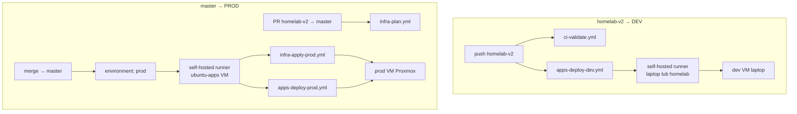
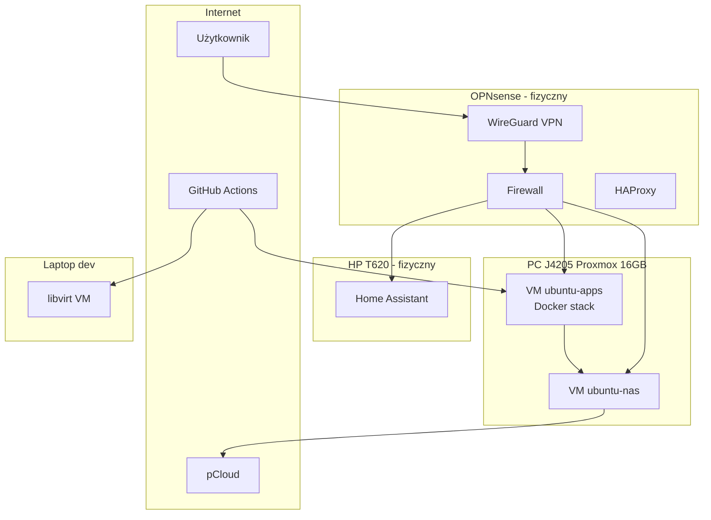

# Homelab — plan greenfield (dummy)

> **Status:** szkic roboczy — uzupełniaj sekcje *Założenia* i *Problemy* w miarę decyzji.  
> **Backlog:** todos w **frontmatter** tego pliku = jedyne źródło prawdy (nie duplikować w osobnych planach).  
> **Gałąź robocza:** `homelab-v2` — **całkowicie nowy, czysty kod**. Do merge `main` zostaje legacy (tylko odczyt); po merge **`main` = wyłącznie zawartość v2** — stary kod znika z domyślnej gałęzi (historia pod tagiem `legacy-pre-v2`).

### Todos — stan (2026-10-18, audyt przejęcia)

Szczegóły i dowody: `docs/audit/2026-10-18-plan-audit.md`. Kolejność: `knowledge/decisions/0001-restore-ci-and-dev-before-f3-metal.md`.

| ID | Status | Co zostało |
|----|--------|------------|
| `gha-cleanup-secrets`, `apps-*`, `backup-dr`, `phases`, `manual-setup-f0`, `preflight`, `secrets-*`, `security`, `branch-v2` | ✅ | — |
| `readme-docs`, `identities`, `knowledge-base` | ✅ | — |
| `gha-pipelines` | ✅ | — |
| `gha-runner-bootstrap` | 🔄 | dev ✅ (usługa systemd); prod po F3 |
| `config-as-code`, `tests-auto` | 🔄 | weryfikacja na działającym DEV → **R2** |
| `rebuild-runbook`, `audit-final` | 🔄 | drill i bramka F9 po stronie DEV → **R3** |
| `restore-ci`, `restore-dev` | ✅ | iteracja #4 (2026-10-18) |
| `f9-gate-dev` | 🔄 | rebuild DEV z repo + vault, ponownie `--suite restore`; bootstrap 2 appek → #14 |
| `hardware`, `implement` | 🔄 | F3 metal, F5 prod |
| `monitoring-alerts`, `ai-log-analysis` | ⏳ | F10, po prod |

---

## Strategia Git — gałąź `homelab-v2`

**Decyzja:** `homelab-v2` to **greenfield** — nowa struktura repo (Compose, workflowy, TF, docs), **bez** utrzymywania legacy plików. Nie refactor „w miejscu” na `dev` ani stopniowe łączenie ze starym `master`.

**Decyzja merge:** po weryfikacji prod `**homelab-v2` zastępuje `master`** — merge to **zamiana drzewa**, nie integracja dwóch wersji. Stara zawartość `master` **nie pozostaje** na domyślnej gałęzi po merge.

### Kroki (jednorazowo, przed F1)

**0. Wyczyść stare secrets i variables Actions** (legacy test pipeline) — patrz sekcja **Czyszczenie GH secrets/variables** poniżej. Zrób to **przed** wgrywaniem nowych wartości pod v2.

```bash
git fetch origin
git checkout master          # jeśli domyślna gałąź to main: git checkout main
git pull
git checkout -b homelab-v2
git push -u origin homelab-v2
```


| Gałąź                 | Rola                                                                                                       |
| --------------------- | ---------------------------------------------------------------------------------------------------------- |
| `master` (lub `main`) | **Do merge:** legacy, zamrożona — **zero** commitów v2. **Po merge:** identyczna z `homelab-v2` (tylko v2) |
| `dev`                 | Stary pipeline testowy — **zamrożona**; po merge v2: **usunąć** lub zarchiwizować tagiem                   |
| `**homelab-v2`**      | **Jedyne źródło prawdy** na czas budowy: czysty kod greenfield — tu commity                                |


### Zasady na `homelab-v2`

- Commity **tylko** na `homelab-v2`; PR → `master` dopiero gdy prod działa i gate F0→F1 zamknięty.
- **Push `homelab-v2`** → Actions deploy **dev** (test). **Merge / push `master`** → Actions deploy **prod** — nigdy odwrotnie.
- Na v2 **usuń** legacy z drzewa (stary `[setup-proxmox-node-vms.yml](.github/workflows/setup-proxmox-node-vms.yml)`, stare playbooki, stary layout) — docelowe pliki **tylko** z v2; merge ma dać czysty stan, nie „v2 + resztki mastera”.
- **GitHub Environments** `dev` / `prod`: workflow dev na `**homelab-v2`**; workflow prod wyłącznie na `**master`**.
- **Terraform Cloud:** workspace **`homelab`** (org `dkhomelabserver`) — **bez** importu starego tfstate.

### Merge v2 → master (zamiana, nie integracja)

**Cel:** po merge `git ls-tree master` = `git ls-tree homelab-v2` — **zero** legacy plików na domyślnej gałęzi.


| Krok | Akcja                                                                                                            |
| ---- | ---------------------------------------------------------------------------------------------------------------- |
| 1    | Tag `**legacy-pre-v2`** na ostatnim commicie `master` **przed** merge (odtwarzalność starego kodu)               |
| 2    | PR `homelab-v2` → `master` — review: diff pokazuje **usunięcie** legacy + **nowe** pliki v2                      |
| 3    | Merge PR (merge commit lub squash — oba OK, o ile drzewo = v2)                                                   |
| 4    | Weryfikacja: na `master` **nie ma** starych ścieżek (`setup-proxmox-node-vms.yml`, stary `ansible/` layout itd.) |
| 5    | Opcjonalnie: gałąź `dev` — delete remote / tag `legacy-dev`                                                      |
| 6    | `homelab-v2` można zostawić lub usunąć po merge — `**master` od tej chwili jedyna gałąź prod**                   |
| 7    | `**README.md` kompletny** — pełna dokumentacja (sekcja *Dokumentacja README*); wymagane przed merge              |


**Jeśli zwykły merge zostawiłby pliki tylko na masterze** (edge case):

```bash
git fetch origin
git checkout master
git merge -s ours -m "Replace master with homelab-v2" homelab-v2   # zachowaj punkt merge
git checkout homelab-v2 -- .
git commit -m "Replace tree with homelab-v2 greenfield"
git push origin master
```

Alternatywa (po tagu `legacy-pre-v2`): `git reset --hard origin/homelab-v2` + `git push --force-with-lease origin master` — tylko gdy PR/merge nie daje czystego drzewa.


---

## CI/CD — deployment przez GitHub Actions

**Decyzja:** cały deploy infra i aplikacji idzie przez **pipeline w GitHub Actions** (`[.github/workflows/](.github/workflows/)`) — **nie** ręczny `ansible-playbook` / `terraform apply` z laptopa jako docelowa ścieżka (wyjątek: bootstrap OPNsense one-shot SSH).

**Decyzja gałąź → środowisko:**


| Gałąź                            | Środowisko | Efekt                                                                                   |
| -------------------------------- | ---------- | --------------------------------------------------------------------------------------- |
| `**homelab-v2`** (commit / push) | **dev**    | Walidacja + deploy na **dev VM** (laptop libvirt) — **zero zmian na prod**              |
| `**master`** (merge / push)      | **prod**   | Terraform apply + deploy aplikacji na **prod** — **zero automatycznego deployu na dev** |


Commitujesz i testujesz na `**homelab-v2`** → pipeline dotyka tylko **dev**. Dopiero **merge do `master`** uruchamia pipeline **prod** (z approval w GitHub Environment).

### Zasady


| Zasada                | Szczegóły                                                                                                                                               |
| --------------------- | ------------------------------------------------------------------------------------------------------------------------------------------------------- |
| **Runner**            | **Dwa self-hosted:** **dev** na **laptopie** (`homelab-dev`); **prod** na `**ubuntu-apps`** (`homelab-prod`); **bez** GitHub-hosted / **bez Tailscale** |
| **Gałąź dev**         | `**homelab-v2`** — jedyna gałąź wyzwalająca deploy **dev**                                                                                              |
| **Gałąź prod**        | `**master`** — jedyna gałąź wyzwalająca deploy **prod** (po merge v2)                                                                                   |
| **Environments**      | GitHub `**dev`** i `**prod`** — secrets przez `gh`; **approval obowiązkowy na prod**                                                                    |
| **Dostęp do homelab** | Runner w LAN — bezpośredni SSH/Ansible/Proxmox API; bootstrap: `utils/setup-github-runner.sh`                                                           |
| **Źródło prawdy**     | **Hybryda:** core infra w repo (`compose/core`, Ansible, TF); appki z **osobnych repo** via **Portainer** (patrz B1)                                    |
| **Izolacja**          | Workflow prod **nie** na push `homelab-v2`; dev **nie** na push `master`                                                                                |


### Pipeline — docelowe workflowy (szkic)




| Plik workflow          | Trigger                             | Runner      | Akcja                                                         |
| ---------------------- | ----------------------------------- | ----------- | ------------------------------------------------------------- |
| `ci-validate.yml`      | push/PR `homelab-v2`, PR → `master` | self-hosted | `terraform validate`, `ansible-lint`, `docker compose config` |
| `apps-deploy-dev.yml`  | push `homelab-v2`                   | self-hosted | Ansible + deploy core compose / Portainer stacks → **dev VM** |
| `infra-plan.yml`       | PR `homelab-v2` → `master`          | self-hosted | `terraform plan` (TFC) — bez apply                            |
| `infra-apply-prod.yml` | push `master` / `workflow_dispatch` | self-hosted | `terraform apply` — env **prod**, approval                    |
| `apps-deploy-prod.yml` | push `master` / `workflow_dispatch` | self-hosted | Ansible + core compose + Portainer → **prod VM**, approval    |


### Self-hosted runner (B5 — ✅)

**Decyzja:** **self-hosted GitHub Actions runner** w LAN — **odrzucone:** GitHub-hosted runner, **Tailscale**, wyłącznie ręczny deploy.


| Element              | Ustalenie                                                                                                                                     |
| -------------------- | --------------------------------------------------------------------------------------------------------------------------------------------- |
| **Lokalizacja prod** | VM `**ubuntu-apps`** — runner prod (`homelab-prod`); ten sam host co Docker/Ansible target                                                    |
| **Lokalizacja dev**  | **Laptop** — runner dev (`homelab-dev`); Actions z laptopa przy push `homelab-v2`; CI failuje gdy laptop wyłączony                            |
| **Bootstrap**        | Skrypt `**utils/setup-github-runner.sh`** — rejestracja w GitHub (token z `gh`/PAT), instalacja usługi, labels `homelab-dev` / `homelab-prod` |
| **Workflow**         | `runs-on: [self-hosted, homelab-prod]` (prod) / `[self-hosted, homelab-dev]` (dev)                                                            |
| **F0 legacy**        | Usunąć **stary** runner (jeśli był); **dwa nowe** runnery — część **F1** (prod na VM, dev na laptopie)                                        |


**Po merge v2 → master:** gałąź robocza dev **krótkoterminowo `homelab-v2`** ✅; po pierwszym udanym prod merge → **nowa gałąź `develop`** (opcja B) — *decyzja git-post-merge*.

**Legacy do usunięcia na v2:** monolityczny `[setup-proxmox-node-vms.yml](.github/workflows/setup-proxmox-node-vms.yml)` — zastąpiony rozdzielonymi workflowami + nowym runnerem.

### Co **nie** idzie przez Actions


| Element                               | Dlaczego                                               |
| ------------------------------------- | ------------------------------------------------------ |
| OPNsense pierwszy bootstrap           | One-shot SSH z laptopa; potem tylko backup config      |
| Flash HAOS na HP620                   | Fizycznie                                              |
| `gh secret set` / Bitwarden           | Lokalnie, przed pipeline                               |
| Pierwsze `git checkout -b homelab-v2` | Lokalnie                                               |
| **Pierwsza rejestracja runnera**      | `utils/setup-github-runner.sh` — lokalnie / na VM (F1) |


~~### Otwarte w ramach pipeline (B5)~~ — **zamknięte:** self-hosted runner (powyżej).

### Czyszczenie GH secrets/variables (F0 — przed F1)

**Decyzja:** na początku greenfield **usuwamy** stare secrets i variables z poprzedniego pipeline testowego (`[setup-proxmox-node-vms.yml](.github/workflows/setup-proxmox-node-vms.yml)`), żeby nie mieszać nazw, nie trzymać martwych credentiali i uniknąć kolizji z nowym inventory v2.


| Poziom                 | Co wyczyścić                                                                                         |
| ---------------------- | ---------------------------------------------------------------------------------------------------- |
| **Repository**         | Secrets/variables na poziomie repo (jeśli były)                                                      |
| **Environment `dev*`*  | Wszystkie legacy wpisy                                                                               |
| **Environment `prod`** | Wszystkie legacy wpisy                                                                               |
| **Po czyszczeniu**     | Nowe nazwy wg `docs/secrets-inventory.md` — wartości tylko przez `gh secret set` + kopia w Bitwarden |


**Inwentarz legacy do usunięcia** (z obecnego workflow — zweryfikuj `gh secret list` / `gh variable list`):


| Nazwa                               | Typ      | Uwaga                                                  |
| ----------------------------------- | -------- | ------------------------------------------------------ |
| `PROXMOX_API_URL`                   | variable | stary test Proxmox                                     |
| `PROXMOX_API_TOKEN_ID`              | variable |                                                        |
| `PROXMOX_API_TOKEN_SECRET`          | secret   |                                                        |
| `PROXMOX_SSH_USERNAME`              | variable |                                                        |
| `PROXMOX_SSH_PASSWORD`              | secret   |                                                        |
| `SSL_CERT`, `SSL_CHAIN`, `SSL_PKEY` | secret   | certy — ewent. zachowaj kopię w Bitwarden przed delete |
| `UBUNTU_DOCKER_SSH_PUB`             | variable |                                                        |
| `UBUNTU_DOCKER_PASSWORD`            | secret   |                                                        |
| `POSTGRES_PASSWORD`                 | secret   | nowe hasło wygenerować na v2                           |


**Procedura (lokalnie, `gh auth login`):**

```bash
# 1. Audyt — zapisz listę nazw (wartości secretów i tak nie odczytasz)
gh secret list
gh secret list --env dev
gh secret list --env prod
gh variable list
gh variable list --env dev
gh variable list --env prod

# 2. Usuń po jednym (repo-level — bez --env)
gh secret delete NAZWA
gh variable delete NAZWA

# 3. Environment-scoped
gh secret delete NAZWA --env dev
gh variable delete NAZWA --env prod

# 4. Po wyczyszczeniu: nowe secrets wg inventory v2 (Bitwarden → gh secret set)
```

**Uwagi:**

- **Self-hosted runner** (jeśli był podpięty do repo) — odłączyć / usunąć w Settings → Actions → Runners.
- Wartości secretów z GH **nie da się odzyskać** — jeśli coś z legacy jest jeszcze potrzebne (certy, klucze), skopiuj z Bitwarden / lokalnych plików **przed** `delete`.
- Po merge `**master` = drzewo v2** — legacy workflowów nie ma na domyślnej gałęzi; czyszczenie GH secrets **na start F0**, nie czekać na merge.

---

## Cel

Self-hosted homelab prod (+ dev na laptopie): aplikacje w Dockerze, centralny Postgres, bezpieczny dostęp (VPN + SSO), backupy na NAS i pCloud, łatwe odtwarzanie po awarii. **Deploy wyłącznie przez GitHub Actions pipeline** (gałąź `homelab-v2` → potem `master`) na **self-hosted runnerze** w LAN.

---

## Decyzje użytkownika (TBD → zamknięte)

> **Data:** 2026-06-11 — sesja AskQuestion; plan zaktualizowany, **bez implementacji**.


| ID      | Temat                | Decyzja                                                                                                                                                              | Status                   |
| ------- | -------------------- | -------------------------------------------------------------------------------------------------------------------------------------------------------------------- | ------------------------ |
| **B1**  | Kontenery Proxmox    | **VM `ubuntu-apps` + Docker** (nie LXC) + **Portainer** — appki z **różnych repo**, bez jednego monolitycznego compose                                               | ✅                        |
| **B1b** | Źródło prawdy deploy | **Hybryda:** core infra (Postgres, Homarr, proxy client, Authelia) w repo `compose/`; **per-app stacks** z osobnych repo przez Portainer / `compose/apps/<name>/`    | ✅                        |
| **B2**  | Reverse proxy        | **OPNsense: HAProxy** (wbudowany) — **os-traefik-maxit odrzucony**                                                                                                   | ✅                        |
| **B3**  | Dostęp               | **WireGuard** jako domyślny dostęp do LAN + **publiczny HTTPS tylko dla wybranych app** (na start: **ToDo Grocery**; reszta **VPN-only**, chyba że później zmienisz) | ✅                        |
| **B4**  | SSO + exposure       | **ToDo Grocery — public**; **pozostałe appki — VPN only**; **SSO (Authelia) na wszystko** gdzie możliwe                                                              | ✅ Authelia rekomendowane |
| **B5**  | CI → homelab         | **Self-hosted runner** + skrypt `utils/setup-github-runner.sh`; **dev runner na laptopie**, **prod runner na ubuntu-apps**; ❌ Tailscale, GitHub-hosted               | ✅                        |
| **B6**  | Storage              | **B+C ✅:** SA500→NAS VM (NFS, Immich/media); Purple→backupy; **Postgres/cache lokalnie** na apps VM; per-app volumes ⏳ TBD                                           | ✅ częściowo              |
| **B7**  | RAM VM               | `**ubuntu-apps` 8 GB** + `**ubuntu-nas` 4 GB**                                                                                                                       | ✅                        |
| **B14** | LUKS                 | **Bez LUKS na start** ✅; LUKS+clevis/TPM → **backlog / dalekie TODO**                                                                                                | ✅                        |
| **B15** | Vault                | **Bitwarden Cloud**                                                                                                                                                  | ✅                        |
| **B16** | Backup offsite       | **rclone → pCloud**                                                                                                                                                  | ✅                        |
| **B17** | Portainer            | **Tak, P0** — zarządzanie multi-repo stacks (wcześniej „nie na start”)                                                                                               | ✅                        |
| **P0**  | Zakres startowy      | **✅ P0/P1/P2 zdefiniowane** — patrz sekcja *Decyzje użytkownika — iteracja #2*                                                                                       | ✅                        |


### B2 — HAProxy vs os-traefik-maxit (OPNsense)


| Kryterium              | **HAProxy** (wbudowany)                       | **os-traefik-maxit** (plugin)            |
| ---------------------- | --------------------------------------------- | ---------------------------------------- |
| Instalacja             | Już w OPNsense                                | Plugin z repozytorium OPNsense           |
| UI / learning curve    | GUI OPNsense, dużo tutoriali homelab          | Traefik-like, mniej typowy na routerze   |
| Certy Let's Encrypt    | ACME via HAProxy / cert plugin OPNsense       | Zależy od pluginu                        |
| Dynamic routing        | Ręczne frontends/backends                     | Bliżej Traefik (labels/routes)           |
| **Rekomendacja planu** | **Start tutaj** — prostsze, natywne, stabilne | Jeśli HAProxy zbyt sztywny — F2 fallback |


**NPM / Traefik na VM apps:** odrzucone na rzecz proxy **na OPNsense** (wydajność routera OK — poza sizingiem).

**Decyzja iter. #2:** **HAProxy** ✅ — os-traefik-maxit **odrzucony**.

### B4 — model dostępu per app


| App                 | VPN                 | Public HTTPS | SSO                    |
| ------------------- | ------------------- | ------------ | ---------------------- |
| **ToDo Grocery**    | opcjonalnie         | **Tak**      | Authelia               |
| **Pozostałe P0/P1** | **Tak** (domyślnie) | Nie          | Authelia               |
| **pgAdmin**         | **Tak only**        | Nie          | Authelia + silne hasło |


---

## Decyzje użytkownika — iteracja #2 (2026-06-11)

> **Status:** sesja decyzyjna zamknięta (plan only, bez implementacji).  
> Poniżej skonsolidowane decyzje; szczegóły opcji w sekcji *Iteracja decyzji #2*.

### Sieć [A4] ✅ — opcja C (istniejące VLAN-y)


| VLAN / nazwa        | Brama               | DHCP range | Tag / uwagi                      |
| ------------------- | ------------------- | ---------- | -------------------------------- |
| **LAN**             | 192.168.1.1         | .100–.200  |                                  |
| **HOMEOFFICE**      | 192.168.10.1        | .100–.200  |                                  |
| **IOT**             | 192.168.20.1        | .100–.200  | **Proxmox host + HP T620 HA**    |
| **GUEST**           | 192.168.30.1        | .100–.200  | WiFi goście                      |
| **DMZ**             | 192.168.50.1        | .7–.14     | **nieużywany na start** (A5)     |
| **APP**             | **192.168.50.50/26** (QinQ) | .30–.62    | **Docker/apps**; VLAN **tag 51** |
| **VPN (WireGuard)** | **10.10.10.1** (`wg0`)      | peers      | As-built; nie `10.0.0.0/24`      |


**✅ A5 (as-built 2026-06-30):** Proxmox **`.20.20`**; APP gw **`.50.50`**; NAS **`.20.12`**, HA **`.20.13`**, apps **`.50.30`**; WG **`10.10.10.0/24`**.

### IP statyczne [A5] ✅ — rezerwacja DHCP w OPNsense (IP ustalone; MAC placeholder)

**Decyzja:** rezerwacja MAC→IP w OPNsense (DHCP reservation).

**Decyzje A5 (as-built 2026-06-30; decyzja DHCP 2026-06-11):**

| Temat | Decyzja |
|-------|---------|
| **APP vs DMZ** | **Uproszczenie:** tylko **APP QinQ tag 51** `192.168.50.0/26` (DHCP `.30`–`.62`); **DMZ (tag 50) nieużywany** na start |
| **Brama APP** | **192.168.50.50/26** (as-built OPNsense QinQ) — **nie** `.50.1` |
| **ubuntu-nas** | **IOT VLAN 20** — `192.168.20.12` (NFS); ruch NFS **APP → IOT** (firewall F2: APP net → `.20.12:2049`) |
| **ubuntu-apps** | **APP VLAN 51** — `192.168.50.30` |
| **MAC** | Placeholder w planie — uzupełnisz przed F3 (OPNsense DHCP reservation) |

**Domena (A6 ✅ 2026-06-11):** strefa **`dkhomelabserver.xyz`** (legacy: `router.dkhomelabserver.xyz` w starym TF). Publicznie tylko **`grocery.dkhomelabserver.xyz`** → HAProxy ACME (F2).


| Host / rola            | VLAN | Tag | IP docelowe      | MAC (placeholder)   |
| ---------------------- | ---- | --- | ---------------- | ------------------- |
| OPNsense IOT           | IOT  | 20  | 192.168.20.1     | (interfejs routera) |
| OPNsense APP           | APP  | 51  | **192.168.50.50** | (QinQ as-built)     |
| Proxmox host (NIC1)    | IOT  | 20  | **192.168.20.20** | `<MAC>` ✅ |
| HP T620 HA             | IOT  | 20  | **192.168.20.13** | F5 (MAC TBD)        |
| `ubuntu-nas` (NFS)     | IOT  | 20  | **192.168.20.12** | F3 (MAC TBD)        |
| `ubuntu-apps` (Docker) | APP  | 51  | **192.168.50.30** | F3 (MAC TBD)        |


**Podział 3× NIC 1 Gb/s (Proxmox) — ✅ potwierdzony w A5:**


| NIC      | Rola                                       | VLAN / IP                          |
| -------- | ------------------------------------------ | ---------------------------------- |
| **NIC1** | IOT / mgmt — Proxmox **`.20.20`** + trunk VM IOT  | tag 20                             |
| **NIC2** | Pass-through **SA500 + Purple** do NAS VM  | brak IP (dyski tylko)              |
| **NIC3** | APP / Docker — trunk VM APP                | tag 51 → `ubuntu-apps` `.50.30`  |


**VM sieć:** `ubuntu-nas` — 1× NIC na **vmbr0 tag 20** (IOT); `ubuntu-apps` — 1× NIC na **vmbr0 tag 51** (APP). NFS: apps montuje `192.168.20.12:/export/...` (firewall: APP → IOT port 2049).

**Dev (laptop libvirt):** bez zmian — `192.168.122.0/24`; `ubuntu-docker` dev np. `.221` (legacy).

**Tabela rezerwacji DHCP OPNsense (do skonfigurowania w F2):**


| Urządzenie     | IP              | MAC placeholder     | VLAN |
| -------------- | --------------- | ------------------- | ---- |
| Proxmox host   | 192.168.20.20   | ✅ na routerze       | 20   |
| HP T620 HA     | 192.168.20.13   | F5                  | 20   |
| `ubuntu-nas`   | 192.168.20.12   | F3                  | 20   |
| `ubuntu-apps`  | 192.168.50.30   | F3                  | 51   |

**Definition of done A5:** IP + VLAN + rola NIC ✅; MAC placeholder ✅; zamień MAC na rzeczywiste przed F3 → odhacz `[x]` w gate.


### DNS + certy [A6] ✅ — opcja B + konkretna nazwa

**Decyzja:** **osobna subdomena publiczna tylko dla ToDo Grocery** — **nie** wildcard na całą domenę homelab.

| Element | Wartość |
|---------|---------|
| **Strefa DNS** | `dkhomelabserver.xyz` |
| **OPNsense / router (legacy)** | `router.dkhomelabserver.xyz` |
| **Grocery (public HTTPS)** | **`grocery.dkhomelabserver.xyz`** |
| **Reszta usług** | VPN-only; wewnętrznie `/etc/hosts` lub split-DNS LAN (*TBD* F2) |
| **Certyfikat** | ACME Let's Encrypt — dedykowany cert dla `grocery.dkhomelabserver.xyz` w HAProxy (F2) |

### Terraform Cloud [A8] ✅ — org `dkhomelabserver`, workspace `homelab`

**Decyzja (2026-06-11):**

| Element | Wartość |
|---------|---------|
| **Org TFC** | **`dkhomelabserver`** |
| **Workspace prod** | **`homelab`** (pusty state, `resource-count: 0`, auto-apply OFF) |
| **Workspace dev** | **brak** — dev TF lokalnie na laptopie |
| **TF version (workspace)** | 1.15.7 |
| **Execution mode** | **remote** (TFC) — w **F1** przełączyć na **Local** dla self-hosted runnera w LAN |
| **GH secret `TF_API_TOKEN`** | env **prod** — **F1** |

**Definition of done A8:**

- [x] Konto TFC + org `dkhomelabserver`
- [x] Workspace **`homelab`** (pusty state)
- [x] `terraform login` — `credentials.tfrc.json` OK (2026-06-11)
- [ ] Token w Bitwarden (`homelab/TF_API_TOKEN/prod`) — user
- [x] API zwraca workspace — zweryfikowane
- [x] A8 gate `[x]`

### Zakres faz [P0] ✅


| Faza   | Aplikacje                                                                                                                                                           |
| ------ | ------------------------------------------------------------------------------------------------------------------------------------------------------------------- |
| **P0** | PostgreSQL, pgAdmin, Homarr, **Trillium** (notes), **Actual Budget**, Linkwarden, Authelia, omni-tools, DumbWhoIs, Portainer, **Bentoo PDF**, ToDo Grocery (public) |
| **P1** | Immich, Syncthing, **Navidrome** (streamer), **Jellyfin** (Direct Play / bez transcode)                                                                             |
| **P2** | Reszta (Beszel, Dozzle, Diun, Zotify defer, Authentik?, itd.)                                                                                                       |


### Pozostałe decyzje iter. #2 (skrót)


| ID                 | Decyzja                                                                                                      | Status      |
| ------------------ | ------------------------------------------------------------------------------------------------------------ | ----------- |
| **B2**             | **HAProxy** na OPNsense (nie os-traefik-maxit)                                                               | ✅           |
| **B6+A1-TF**       | NFS z NAS VM (media/Immich) + lokalne wolumeny Docker na apps VM (Postgres/cache); per-app volumes ⏳         | ✅ częściowo |
| **B14**            | **Bez LUKS na start**; auto-unlock (clevis/TPM) → backlog                                                    | ✅           |
| **A11**            | ToDo Grocery: **Portainer Git deploy** (compose z repo Grocery)                                              | ✅           |
| **A13**            | **Runner dev na laptopie**; Actions zawsze z laptopa przy dev                                                | ✅           |
| **B8**             | Syncthing **tak** → **P1**                                                                                   | ✅           |
| **B9**             | **Actual Budget** → **P0**                                                                                   | ✅           |
| **B10**            | **Trillium** → **P0**                                                                                        | ✅           |
| **B11**            | **Navidrome** → **P1**                                                                                       | ✅           |
| **B12**            | Jellyfin wideo **Direct Play only** (bez transcode) → **P1**                                                 | ✅           |
| **B13**            | **Zotify odłożony** (backlog)                                                                                | ✅           |
| **B18**            | Dev: **pełny stack test** (parity z prod P0), nie minimalny subset                                           | ✅           |
| **A14**            | HA na T620: **greenfield** (nowa instalacja)                                                                 | ✅           |
| **A15**            | Retention: **trzymaj 2 najnowsze backupy**; przy 3. usuń najstarszy                                          | ✅           |
| **secrets**        | Szablon `docs/secrets-inventory.md` w F0-10 (nazwy tylko)                                                    | ✅           |
| **B19**            | **Beszel** (nie Prometheus+Grafana)                                                                          | ✅           |
| **B20**            | **Diun** w F6; **Trivy odłożony** do stabilnego P0                                                           | ✅           |
| **B21**            | DumbWhoIs + omni-tools → **P0** (scope); opcjonalny przyszły podział P0–P6                                   | ✅           |
| **git-post-merge** | Krótkoterminowo `**homelab-v2`** jako dev; po pierwszym prod merge → `**develop**`                           | ✅           |
| **proxmox-host**   | **Cleanup legacy VM** (nie świeży install) + **TODO:** uporządkować SSH keys i Proxmox API tokens dla deploy | ✅           |


### CI/CD — dual runners ✅


| Runner   | Host             | Label          | Workflow                               |
| -------- | ---------------- | -------------- | -------------------------------------- |
| **Dev**  | Laptop           | `homelab-dev`  | push `homelab-v2` → deploy dev VM      |
| **Prod** | `ubuntu-apps` VM | `homelab-prod` | push/merge `master` → TF + deploy prod |


**Uwaga:** wcześniejszy plan sugerował jeden runner na ubuntu-apps — **skorygowane:** dev **wyłącznie laptop**, prod **ubuntu-apps** (lub Proxmox host — runner na VM apps wystarczy).

---

## Iteracja decyzji #2 (archiwum opcji + konsekwencje)

> **Data:** 2026-06-11 — iteracja #2 planu; **bez implementacji**.  
> Format: opcje + skutki (złożoność, RAM, bezpieczeństwo, utrzymanie, CI, DR).  
> **Zamknięte ✅** — nie powtarzamy (B1, B3, B4, B5, B7, B15, B16, B17, Bitwarden, Portainer, rclone, self-hosted runner).  
> **Decyzje użytkownika:** patrz sekcja *Decyzje użytkownika — iteracja #2* powyżej.

### 🔴 Blokujące F1 / F2 / F3

#### [A4] Mapa sieci (VLAN, CIDR, trunk) — ✅ **decyzja: opcja C**

**Kontekst:** Bez segmentacji nie da się sensownie napisać OPNsense baseline, TF firewall ani Ansible inventory.


| Opcja                                                 | Konsekwencje (skrót)                                                                    |
| ----------------------------------------------------- | --------------------------------------------------------------------------------------- |
| A — **Płaska LAN** (jeden VLAN, np. `192.168.1.0/24`) | Najprostsze TF/Ansible; mniej izolacji; HA + Proxmox + Docker w jednej broadcast domain |
| B — **2 VLAN-y** (LAN + mgmt/Proxmox, np. 10/20)      | Lepsza separacja mgmt; więcej reguł OPNsense i trunk na switchu                         |
| C — **3+ VLAN-y** (LAN, mgmt, IoT/HA, ewent. guest)   | Najbezpieczniejsze; najwyższa złożoność konfiguracji i debugowania                      |
| **Rekomendacja (łatwiej)**                            | ~~**B**~~ → **✅ C** (istniejące VLAN-y — patrz tabela w sekcji iter. #2)                |


#### [A5] Docelowe IP statyczne — ✅ **as-built 2026-06-30** (MAC placeholder → F3)

**Kontekst:** Ansible, TF i dokumentacja `docs/network.md` wymagają stałej adresacji hostów i VM.


| Opcja                                           | Konsekwencje (skrót)                                                                     |
| ----------------------------------------------- | ---------------------------------------------------------------------------------------- |
| A — **DHCP reservation** (MAC → IP na OPNsense) | Mniej ręcznej pracy przy reinstalacji; zależność od routera; TF musi znać zakres         |
| B — **Statyczne IP w OS** (Proxmox, VM, T620)   | Przewidywalne bez DHCP; więcej kroków przy rebuild; łatwiejsze dla TF cloud-init         |
| C — **Miks** (infra statyczne, reszta DHCP)     | Elastyczne; ryzyko niespójności dokumentacji                                             |
| **Rekomendacja (łatwiej)**                      | **✅ DHCP reservation** + podział 3× NIC; IP as-built: `.20.20`/`.12`/`.13`/`.50.30`, APP gw `.50.50`, WG `10.10.10.0/24` |


#### [A6] Domena DNS + certy (wildcard) — ✅ **decyzja: opcja B**

**Kontekst:** Publiczny **ToDo Grocery**, Homarr i reverse proxy (B2) potrzebują nazw FQDN i ACME.


| Opcja                                                          | Konsekwencje (skrót)                                                 |
| -------------------------------------------------------------- | -------------------------------------------------------------------- |
| A — **Jedna domena + wildcard** (`*.homelab.example`)          | Jeden cert ACME; prostszy HAProxy; wszystkie subdomeny pod kontrolą  |
| B — **Osobna subdomena tylko dla Grocery** (`grocery.example`) | Mniejszy publiczny footprint; reszta bez public DNS                  |
| C — **DuckDNS / dynamic DNS**                                  | Tanie/szybkie; mniej profesjonalne; ograniczenia przy wildcard       |
| **Rekomendacja (łatwiej)**                                     | ~~**A** wildcard~~ → **✅ B** — osobna subdomena tylko Grocery public |


#### [B2] Reverse proxy OPNsense: HAProxy vs os-traefik-maxit — ✅ **decyzja: opcja A (HAProxy)**

**Kontekst:** Wybór przy **F2** — wszystkie usługi HTTPS idą przez router (nie NPM/Traefik na VM).


| Opcja                             | Konsekwencje (skrót)                                                            |
| --------------------------------- | ------------------------------------------------------------------------------- |
| A — **HAProxy** (wbudowany)       | Natywny UI OPNsense; dużo tutoriali; ręczne frontends/backends; stabilny start  |
| B — **os-traefik-maxit** (plugin) | Bliżej modelu Traefik; dodatkowy plugin do utrzymania; mniej typowy na routerze |
| **Rekomendacja (łatwiej)**        | **✅ A (HAProxy)** — os-traefik-maxit odrzucony                                  |


#### [B6 + A1-TF] Mapa dysków w TF + storage per-app — ✅ **decyzja: B + C (częściowo)**

**Kontekst:** SA500/Purple ✅ co do roli; brakuje mount/LVM w TF oraz reguły local vs NFS per app (blokuje F3 TF i F4 Compose).


| Opcja                                                                     | Konsekwencje (skrót)                                                                      |
| ------------------------------------------------------------------------- | ----------------------------------------------------------------------------------------- |
| A — **Wszystkie wolumeny app → NFS (SA500)**                              | Jeden punkt backupu mediów; wolniejsze I/O dla DB/cache; mniej miejsca na root VM         |
| B — **DB/cache local (256 GB SSD apps VM), media → NFS**                  | Lepsza wydajność Postgres/Immich cache; bardziej złożony Compose; wymaga sizing root disk |
| C — **Osobny dysk w Proxmox per VM** (pass-through SA500 tylko do NAS VM) | Czysta separacja; obecny plan ✅; doprecyzować tylko mountpointy w guest                   |
| **Rekomendacja (łatwiej)**                                                | **✅ B + C** — per-app volumes ⏳ TBD                                                       |


#### [B14] LUKS na dyskach data (gate F3) — ✅ **decyzja: opcja A (bez LUKS)**

**Kontekst:** Szyfrowanie at-rest tylko jeśli reboot Proxmox **nie** wymaga ręcznego hasła (warunek z planu).


| Opcja                                           | Konsekwencje (skrót)                                                                  |
| ----------------------------------------------- | ------------------------------------------------------------------------------------- |
| A — **Bez LUKS na start**                       | Prostszy DR (vzdump restore); słabsza ochrona przy fizycznym dostępie do Purple/SA500 |
| B — **LUKS + clevis/TPM/keyfile** (auto-unlock) | Lepsze bezpieczeństwo; złożony setup initramfs; klucze recovery w Bitwarden           |
| C — **LUKS tylko Purple (backupy)**             | Kompromis; backup restore trudniejszy; hot data SA500 bez szyfrowania                 |
| **Rekomendacja (łatwiej)**                      | **✅ A** na start; **B** (auto-unlock) → backlog                                       |


#### [P0] Zakres aplikacji startowych (F4) — ✅ **zdefiniowany przez użytkownika**

**Kontekst:** Sekcja E to propozycja agenta — bez Twojego P0 F4 może rozrosnąć się miesiącami (scope creep).


| Opcja                                                                     | Konsekwencje (skrót)                                                  |
| ------------------------------------------------------------------------- | --------------------------------------------------------------------- |
| A — **Lean P0** (Postgres, pgAdmin, Homarr, Portainer, Authelia, Grocery) | ~6 usług; Immich → P1; mniejsze RAM; szybsze F4                       |
| B — **P0 z Immich** (+ pozycje z propozycji E)                            | Większy RAM/I/O na J4205; dłuższy F4; NAS od razu krytyczny           |
| C — **Tylko infra P0** (Postgres, Authelia, proxy, CI) — appki P1         | Najszybszy gate prod; Grocery public przesunięty                      |
| **Rekomendacja (łatwiej)**                                                | ~~**A** lean~~ → **✅ scope użytkownika** (P0/P1/P2 w sekcji iter. #2) |


#### [A11 + deploy] ToDo Grocery — ✅ **decyzja: opcja A (Portainer Git deploy)**

**Kontekst:** App z osobnego repo (B1); public HTTPS wymaga gotowego obrazu/stacku przed F4.


| Opcja                                                           | Konsekwencje (skrót)                                                  |
| --------------------------------------------------------------- | --------------------------------------------------------------------- |
| A — **Portainer Git deploy** (compose z repo Grocery)           | Webhook po push; CI homelab nie buduje app; prostszy pipeline homelab |
| B — **GHCR image** (build w repo Grocery, Portainer pull image) | Szybszy deploy VM; osobny CI w app repo; wersjonowanie obrazów        |
| C — **Submodule / kopia compose w homelab**                     | Jedna gałąź deploy; duplikacja konfiguracji; gorsze multi-repo        |
| **Rekomendacja (łatwiej)**                                      | **✅ A** — Portainer Git deploy z repo Grocery                         |


#### [A13 + B5-dev] Runner dev + laptop libvirt — ✅ **decyzja: opcja A (runner na laptopie)**

**Kontekst:** Prod runner ✅ na `ubuntu-apps`; dev workflow wymaga decyzji czy laptop zawsze online.


| Opcja                                                       | Konsekwencje (skrót)                                                         |
| ----------------------------------------------------------- | ---------------------------------------------------------------------------- |
| A — **Runner na laptopie** (`homelab-dev`)                  | Izolacja dev/prod; push `homelab-v2` failuje gdy laptop wyłączony            |
| B — **Ten sam runner prod + SSH do dev VM**                 | Zawsze dostępny deploy dev; ryzyko pomyłki prod/dev; prostsza infra runnerów |
| C — **Tylko `workflow_dispatch` na dev** (bez auto na push) | Brak failów CI; wolniejsza pętla dev                                         |
| **Rekomendacja (łatwiej)**                                  | **✅ A** — dev runner laptop; prod runner ubuntu-apps                         |


---

### 🟡 Ważne (F4–F5) — ✅ zamknięte iter. #2

#### [B8] Syncthing — ✅ **A → P1**

**Kontekst:** Sync telefon ↔ laptop w LAN; nie wymaga internetu po pierwszej konfiguracji.


| Opcja                                    | Konsekwencje (skrót)                                    |
| ---------------------------------------- | ------------------------------------------------------- |
| A — **Tak, kontener na apps VM**         | Niski RAM; kolejny port/VPN; backup folderów opcjonalny |
| B — **Nie — tylko cloud (Immich, etc.)** | Mniej usług; brak sync plików ogólnych                  |
| **Rekomendacja (łatwiej)**               | **A** jeśli regularnie syncujesz pliki poza zdjęciami   |


#### [B10] Notes — ✅ **A Trillium → P0**

**Kontekst:** MD, „łączenie kropek”; faza ? w inwentarzu.


| Opcja                       | Konsekwencje (skrót)                              |
| --------------------------- | ------------------------------------------------- |
| A — **Trillium**            | Drzewo + linki; własny storage plików; średni RAM |
| B — **Joplin Server**       | Znany model; Postgres; sync mobilny               |
| C — **Outline / BookStack** | Wiki-style; mniej „graph”; Postgres               |
| D — **Odłożyć (P2)**        | Zero kosztu teraz; notatki poza homelab           |
| **Rekomendacja (łatwiej)**  | **A** przy priorytecie graph; **D** jeśli P0 lean |


#### [B9] Budżet — ✅ **A Actual Budget → P0**

**Kontekst:** Oba na Postgres; faza ? — nie blokuje F1.


| Opcja                      | Konsekwencje (skrót)                                  |
| -------------------------- | ----------------------------------------------------- |
| A — **Actual Budget**      | Lżejszy UI; sync plików budżetu; mniejsza społeczność |
| B — **Firefly III**        | Bogatsze API/reguły; cięższy; dojrzały ekosystem      |
| C — **P2 / pominąć**       | Brak kosztu RAM teraz                                 |
| **Rekomendacja (łatwiej)** | **A** jeśli wolisz prostotę; **C** przy lean P0       |


#### [B11] Streamer muzyki — ✅ **A Navidrome → P1**

**Kontekst:** LAN streaming + ewentualna integracja z Zotify (P1).


| Opcja                                   | Konsekwencje (skrót)                         |
| --------------------------------------- | -------------------------------------------- |
| A — **Navidrome**                       | Lekki na Celeron; tylko audio; Subsonic API  |
| B — **Jellyfin (audio)**                | Jedna app z wideo; cięższy niż Navidrome     |
| C — **Bez dedykowanego streamera (P2)** | Zotify bez UI streamingu na start            |
| **Rekomendacja (łatwiej)**              | **A** gdy muzyka w scope; **C** przy lean P0 |


#### [B12] Jellyfin wideo — ✅ **B Direct Play only → P1**

**Kontekst:** J4205 + iGPU — Direct Play OK, transkodowanie praktycznie nie.


| Opcja                                     | Konsekwencje (skrót)                               |
| ----------------------------------------- | -------------------------------------------------- |
| A — **Pominąć wideo**                     | Oszczędność RAM/CPU; media tylko Immich + audio    |
| B — **Jellyfin Direct Play only (P1/P2)** | Duże pliki na NAS; bez transcode OK; monitoring UX |
| C — **Jellyfin P0 z transcode**           | Wysokie ryzyko lagów; niezalecane na J4205         |
| **Rekomendacja (łatwiej)**                | **A** lub **B** bez transcode                      |


#### [B13] Zotify — ✅ **C odłożony (backlog)**

**Kontekst:** P1 w planie; szara strefa ToS Spotify — świadoma decyzja, tylko LAN.


| Opcja                               | Konsekwencje (skrót)                             |
| ----------------------------------- | ------------------------------------------------ |
| A — **Zotify P1 + zakładka Homarr** | Niski koszt UI; legal/ToS po Twojej stronie      |
| B — **Zotify bez panelu**           | Mniej utrzymania; ręczne uruchamianie            |
| C — **Pominąć Zotify**              | Brak ryzyka ToS; muzyka tylko z legalnych źródeł |
| **Rekomendacja (łatwiej)**          | **A** jeśli akceptujesz ToS; inaczej **C**       |


#### [B18] Dev subset — ✅ **B pełny stack test (parity P0)**

**Kontekst:** Laptop dev nie musi odwzorowywać całego prod (Immich, NAS).


| Opcja                                                | Konsekwencje (skrót)                            |
| ---------------------------------------------------- | ----------------------------------------------- |
| A — **Core only** (Postgres, Authelia, Grocery stub) | Szybki CI; brak testów Immich na dev            |
| B — **Parity z prod P0**                             | Wolniejszy laptop; pewniejsze testy przed merge |
| **Rekomendacja (łatwiej)**                           | **A** — Immich/NAS testować na prod w P1        |


#### [A14] Home Assistant — ✅ **A greenfield**

**Kontekst:** Greenfield HA vs restore; wpływa na F5 i listę USB/cloud.


| Opcja                                   | Konsekwencje (skrót)                                |
| --------------------------------------- | --------------------------------------------------- |
| A — **Greenfield HA** (nowa instalacja) | Prostszy start; ręczna rekonfiguracja integracji    |
| B — **Restore z backup `.tar`**         | Szybkie odtworzenie; migracja ze starego środowiska |
| C — **Hybryda** (restore + czyszczenie) | Średni wysiłek; ryzyko starych śmieci w config      |
| **Rekomendacja (łatwiej)**              | **B** jeśli masz działający backup; inaczej **A**   |


#### [A15 + DR] — ✅ **A + retention 2 backupy**

**Kontekst:** Rozmiar SA500/Purple i koszt pCloud; harmonogram vzdump/pg_dump.


| Opcja                                                    | Konsekwencje (skrót)                                                |
| -------------------------------------------------------- | ------------------------------------------------------------------- |
| A — **Retention krótki** (7–14 dni local, 30 dni pCloud) | Mniejszy pCloud; mniejsze okno recovery                             |
| B — **Retention długi** (30+ local, 90+ pCloud)          | Większy Purple/pCloud; lepszy DR historyczny                        |
| C — **Immich duży (>500 GB)**                            | SA500 szybko pełny; wcześniejszy upgrade/archiwum                   |
| **Rekomendacja (łatwiej)**                               | Podaj szacunki GB — bez tego domyślnie **A** + monitoring zajętości |

**Decyzje A15 (zamknięte):**

| Element | Wartość |
| ------- | ------- |
| **Retention lokalny (Purple)** | **2 najnowsze** kopie **per strumień backupu**; przy 3. uruchomieniu usuń najstarszą |
| **Strumienie objęte retention** | `vzdump` (apps + NAS VM), `pg_dump`, HA `.tar`, OPNsense `config.xml` |
| **Retention offsite (pCloud)** | *TBD w F5* — rekomendacja: **ta sama zasada 2 kopii** dla strumieni DR (nie pełne media) |
| **Media live (SA500)** | Bez rotacji retention — rozmiar rośnie z biblioteką; monitoring zajętości w F5 |
| **Pełny backup mediów offsite** | **❌ poza homelab rclone** — multimedia już na pCloud osobno; homelab → pCloud tylko DR (vzdump, configs, `pg_dump`, repo zip) |
| **Dev (libvirt VM)** | Media testowe **po kilka MB** każda — tylko funkcjonalnie, nie prod sizing |

**Szacunki GB (2026-06-11 — prod caps od użytkownika; dev = kilka MB):**

| Kategoria | Dysk / miejsce | Formuła | Wartość prod | % pojemności | Status |
| --------- | -------------- | ------- | ------------ | ------------ | ------ |
| **Immich** (oryginały + miniatury ~15%) | SA500 NFS | `IMMICH_GB × 1.15` | **60 GB → 69 GB** | ~3% z 2 TB | ✅ cap 60 GB |
| **Muzyka** (Navidrome P1) | SA500 NFS | `MUSIC_GB` | **150 GB** | +8% | ✅ cap 150 GB |
| **Wideo** (Jellyfin P1) | SA500 NFS | `VIDEO_GB` | **400 GB** | +20% | ✅ cap 400 GB |
| **Syncthing** (P1, ogólne pliki) | SA500 NFS | `SYNC_GB` | **20 GB** | +1% | placeholder |
| **NFS / misc** (nagłówki, staging) | SA500 | stałe | **100 GB** bufor | +5% | szacunek planu |
| **Σ SA500 (hot media)** | **SA500 2 TB** | suma powyższych | **~739 GB** | **~37%** | ✅ OK (< 1.5 TB) |
| **Postgres + cache Docker** | SSD 256 GB (apps VM lokalnie) | `30 + DB_GB` | **~40 GB** | ~16% root VM | rośnie z P0 |
| **vzdump `ubuntu-apps` × 2** | Purple | `2 × ~45 GB` skompres. | **~90 GB** | 2% z 4 TB | formuła; F5 zmierzy |
| **vzdump `ubuntu-nas` × 2** (tylko root VM, bez pass-through SA500/Purple) | Purple | `2 × ~15 GB` | **~30 GB** | +1% | formuła; F5 zmierzy |
| **pg_dump × 2** | Purple | `2 × PG_GB` | **~10 GB** (`PG_GB≈5`) | <1% | formuła |
| **HA backup × 2** | Purple | `2 × ~1 GB` | **~2 GB** | <1% | formuła |
| **OPNsense config × 2** | Purple | pomijalne | **<0.1 GB** | — | formuła |
| **Bufor Purple (nagłe wzrosty, rsync)** | Purple | `20%` nad Σ backupów | **~30 GB** | +1% | szacunek planu |
| **Σ Purple (2 generacje DR)** | **Purple 4 TB** | suma backupów + bufor | **~158 GB** | **~4%** | duży zapas |
| **pCloud offsite (DR only — homelab rclone)** | pCloud | `vzdump + pg_dump + HA + OPNsense + repo zip` × 2 | **~160 GB** | **500 GB wolne** ✅ | **bez** pełnych bibliotek mediów (już na pCloud osobno) |
| ~~pCloud pełne media via homelab~~ | — | — | — | — | **❌ poza scope** — media już backupowane na pCloud niezależnie |

**Formuła Σ SA500:** `(60 × 1.15) + 150 + 400 + 20 + 100 = **739 GB**` (~37% z 2 TB).

**Wniosek (2026-06-11):** obecny sprzęt (**SA500 2 TB + Purple 4 TB**) wystarcza z dużym marginesem. **pCloud:** user potwierdził **500 GB wolnego** — homelab DR **~160 GB** (backup-only) mieści się z marginesem; multimedia poza scope homelab rclone (już na pCloud osobno).

Szczegóły i kroki weryfikacji: `docs/manual-setup.md` → [Referencja — A15 Storage sizing](#referencja--a15-storage-sizing-f3f5).

#### [secrets] — ✅ **A szablon F0-10**

**Kontekst:** Bitwarden ✅; brakuje formalnej tabeli nazw secretów przed F1 `gh secret set`.


| Opcja                                     | Konsekwencje (skrót)                              |
| ----------------------------------------- | ------------------------------------------------- |
| A — **Szablon w F0-10** (nazwy tylko)     | Gate F1 spełniony; rotacja udokumentowana         |
| B — **Pełna tabela per app dopiero w F4** | Szybsze F0; ryzyko brakujących secretów w CI      |
| **Rekomendacja (łatwiej)**                | **A** — core secrets (Postgres, SSH, rclone) w F1 |


---

### 🟢 Później (F5 / F6) — ✅ zamknięte iter. #2

#### [B19] Metryki — ✅ **A Beszel**

**Kontekst:** P2; J4205 ma ograniczone RAM.


| Opcja                                          | Konsekwencje (skrót)                             |
| ---------------------------------------------- | ------------------------------------------------ |
| A — **Beszel**                                 | Bardzo lekki; mniej dashboardów                  |
| B — **Prometheus + Grafana**                   | Pełny stack; +512 MB–1 GB RAM; więcej utrzymania |
| C — **Bez dedykowanych metryk (Dozzle tylko)** | Zero kosztu; brak alertów historycznych          |
| **Rekomendacja (łatwiej)**                     | **A** na tym sprzęcie                            |


#### [B20] Diun + audyty — ✅ **A Diun (F6); Trivy defer do stabilnego P0**

**Kontekst:** Cykliczny security hygiene — nie blokuje prod start.


| Opcja                                        | Konsekwencje (skrót)                          |
| -------------------------------------------- | --------------------------------------------- |
| A — **Diun + Trivy w CI** (skan przy deploy) | Wykrywa CVE w pipeline; wolniejszy build      |
| B — **Cron Trivy na VM**                     | Niezależne od GHA; kolejny cron do utrzymania |
| C — **Odłożyć**                              | Szybsze F4–F5; ręczne `docker pull` updates   |
| **Rekomendacja (łatwiej)**                   | **c**                                         |


#### [B21] DumbWhoIs, omni-tools — ✅ **P0** (scope); opcj. przyszły podział P0–P6

**Kontekst:** Małe narzędzia VPN-only; niski wpływ na architekturę.


| Opcja                      | Konsekwencje (skrót)                    |
| -------------------------- | --------------------------------------- |
| A — **P1** (zaraz po P0)   | Więcej Homarr shortcuts; marginalny RAM |
| B — **P2**                 | Mniejszy backlog F4                     |
| **Rekomendacja (łatwiej)** | **B** przy lean P0                      |


#### [git-post-merge] — ✅ **A krótkoterminowo; B po pierwszym prod merge**

**Kontekst:** Po zamianie drzewa — skąd commitować dev deploy.


| Opcja                                        | Konsekwencje (skrót)                                        |
| -------------------------------------------- | ----------------------------------------------------------- |
| A — **Zostawić `homelab-v2`** jako gałąź dev | Dwa flow znane; możliwy confusion                           |
| B — **Nowa gałąź `develop` po merge**        | Czystsza semantyka; jednorazowa migracja workflow           |
| C — **Tylko feature branches → master**      | Proste; brak długiej gałęzi dev                             |
| **Rekomendacja (łatwiej)**                   | **A** krótkoterminowo; **B** po pierwszym udanym prod merge |


#### [proxmox-host] — ✅ **B cleanup legacy VM** + TODO SSH keys / Proxmox API tokens

**Kontekst:** Greenfield TF = nowy state; stary metal może mieć testowe VM.


| Opcja                                  | Konsekwencje (skrót)                                              |
| -------------------------------------- | ----------------------------------------------------------------- |
| A — **Świeży install Proxmox**         | Czysty TF; downtime; utrata starych VM                            |
| B — **Cleanup ręczny + greenfield TF** | Szybsze; ryzyko pozostałości config                               |
| **Rekomendacja (łatwiej)**             | **A** jeśli legacy VM niepotrzebne; **B** jeśli host już stabilny |


---

### Dane do dostarczenia (A0–A16 — status)


| ID      | Temat                                          | Blokuje  | Status                                         |
| ------- | ---------------------------------------------- | -------- | ---------------------------------------------- |
| **A0**  | Audyt + delete legacy GH secrets/variables     | F0 → F1  | [x] ✅ 2026-06-11 — dev/prod/repo puste |
| **A1**  | Mapa dysków w TF (mount SA500/Purple w NAS VM) | F3       | [x] spec; [ ] TF                               |
| **A4**  | VLAN, CIDR, trunk                              | F1/F2/F3 | [x] ✅ iter. #2 — opcja C                       |
| **A5**  | Statyczne IP (OPNsense, Proxmox, VM, T620)     | F1/F3    | [~] ✅ as-built 2026-06-30; MAC placeholder do F3 |
| **A6**  | Domena + wildcard DNS                          | F2/F4    | [x] ✅ **`grocery.dkhomelabserver.xyz`** |
| **A7**  | GitHub repo + Environments dev/prod            | F1       | [x] ✅ 2026-06-11 — approval prod, branch `main` |
| **A8**  | Terraform Cloud workspace                      | F1       | [x] ✅ org **`dkhomelabserver`**, workspace **`homelab`**, `terraform login` OK |
| **A9**  | pCloud + rclone auth                           | F5       | [~] ⏳ 2026-06-11 — konto pCloud ✅ (**500 GB wolne**); brak `rclone` OAuth remote; patrz F0-04d |
| **A10** | Bitwarden vault gotowy (2FA)                   | F0/F1    | [x] ✅ 2026-06-11 — Password Manager, folder `homelab`, `TF_API_TOKEN/prod` |
| **A11** | Repo ToDo Grocery + Dockerfile/stack           | F4       | [x] ✅ Portainer Git deploy                     |
| **A13** | Laptop libvirt + polityka runner dev           | F1       | [x] ✅ runner dev na laptopie                   |
| **A14** | Lista integracji HA (T620)                     | F5       | [x] ✅ greenfield HA                            |
| **A15** | Szacunki GB (Immich, muzyka) + retention       | F3/F5    | [x] ✅ 2026-06-11 — Σ SA500 **739 GB**; Purple **~158 GB**; pCloud DR **~160 GB** (backup-only) |
| **A16** | Weryfikacja GitHub / źródła repo per app (P0/P1/P2) | F4/F6 | [x] ✅ 2026-06-11 — **20/20** potwierdzone; patrz `docs/apps-sources.md` |


**Checklist iteracji #2:** ... pozostałe **A9 partial** (A8 ✅ A10 ✅).

---

## Sprzęt fizyczny (3 maszyny)


| #   | Urządzenie                     | Rola                                                         | Uwagi                             |
| --- | ------------------------------ | ------------------------------------------------------------ | --------------------------------- |
| 1   | **OPNsense**                   | Router, firewall, **WireGuard**, **reverse proxy (HAProxy)** | Poza sizingiem zasobów            |
| 2   | **HP T620**                    | **Home Assistant** (HAOS, flash)                             | Poza Proxmox; git + backup `.tar` |
| 3   | **PC Proxmox** (Celeron J4205) | **Proxmox** na metalu                                        | **2 VM:** NAS + aplikacje/Docker  |


### HP T620 — Home Assistant


| Parametr  | Wartość                                                        |
| --------- | -------------------------------------------------------------- |
| **Model** | HP T620 thin client                                            |
| **CPU**   | AMD GX-415GA (4× ~1.5 GHz, x86_64)                             |
| **RAM**   | 16 GB DDR3L                                                    |
| **Dysk**  | SSD 128 GB                                                     |
| **Sieć**  | 1× NIC 1 Gb/s — **IOT VLAN tag 20**                            |
| **Rola**  | HAOS (flash) — wystarczające zasoby pod HA + typowe integracje |


**HAOS:** architektura **x86_64** — obraz standardowy. 128 GB SSD OK na system + logi; dane HA głównie w backup `.tar`.

### PC Proxmox — host aplikacji + NAS (VM)


| Parametr         | Wartość                                                                                   |
| ---------------- | ----------------------------------------------------------------------------------------- |
| **CPU**          | Intel **Celeron J4205** (4 rdzenie, ~2.0 GHz, TDP 10 W)                                   |
| **iGPU**         | Intel HD Graphics 505 — Direct Play w Jellyfin możliwy; **transkodowanie ograniczone**    |
| **RAM fizyczna** | **16 GB** — podział VM **8+4 GB** ✅ (B7)                                                  |
| **Sieć**         | **3× NIC 1 Gb/s** — ✅ **NIC1 IOT/mgmt `.20.20`, NIC2 dyski, NIC3 APP** (as-built A5 2026-06-30) |


**Dyski:**


| Dysk      | Pojemność  | Typ                  | Planowane użycie (*TBD* w TF)                                     |
| --------- | ---------- | -------------------- | ----------------------------------------------------------------- |
| System    | **256 GB** | SSD                  | Proxmox VE, dyski systemowe VM (`ubuntu-apps`, `ubuntu-nas` root) |
| Data fast | **2 TB**   | SSD WD Red **SA500** | ✅ NAS VM: NFS, Immich/media (hot)                                 |
| Data bulk | **4 TB**   | HDD WD **Purple**    | ✅ Backupy lokalne, vzdump, archiwum                               |


**Uwagi planistyczne (16 GB RAM):**

- Proxmox host ~~1–2 GB; zostaje **~~14 GB** na obie VM łącznie.
- Wstępny podział **B7 ✅:** **apps 8 GB + NAS 4 GB** (~4 GB bufor host + Proxmox).
- Immich + Postgres + kilka kontenerów na Celeron — **P0 bez Immich** (Immich P1); monitoring swap w F4.

### VM na Proxmox (planowane)


| VM            | Rola                   | System             | RAM (propozycja → B7) | Dysk                                                    |
| ------------- | ---------------------- | ------------------ | --------------------- | ------------------------------------------------------- |
| `ubuntu-apps` | Docker + **Portainer** | Ubuntu 24.04 cloud | **8 GB** ✅            | root 256 GB SSD; wolumeny app *TBD* (local vs NFS)      |
| `ubuntu-nas`  | NFS/SMB, backupy       | Ubuntu 24.04 cloud | **4 GB** ✅            | root SSD; **SA500** + **Purple** (*TBD* mount/LVM w TF) |


**B6 — storage per-app ✅ (B+C):** Postgres + cache **lokalnie** na `ubuntu-apps`; media/Immich → **NFS** z NAS VM; dodatkowe wolumeny per app ⏳ TBD przy F4.

### Dev (poza prod)


| Host             | Rola                                                                  |
| ---------------- | --------------------------------------------------------------------- |
| Laptop + libvirt | VM testowa (`192.168.122.x`) — ten sam stack co prod, mniejsze zasoby |


### Zakres planowania zasobów (RAM / CPU / dysk)


| Maszyna        | Uwzględniana w sizingu?     | Uwagi                                                                                                                              |
| -------------- | --------------------------- | ---------------------------------------------------------------------------------------------------------------------------------- |
| **OPNsense**   | **Nie**                     | Decyzja użytkownika: router ma wystarczającą moc; HAProxy, WireGuard, ewent. dodatki na OPNsense **nie** są ograniczeniem w planie |
| **HP T620**    | Tak (informacyjnie)         | 16 GB — więcej niż potrzeba pod HA; bez optymalizacji RAM                                                                          |
| **PC Proxmox** | **Tak (główny bottleneck)** | 16 GB RAM, J4205 — limity VM, Compose, Immich                                                                                      |
| **Laptop dev** | Osobno                      | Mniejszy stack testowy                                                                                                             |


---

## Decyzja architektoniczna: Docker w VM vs LXC

**Decyzja B1 ✅:** **VM `ubuntu-apps` + Docker** (nie LXC).

### Portainer + multi-repo (B1 + B17 ✅)

Appki pochodzą z **różnych repozytoriów** (np. ToDo Grocery) — **nie** jeden monolityczny `docker-compose.yml` dla wszystkiego.


| Warstwa        | Gdzie                            | Co                                                                           |
| -------------- | -------------------------------- | ---------------------------------------------------------------------------- |
| **Core infra** | Repo `homelab` → `compose/core/` | Postgres, pgAdmin, Homarr, Authelia, Dozzle (później) — **Compose w git**    |
| **Per-app**    | Osobne repo / GitHub             | Stack deployowany przez **Portainer** (Git deploy, webhook) lub Ansible pull |
| **Portainer**  | Kontener na `ubuntu-apps`        | UI do zarządzania stacks z wielu źródeł; **P0**                              |


**CI/CD:** Ansible deployuje **core compose**; Portainer stacks — osobno (webhook po push w app repo *lub* manual w P0).

- [x] **VM + Docker + Portainer** — potwierdzone
- [ ] LXC — odrzucone

---

## Strategia generowania sekretów i zmiennych

### Zasady


| Typ                          | Jak generować                                        | Gdzie trzymać                                  | W repo              |
| ---------------------------- | ---------------------------------------------------- | ---------------------------------------------- | ------------------- |
| Hasła DB, API keys, tokeny   | `openssl rand -base64 32` lub `openssl rand -hex 32` | `gh secret set --env prod/dev`                 | tylko `*.example`   |
| Klucze SSH                   | `ssh-keygen -t ed25519`                              | `gh secret` (private), `gh variable` (public)  | nigdy               |
| APP_KEY / NEXTAUTH / JWT     | `openssl rand -base64 32` per app                    | GH Secret → Ansible → `/opt/secrets/<app>.env` | nigdy               |
| Hasła użytkowników aplikacji | generator przy pierwszym deploy                      | secrets + dokumentacja w vault osobistym       | nigdy               |
| Niesekretne URL, IP, porty   | ręcznie / tfvars                                     | `gh variable set` + inventory Ansible          | tfvars bez haseł OK |


### Flow

1. **Generuj lokalnie** w terminalu (nie w chat, nie w repo).
2. **Zapisz kopię w vault osobistym** (Bitwarden / inny) — **przed** wgraniem do GitHub (patrz niżej).
3. **Wgraj przez `gh secret set` / `gh variable set`** (patrz sekcja Sekrety).
4. **Deploy:** Ansible templating → pliki `.env` na VM (`mode 0600`).
5. **Rotacja:** nowy secret → vault → GH → redeploy — data rotacji w vault.

### Widoczność secretów GitHub — problem

**GitHub Secrets są write-only:** po `gh secret set` **nie odczytasz wartości z powrotem** — ani w UI, ani przez CLI.


| Co widzisz                                   | Komenda / miejsce                                   |
| -------------------------------------------- | --------------------------------------------------- |
| **Nazwy** secretów                           | `gh secret list --env prod`                         |
| **Nazwy** variables + **wartości** variables | `gh variable list --env prod` (variables ≠ secrets) |
| **Wartości** secretów                        | **Nigdy** z GitHub — zaprojektowane celowo          |


**Konsekwencja:** jeśli zapiszesz tylko przez `gh secret set` i nie masz kopii — **secret przepada** (utrata przy rotacji, awarii, zapomnieniu).

### Vault osobisty — rekomendacja (Bitwarden lub inny)

**Tak — sensownie i bezpiecznie** trzymać **drugą kopię** w menedżerze haseł (homelab):


| Miejsce                                               | Co trzymać                                                | Uwagi                                             |
| ----------------------------------------------------- | --------------------------------------------------------- | ------------------------------------------------- |
| **Bitwarden** (lub KeePassXC, 1Password, Proton Pass) | Wartości secretów + notatki (np. „POSTGRES prod 2026-06”) | Vault z 2FA; **nie** sync do publicznego repo     |
| **GitHub Secrets**                                    | Kopia operacyjna dla CI/CD                                | Write-only z perspektywy odczytu                  |
| **Repo `docs/secrets-inventory.md`**                  | Tylko **lista nazw** + env + data rotacji                 | **Bez wartości** — do audytu „co powinno istnieć” |
| **OPNsense / router**                                 | API keys tylko na urządzeniu                              | Poza GH i poza repo                               |


**Procedura przy tworzeniu secretu (✅ decyzja iter. #2 — szablon F0-10):**

```bash
# 1. Wygeneruj
SECRET=$(openssl rand -base64 32)

# 2. Zapisz ręcznie w Bitwarden (Secure Note: homelab/POSTGRES_PASSWORD/prod)
#    — wklej $SECRET, data, powiązana appka

# 3. Dopiero potem wgraj do GitHub (wartość nie wraca)
gh secret set POSTGRES_PASSWORD --env prod --body "$SECRET"

# 4. Wyczyść zmienną shell (opcjonalnie)
unset SECRET

# 5. Zaktualizuj docs/secrets-inventory.md — tylko nazwa + data
```

**Klucze SSH:** private key w Bitwarden (attachment) **lub** tylko na laptopie w `~/.ssh/` + **public** w GH variable; nigdy oba private w GH i plain file bez hasła.

**Czego unikać:**

- Pliku `secrets.txt` / `.env` z prawdziwymi wartościami na dysku bez szyfrowania
- Wklejania wartości do Cursor chat / Issues / Slack
- Polegania wyłącznie na GitHub jako „bazy haseł”

**Otwarte (do decyzji):** ~~Bitwarden Cloud vs Vaultwarden~~ → **✅ Bitwarden Cloud** (B15).

### Podział sekretów (TBD — dopisz)


| Sekret              | GH env     | Na hoście                   | Uwagi                  |
| ------------------- | ---------- | --------------------------- | ---------------------- |
| `POSTGRES_PASSWORD` | prod, dev  | `/opt/secrets/postgres.env` | jeden silnik, wiele DB |
| OPNsense API        | **nie GH** | tylko router                |                        |
| WireGuard           | OPNsense   | config backup               | już na routerze        |
| pCloud (rclone)     | prod       | GH secret                   | ✅ **rclone** (B16)     |


---

## Dostęp zewnętrzny i reverse proxy


| Element                       | Stan / decyzja                                                                                            |
| ----------------------------- | --------------------------------------------------------------------------------------------------------- |
| **WireGuard VPN**             | OPNsense — **domyślny** dostęp do LAN (większość usług **VPN-only**)                                      |
| **Publiczny HTTPS**           | ✅ Tylko **wybrane app** — na start: **ToDo Grocery**; reszta **VPN-only**, chyba że później zmienisz (B3) |
| **Reverse proxy**             | ✅ **OPNsense HAProxy** (os-traefik-maxit odrzucony)                                                       |
| **Proxy na VM (NPM/Traefik)** | ❌ Odrzucone — proxy na routerze                                                                           |
| **SSO**                       | ✅ **Authelia** na wszystkie usługi (VPN + public); Authentik → P2 jeśli potrzeba IdP                      |


---

## Weryfikacja repo aplikacji [A16]

**Gate A16:** Zweryfikować link GitHub / źródło dla każdej appki — **[x] ✅ 2026-06-11 (20/20)**

**Dokumentacja:** [`docs/apps-sources.md`](docs/apps-sources.md) — pełna tabela + uwagi deploy (Portainer Git vs GHCR vs compose w `homelab`).

| App | Faza | GitHub URL | Status | Uwagi |
| --- | ---- | ---------- | ------ | ----- |
| **PostgreSQL** | P0 | [postgres/postgres](https://github.com/postgres/postgres) | [x] | upstream; obraz Docker Hub `postgres` |
| **pgAdmin** | P0 | [pgadmin-org/pgadmin4](https://github.com/pgadmin-org/pgadmin4) | [x] | obraz Docker Hub `dpage/pgadmin4` |
| **Homarr** | P0 | [homarr-labs/homarr](https://github.com/homarr-labs/homarr) | [x] | aktywny 2026-06-11 |
| **Trillium** (Trilium) | P0 | [TriliumNext/Trilium](https://github.com/TriliumNext/Trilium) | [x] | fork od `zadam/trilium`; plan: „Trillium” |
| **Actual Budget** | P0 | [actualbudget/actual](https://github.com/actualbudget/actual) | [x] | |
| **Linkwarden** | P0 | [linkwarden/linkwarden](https://github.com/linkwarden/linkwarden) | [x] | ~~linkwarden-app~~ → 404 |
| **Authelia** | P0 | [authelia/authelia](https://github.com/authelia/authelia) | [x] | |
| **omni-tools** | P0 | [iib0011/omni-tools](https://github.com/iib0011/omni-tools) | [x] | |
| **DumbWhoIs** | P0 | [DumbWareio/DumbWhoIs](https://github.com/DumbWareio/DumbWhoIs) | [x] | [dumbware.io](https://www.dumbware.io/DumbWhoIs) |
| **Bento PDF** | P0 | [alam00000/bentopdf](https://github.com/alam00000/bentopdf) | [x] | plan: „Bentoo PDF” = upstream **BentoPDF** |
| **Portainer** | P0 | [portainer/portainer](https://github.com/portainer/portainer) | [x] | |
| **Easy Todo Grocery** | P0 | [DaveKadziola/easytodo-grocery-list](https://github.com/DaveKadziola/easytodo-grocery-list) | [x] | własne repo; Portainer Git deploy (A11) |
| **Immich** | P1 | [immich-app/immich](https://github.com/immich-app/immich) | [x] | |
| **Syncthing** | P1 | [syncthing/syncthing](https://github.com/syncthing/syncthing) | [x] | |
| **Navidrome** | P1 | [navidrome/navidrome](https://github.com/navidrome/navidrome) | [x] | |
| **Jellyfin** | P1 | [jellyfin/jellyfin](https://github.com/jellyfin/jellyfin) | [x] | |
| **Beszel** | P2 | [henrygd/beszel](https://github.com/henrygd/beszel) | [x] | |
| **Diun** | P2 | [crazy-max/diun](https://github.com/crazy-max/diun) | [x] | |
| **Dozzle** | P2 | [amir20/dozzle](https://github.com/amir20/dozzle) | [x] | |
| **Zotify** | P2 | [Googolplexed0/zotify](https://github.com/Googolplexed0/zotify) | [x] | defer (B13) |

**Weryfikacja:** `gh api repos/<owner>/<repo>` 2026-06-11 — wszystkie istnieją, `archived=false`. Wyjątki nazewnicze: TriliumNext (nie zadam), linkwarden (nie linkwarden-app), BentoPDF (plan: Bentoo).

---

## Aplikacje — inwentarz

Legenda fazy: **P0** start, **P1** soon, **P2** później, **?** decyzja / pomijamy


| Aplikacja                         | Cel                                                             | Faza | GitHub / źródło | Postgres?    | Uwagi / decyzje                                                            |
| --------------------------------- | --------------------------------------------------------------- | ---- | --------------- | ------------ | -------------------------------------------------------------------------- |
| **PostgreSQL**                    | Wspólna baza                                                    | P0   | [postgres/postgres](https://github.com/postgres/postgres) | —            | Jedna instancja; **osobna DB + user per app**                              |
| **pgAdmin**                       | GUI Postgres                                                    | P0   | [pgadmin-org/pgadmin4](https://github.com/pgadmin-org/pgadmin4) | —            | Połączenie do centralnego PG; VPN-only                                     |
| **Homarr**                        | Dashboard + **skróty do appek**                                 | P0   | [homarr-labs/homarr](https://github.com/homarr-labs/homarr) | nie          | Porobić shortcuts do wszystkich usług                                      |
| **Trillium** (notes)              | MD, „łączenie kropek”                                           | P0   | [TriliumNext/Trilium](https://github.com/TriliumNext/Trilium) | nie          | ✅ B10 — własny storage plików; plan: „Trillium”                            |
| **Easy Todo Grocery**             | Własny projekt                                                  | P0   | [DaveKadziola/easytodo-grocery-list](https://github.com/DaveKadziola/easytodo-grocery-list) | tak          | **Public HTTPS** (subdomena); Portainer Git deploy (A11) ✅                 |
| **Actual Budget**                 | Budżet domowy                                                   | P0   | [actualbudget/actual](https://github.com/actualbudget/actual) | tak          | ✅ B9                                                                       |
| **Linkwarden**                    | Zakładki                                                        | P0   | [linkwarden/linkwarden](https://github.com/linkwarden/linkwarden) | tak          | ✅ przeniesione z P1                                                        |
| **Authelia**                      | SSO / forward-auth                                              | P0   | [authelia/authelia](https://github.com/authelia/authelia) | nie          | ✅ Wszystkie usługi; VPN + public Grocery                                   |
| **omni-tools**                    | Narzędzia web                                                   | P0   | [iib0011/omni-tools](https://github.com/iib0011/omni-tools) | nie          | ✅ B21 — VPN only                                                           |
| **DumbWhoIs**                     | WHOIS / IP / ASN lookup                                         | P0   | [DumbWareio/DumbWhoIs](https://github.com/DumbWareio/DumbWhoIs) | *TBD*        | ✅ B21 — VPN only; dumbware.io                                              |
| **Bento PDF**                     | PDF tools                                                       | P0   | [alam00000/bentopdf](https://github.com/alam00000/bentopdf) | nie          | VPN only; plan: „Bentoo PDF” = BentoPDF ✅                                   |
| **Portainer**                     | Multi-repo Docker stacks                                        | P0   | [portainer/portainer](https://github.com/portainer/portainer) | nie          | ✅ B17 — appki z osobnych repo                                              |
| **Immich**                        | Google Photos self-host                                         | P1   | [immich-app/immich](https://github.com/immich-app/immich) | tak (Immich) | RAM/storage hungry; **VPN-only**; library → NFS                            |
| **Syncthing**                     | Sync telefon ↔ laptop (LAN)                                     | P1   | [syncthing/syncthing](https://github.com/syncthing/syncthing) | nie          | ✅ B8 — LAN bez internetu po konfiguracji                                   |
| **Navidrome**                     | Streamer muzyki (Subsonic)                                      | P1   | [navidrome/navidrome](https://github.com/navidrome/navidrome) | nie          | ✅ B11 — lekki na Celeron                                                   |
| **Jellyfin**                      | Wideo Direct Play only                                          | P1   | [jellyfin/jellyfin](https://github.com/jellyfin/jellyfin) | nie          | ✅ B12 — **bez transcode** na J4205                                         |
| **Zotify**                        | Spotify downloader                                              | P2   | [Googolplexed0/zotify](https://github.com/Googolplexed0/zotify) | nie          | ✅ B13 — **odłożony** (backlog); ToS Spotify                                |
| **Beszel**                        | Metryki host/VM                                                 | P2   | [henrygd/beszel](https://github.com/henrygd/beszel) | nie          | ✅ B19 — zamiast Prometheus+Grafana                                         |
| **Diun**                          | Powiadomienia o update obrazów Docker                           | P2   | [crazy-max/diun](https://github.com/crazy-max/diun) | nie          | ✅ B20 — F6; Trivy defer                                                    |
| **Dozzle**                        | Logi kontenerów w UI                                            | P2   | [amir20/dozzle](https://github.com/amir20/dozzle) | nie          |                                                                            |
| ~~Prometheus + Grafana~~          | —                                                               | —    | —               | —            | ❌ — **Beszel** (B19)                                                       |
| ~~nginx-proxy-manager / Traefik~~ | —                                                               | —    | —               | —            | ❌ Proxy na **OPNsense HAProxy** (B2)                                       |


### PostgreSQL — strategia współdzielenia

- **Jedna instancja** Postgres na VM apps (kontener).
- **Per aplikacja:** `CREATE DATABASE`, dedykowany user, hasło z GH secret.
- Ansible/Compose: init script lub role `postgres_apps` — lista DB *TBD* z tabeli powyżej.
- pgAdmin: jeden serwer → wszystkie DB.

### Adresacja i zasoby (do uzupełnienia)


| Usługa | URL wewn.                 | URL przez VPN/SSO  | RAM limit | CPU | Wolumen |
| ------ | ------------------------- | ------------------ | --------- | --- | ------- |
| *TBD*  | `http://192.168.x.x:port` | `https://*.domain` |           |     |         |


---

## Operacje i observability (TBD)


| Tool                                | Cel                                   | Faza          |
| ----------------------------------- | ------------------------------------- | ------------- |
| **Beszel** / ~~Prometheus+Grafana~~ | Metryki host/VM                       | P2 (Beszel ✅) |
| **Diun**                            | Monitor nowych tagów Docker           | P2 (F6 ✅)     |
| **Dozzle**                          | Logi kontenerów                       | P2            |
| **Audyty bezpieczeństwa**           | Trivy defer; Lynis? — po stabilnym P0 | P2            |

**Rozszerzenie (iter. #3):** monitoring + alerty z progami i analiza logów — patrz **F10** na końcu planu.

---

## Bezpieczeństwo


| Temat                  | Pytanie / kierunek                                                                           |
| ---------------------- | -------------------------------------------------------------------------------------------- |
| **SSO**                | Authelia (lżejszy) vs Authentik (Pełny IdP) — konfiguracja per-app w forward-auth            |
| **Dostęp z internetu** | Preferowany: **WireGuard (OPNsense)** → LAN; publiczne tylko *TBD* (CDN? ograniczone porty?) |
| **Kradzież maszyny**   | LUKS at-rest                                                                                 |
| **Backup secrets**     | Osobno od backupów danych; recovery codes w menedżerze haseł                                 |
| **Audyty**             | Diun F6; Trivy defer do stabilnego P0 (B20)                                                  |


---

## Backupy i odtwarzanie (DR)

### Cele


| Źródło                                 | Lokalnie (NAS VM) | Chmura          | Narzędzie (TBD)                          |
| -------------------------------------- | ----------------- | --------------- | ---------------------------------------- |
| Proxmox VM (vzdump)                    | tak               | pCloud?         | Proxmox + *TBD*                          |
| PostgreSQL                             | tak               | pCloud?         | `pg_dump` cron                           |
| Home Assistant                         | tak               | pCloud?         | HA backup `.tar`                         |
| OPNsense config                        | tak               | pCloud?         | `config.xml` / backup API                |
| Multimedia (Immich, muzyka, wideo) | SA500 (live)      | **pCloud osobno** (już backupowane) | **poza homelab rclone** — nie duplikować via NAS |
| Sekrety / compose / git                | git remote        | —               | GitHub                                   |


### Odtwarzanie „łatwe” (skrypty docelowe)


| System             | Metoda backup                          | Metoda restore                   | W repo (TBD)                   |
| ------------------ | -------------------------------------- | -------------------------------- | ------------------------------ |
| **OPNsense**       | Export config + dokumentacja bootstrap | Flash/reinstall + restore config | `opnsense/RESTORE.md` + skrypt |
| **Proxmox**        | vzdump VM + dokumentacja hosta         | ISO + restore VM + TF apply      | `utils/restore-proxmox.md`     |
| **Home Assistant** | Scheduled `.tar`                       | Flash HAOS + upload backup       | `homeassistant/RESTORE.md`     |
| **VM apps + NAS**  | vzdump lub rsync wolumenów             | qmrestore / compose up           | Ansible                        |


**ZeroByte** — ❌ odrzucone na rzecz **rclone** (B16).

**LUKS (B14):** ✅ **bez LUKS na start**; auto-unlock (clevis/TPM) → backlog.

**Retention (A15):** trzymaj **2 najnowsze backupy** lokalnie **per strumień** (`vzdump` apps/NAS, `pg_dump`, HA, OPNsense); przy 3. usuń najstarszy. **Σ SA500 739 GB** (prod caps); Purple **~158 GB**; homelab rclone → pCloud **~160 GB** (DR only, bez mediów — media już na pCloud osobno).

---

## Topologia docelowa (szkic)




---

## Założenia (zaktualizowane)

- [x] **VM + Docker + Portainer** (B1, B17)
- [x] **Self-hosted GHA dual runner** — dev laptop, prod ubuntu-apps (B5, A13)
- [x] **Reverse proxy na OPNsense — HAProxy** (B2 ✅)
- [x] **Authelia SSO** + **Grocery public** (subdomena A6), reszta VPN (B4)
- [x] **RAM VM 8+4 GB** (B7); **B6 B+C** storage; **rclone→pCloud** (B16); **Bitwarden Cloud** (B15)
- [x] **Mapa VLAN A4**; **P0/P1/P2** scope; **bez LUKS na start**; **retention 2 backupy**
- [ ] **Greenfield TF** — cleanup legacy VM na Proxmox + TODO SSH keys / API tokens
- [ ] **Gałąź `homelab-v2`** — greenfield; **merge = zamiana `master`** (legacy tylko pod tagiem `legacy-pre-v2`)
- [ ] **Deployment przez GitHub Actions** — `homelab-v2` → **dev**; merge/push `master` → **prod** (approval)
- [ ] **F0: wyczyszczone** stare repo secrets/variables + env `dev`/`prod` (legacy pipeline)
- [ ] `**README.md`** — pełna dokumentacja projektu (patrz sekcja *Dokumentacja README*)
- [ ] **3 maszyny fizyczne:** OPNsense (bez sizingu zasobów), **HP T620**, **PC Proxmox** (16 GB, J4205)
- [ ] Sekrety przez `**gh` CLI** + **kopia w Bitwarden** (vault osobisty)
- [ ] **WireGuard** na OPNsense — główny dostęp zdalny
- [ ] **OPNsense poza planowaniem zasobów** — wystarczająca moc; HAProxy/dodatki na routerze OK pod kątem wydajności
- [ ] Wspólny **PostgreSQL** z osobnymi DB per app
- [ ] Backupy: **NAS VM (Purple) + rclone → pCloud** ✅ B16
- [ ] **Homarr** — skróty do wszystkich usług
- [ ] Dev: laptop libvirt — **pełny stack P0** (B18 ✅); runner dev na laptopie

---

## Problemy / otwarte pytania

### ✅ Zamknięte (2026-06-11 + iter. #2)

1. ~~LXC vs VM~~ → **VM + Portainer**
2. ~~Reverse proxy NPM/Traefik VM~~ → **OPNsense HAProxy**
3. ~~CI Tailscale~~ → **self-hosted dual runner**
4. ~~Bitwarden cloud vs Vaultwarden~~ → **Cloud**
5. ~~Backup tool~~ → **rclone**
6. ~~Portainer?~~ → **P0 tak**
7. ~~RAM VM~~ → **8+4 GB**
8. ~~VLAN map~~ → **A4 opcja C**
9. ~~P0 scope~~ → **P0/P1/P2 zdefiniowane**
10. ~~Trillium / Actual / Syncthing / Navidrome / Jellyfin / Zotify~~ → fazy ustalone
11. ~~LUKS~~ → **bez na start**
12. ~~HA restore~~ → **greenfield**
13. ~~Dev minimal~~ → **pełny stack P0**

### ⏳ Nadal otwarte

1. ~~**A5**~~ as-built ✅ 2026-06-30 — IP/VLAN/NIC/WG; MAC placeholder do F3
2. ~~**A10**~~ ✅ — Bitwarden PM, folder `homelab`
3. **Proxmox** — uporządkowanie SSH keys + API tokens (TODO)
4. **B6** — per-app volumes szczegółowo przy F4
5. ~~**Domena**~~ ✅ — `grocery.dkhomelabserver.xyz` (A6)

### Znane ryzyka


| Ryzyko                            | Wpływ                         | Mitigacja                                                            |
| --------------------------------- | ----------------------------- | -------------------------------------------------------------------- |
| Secret tylko w GitHub, bez kopii  | Nieodwracalna utrata wartości | Bitwarden przed `gh secret set`; inventory nazw w repo               |
| Celeron + transkodowanie wideo    | Jellyfin lag                  | Direct play only / osobny sprzęt / pominąć wideo                     |
| Jeden host Proxmox                | SPOF                          | Backupy vzdump + config offsite                                      |
| Złożony stack SSO                 | Trudny debug                  | Zacząć od Authelia + 2 apps                                          |
| Self-hosted runner offline (dev)  | Brak deploy CI dev            | Runner dev na laptopie — akceptacja offline; prod runner ubuntu-apps |
| Self-hosted runner offline (prod) | Brak deploy prod              | Runner prod na ubuntu-apps; monitoring; workflow_dispatch            |


---

## Warstwy IaC (szkielet repo)

```
homelab/
  README.md
  utils/setup-github-runner.sh   # bootstrap self-hosted runner (B5)
  terraform/
  ansible/
  compose/
    core/                        # Postgres, Homarr, Authelia, Portainer — git
  opnsense/
  homeassistant/
  docs/
  .github/workflows/             # runs-on: self-hosted
```

---

## Dokumentacja README

**Wymaganie:** na `homelab-v2` (i po merge na `master`) `**README.md` w korzeniu repo** to **pełna dokumentacja projektu** — punkt wejścia dla Ciebie za rok i dla agenta/CI. Uzupełniana iteracyjnie od **F1**; **musi być kompletna przed merge v2 → master**.

### Co README musi zawierać


| Sekcja                      | Treść                                                                                                         |
| --------------------------- | ------------------------------------------------------------------------------------------------------------- |
| **Opis projektu**           | Cel homelab, greenfield v2, link do gałęzi / tagów legacy                                                     |
| **Architektura**            | 3 maszyny fizyczne, 2 VM Proxmox, dev laptop; diagram (mermaid lub obraz)                                     |
| **Stack technologiczny**    | Terraform, Ansible, Docker Compose, GitHub Actions, TFC, Postgres                                             |
| **Struktura repo**          | Drzewo katalogów i rola każdego (`compose/`, `ansible/`, …)                                                   |
| **Wymagania wstępne**       | Narzędzia lokalne — `**docs/manual-setup.md`** (F0, ręcznie na laptopie)                                      |
| **Sekrety**                 | Procedura: generuj → Bitwarden → `gh secret set`; odesłanie do `docs/secrets-inventory.md` (**bez wartości**) |
| **Środowiska**              | Dev (laptop libvirt) vs prod (Proxmox); różnice w deploy                                                      |
| **Quick start — dev**       | Włączenie VM dev, pierwszy deploy przez Actions / lokalnie                                                    |
| **Quick start — prod**      | Kolejność: OPNsense → Proxmox TF → Ansible → Compose; approval prod                                           |
| **CI/CD**                   | homelab-v2=dev, master=prod; **self-hosted runner**; `utils/setup-github-runner.sh`                           |
| **Aplikacje**               | Tabela usług: URL (wewn./public), faza P0/P1, DB, backup                                                      |
| **Sieć**                    | VLAN, IP (gdy znane), WireGuard, reverse proxy, domeny                                                        |
| **Backup i DR**             | NAS, pCloud, restore HA/OPNsense/Postgres; odesłanie do `docs/DR.md`                                          |
| **Operacje**                | Typowe: dodanie appki, rotacja secretu, restart stacku, logi (Dozzle)                                         |
| **Rozwiązywanie problemów** | Najczęstsze błędy CI, SSH, Compose                                                                            |
| **Decyzje / ADR**           | Skrót kluczowych decyzji (VM vs LXC, merge strategy, brak self-hosted runner)                                 |


### Pliki w `docs/` (README linkuje, nie duplikuje wszystkiego)


| Plik                        | Rola                                                                                           |
| --------------------------- | ---------------------------------------------------------------------------------------------- |
| `docs/manual-setup.md`      | **Sprint F0** — checklista F0-01…F0-12 (ręczny setup laptopa; wykonanie w sprincie, nie teraz) |
| `docs/secrets-inventory.md` | Nazwy secretów, env, data rotacji                                                              |
| `docs/DR.md`                | Procedury disaster recovery                                                                    |
| `docs/network.md`           | Mapa IP/VLAN (gdy A4/A5 zamknięte)                                                             |
| `docs/opnsense-baseline.md` | Baseline routera, export config                                                                |
| `docs/homarr-services.md`   | Mapowanie usług → skróty Homarr                                                                |
| `docs/apps-sources.md`      | **A16** — GitHub / źródło per app; status weryfikacji; deploy path (Portainer vs compose)      |


### Fazy uzupełniania


| Faza            | README                                                     |
| --------------- | ---------------------------------------------------------- |
| **F1**          | Szkielet + struktura repo + dev quick start + CI overview  |
| **F2–F3**       | OPNsense, Proxmox, sieć                                    |
| **F4–F5**       | Aplikacje P0, backup/DR                                    |
| **Przed merge** | Przegląd kompletności — brak sekcji „TBD” bez uzasadnienia |


---

## Sekrety (gh CLI)

**Zasada:** generuj lokalnie → **zapis w Bitwarden** → `gh secret set` — patrz **Strategia generowania sekretów** i **Widoczność secretów GitHub**.

**Na początku (F0):** wyczyść legacy secrets/variables — sekcja **Czyszczenie GH secrets/variables** w CI/CD; dopiero potem wgrywaj nowe pod v2.

```bash
gh auth login
gh secret list --env prod          # tylko nazwy — nie wartości
gh variable list --env prod        # variables: wartości widoczne (nie trzymaj haseł w variables!)
```

**W repo:** `[docs/secrets-inventory.md](docs/secrets-inventory.md)` — ✅ szablon nazw w **F0-10** (zero wartości).

Szczegółowa tabela secretów per app — uzupełnij w miarę wdrożeń.

---

## Sprint F0 — ręczny setup laptopa

> **Wykonanie:** w osobnym sprincie F0, **po** zamknięciu decyzji planu.  
> **Checklist:** `[docs/manual-setup.md](docs/manual-setup.md)` — kroki **F0-01 … F0-12**.


| ID    | Zadanie                                                                       | Gate F1  |
| ----- | ----------------------------------------------------------------------------- | -------- |
| F0-01 | Audyt narzędzi na laptopie                                                    | tak      |
| F0-02 | Instalacja brakujących pakietów                                               | tak      |
| F0-03 | Grupy użytkownika + libvirt (sieć `default`)                                  | tak      |
| F0-04 | GitHub CLI + sync repo                                                        | tak      |
| F0-05 | Audyt legacy secrets/variables                                                | tak      |
| F0-06 | Backup Bitwarden przed kasowaniem                                             | tak      |
| F0-07 | Usunięcie legacy secrets/variables                                            | tak      |
| F0-08 | Usunięcie **legacy** runnera; **nowy** runner — F1 (`setup-github-runner.sh`) | F1       |
| F0-09 | Gałąź `homelab-v2`                                                            | tak      |
| F0-10 | Commit `docs/` na `homelab-v2`                                                | zalecane |
| F0-11 | Przygotowanie Bitwarden                                                       | tak      |
| F0-12 | Gate F0 — weryfikacja końcowa                                                 | tak      | [x] ✅ 2026-06-11 |


**Poza F0:** dev VM, pipeline GHA, nowe `gh secret set` → **F1**.

---

## Fazy / sprinty


| Faza   | Zakres                                                                                  | Notatki     |
| ------ | --------------------------------------------------------------------------------------- | ----------- |
| **F0** | Plan + decyzje B1–B7 ✅ (częściowo) + sprint `manual-setup.md`                           | w toku      |
| **F1** | GHA pipeline + nowe GH secrets + TFC + **dev VM** + szkielet `README.md` — `homelab-v2` |             |
| **F2** | OPNsense bootstrap + WireGuard doc + backup config                                      |             |
| **F3** | Proxmox TF: NAS VM + apps VM                                                            |             |
| **F4** | Postgres + **P0 apps** (Homarr, Grocery, pgAdmin, Trillium, Actual, …)                  | Immich → P1 |
| **F5** | HA **T620**, NAS backup jobs (Purple 4 TB), pCloud                                      |             |
| **F6** | P1/P2 apps, Diun, Dozzle, audyty, Grafana/Beszel + **domknięcie README** przed merge    | w dużej mierze wchłonięta przez F4/F7 (2026-10-18); zostaje Grafana — decyzja później |
| **F7** | Iter. #3: tożsamości + credentiale jako kod, prekonfiguracja apps jako kod, `tests/`    | odtwarzalność |
| **F8** | Iter. #3: baza wiedzy `docs/kb/` + lessons learned + rebuild/migration runbook          | dokumentacja |
| **F9** | Iter. #3: audyt bezpieczeństwa + audyt repo + drill „odtworzenie z zera”                 | gate merge → `main` |
| **R1–R3** | Iter. #4: przywrócenie CI, odtworzenie DEV, bramka F9 po stronie DEV                     | **przed F3 metal** (decyzja 0001) |
| **F10** | Monitoring + progi alertów; analiza logów agentem AI (z sanityzacją)                    | **po uruchomieniu prod** |


---

## Sieć (docelowa — A4 ✅)


| VLAN / nazwa        | Brama               | DHCP range      | Tag / uwagi                            |
| ------------------- | ------------------- | --------------- | -------------------------------------- |
| **LAN**             | 192.168.1.1         | .100–.200       |                                        |
| **HOMEOFFICE**      | 192.168.10.1        | .100–.200       |                                        |
| **IOT**             | 192.168.20.1        | .100–.200       | **Proxmox host + HP T620 HA** (tag 20) |
| **GUEST**           | 192.168.30.1        | .100–.200       | WiFi goście                            |
| **DMZ**             | 192.168.50.1        | .7–.14          | **nieużywany na start** (A5)           |
| **APP**             | **192.168.50.50/26** | .30–.62         | **Docker/apps**; VLAN **tag 51** (QinQ) |
| **VPN (WireGuard)** | **10.10.10.1** (`wg0`) | peers         | As-built; nie `10.0.0.0/24`            |
| **dev libvirt**     | `192.168.122.0/24`  | libvirt default | Laptop — izolowany od prod             |


**✅ A5 (as-built 2026-06-30):** Proxmox **`.20.20`**; APP gw **`.50.50`**; NAS **`.20.12`**, HA **`.20.13`**, apps **`.50.30`**; WG **`10.10.10.0/24`**. Proxmox 3× NIC: NIC1 IOT · NIC2 dyski (pass-through) · NIC3 APP.

---

## Przed implementacją — gate F0 → F1

> **Implementacja startuje dopiero po** wypełnieniu checklisty i zamknięciu pytań **blokujących** (oznaczone 🔴).

### A. Musisz dostarczyć (dane, dostęp, artefakty)


| #   | Co                                                                                                                              | Po co                                                                                            | Status                                |
| --- | ------------------------------------------------------------------------------------------------------------------------------- | ------------------------------------------------------------------------------------------------ | ------------------------------------- |
| A0  | **Wyczyścić stare GitHub secrets/variables** (repo + env dev/prod) — audyt `gh secret list` / `gh variable list`, delete legacy | czysty start v2, brak kolizji nazw                                                               | [x] ✅ 2026-06-11                     |
| A1  | **PC Proxmox** — ✅ CPU Celeron **J4205**, **16 GB** RAM, dyski: 256 GB SSD + 2 TB SA500 + 4 TB Purple, 3×1 Gb/s                 | RAM/CPU VM, mapa dysków w TF, Immich                                                             | [x] spec podany; [ ] mapa dysków w TF |
| A2  | **HP T620** — ✅ AMD **GX-415GA**, **16 GB** DDR3L, 128 GB SSD, 1 Gb/s, x86_64                                                   | Flash HAOS                                                                                       | [x]                                   |
| A3  | ~~Model / RAM OPNsense~~                                                                                                        | **N/A** — OPNsense **poza planowaniem zasobów**; wystarczająca moc na WireGuard + ewent. HAProxy | [x] wyłączone z sizingu               |
| A4  | **Mapa sieci:** VLAN-y, CIDR, brama, trunk                                                                                      | OPNsense bootstrap, TF, firewall                                                                 | [x] ✅ iter. #2                        |
| A5  | **Docelowe IP:** DHCP reservation OPNsense; Proxmox/VM/T620                                                                     | inventory Ansible, tfvars                                                                        | [~] ✅ as-built 2026-06-30; MAC placeholder → F3 |
| A6  | **Domena DNS** — subdomena Grocery public                                                                                       | HAProxy, Grocery public                                                                          | [x] ✅ **`grocery.dkhomelabserver.xyz`** |
| A7  | **Dostęp do repo GitHub** + GitHub Environments                                                                                 | CI, gh secrets, **runner registration**                                                          | [x] ✅ 2026-06-11 — approval prod, branch `main`; dev branch policy po F0-09 |
| A8  | **Konto Terraform Cloud**                                                                                                       | TF state                                                                                         | [x] ✅ org **`dkhomelabserver`**, workspace **`homelab`**; execution Local w F1 |
| A9  | **Konto pCloud** + auth dla **rclone**                                                                                          | backup offsite (B16)                                                                             | [~] ⏳ 2026-06-11 — `rclone` 1.60.1; `rclone.conf` pusty; brak remote `pcloud`; patrz `docs/manual-setup.md` F0-04d |
| A10 | **Bitwarden Cloud** + 2FA                                                                                                       | ✅ decyzja B15                                                                                    | [x] ✅ 2026-06-11 — PM, folder `homelab` |
| A11 | **Repo ToDo Grocery** + stack Portainer Git deploy                                                                              | P0 public app                                                                                    | [x] ✅ iter. #2                        |
| A12 | ~~Tailscale dla CI~~                                                                                                            | ✅ **Self-hosted runner** (B5)                                                                    | [x]                                   |
| A13 | **Laptop dev:** runner `homelab-dev` na laptopie                                                                                | dev workflow                                                                                     | [x] ✅ iter. #2                        |
| A14 | **HA greenfield** na T620 (lista integracji przy F5)                                                                            | restore vs greenfield HA                                                                         | [x] ✅ iter. #2                        |
| A15 | **Retention backupów:** 2 najnowsze; szacunki GB Immich/muzyka/wideo                                                                  | rozmiar NAS + pCloud                                                                             | [x] ✅ 2026-06-11 — Σ SA500 **739 GB**; Purple **~158 GB**; pCloud DR **~160 GB** |
| A16 | **Weryfikacja GitHub / źródła** per app (P0/P1/P2); `docs/apps-sources.md`                                                       | Portainer Git deploy, multi-repo (B1)                                                            | [x] ✅ 2026-06-11 — **20/20** |


### B. Pytania do Ciebie (decyzje — zamknij przed F1)

#### 🔴 Blokujące (bez tego nie projektujemy TF/Compose)


| ID  | Pytanie                     | Status / decyzja                                 |
| --- | --------------------------- | ------------------------------------------------ |
| B1  | VM + Docker + **Portainer** | ✅ VM (nie LXC); multi-repo                       |
| B2  | Reverse proxy **OPNsense**  | ✅ **HAProxy** (os-traefik-maxit odrzucony)       |
| B3  | VPN + public HTTPS          | ✅ WireGuard; public: **Grocery** (subdomena A6)  |
| B4  | SSO                         | ✅ **Authelia P0** wszystko                       |
| B5  | CI → homelab                | ✅ **Dual runner:** dev laptop + prod ubuntu-apps |
| B6  | Storage                     | ✅ B+C — NFS media + local DB/cache; per-app ⏳    |
| B7  | RAM                         | ✅ **8 GB apps + 4 GB NAS**                       |
| B14 | LUKS                        | ✅ **Bez LUKS na start**; auto-unlock → backlog   |


#### 🟡 Ważne — ✅ zamknięte iter. #2


| ID  | Pytanie        | Status / decyzja                     |
| --- | -------------- | ------------------------------------ |
| B8  | Syncthing      | ✅ **Tak → P1**                       |
| B9  | Budżet         | ✅ **Actual Budget → P0**             |
| B10 | Notes          | ✅ **Trillium → P0**                  |
| B11 | Streamer       | ✅ **Navidrome → P1**                 |
| B12 | Jellyfin wideo | ✅ **Direct Play → P1**               |
| B13 | Zotify         | ✅ **Odłożony (backlog)**             |
| B15 | Bitwarden      | ✅ **Cloud**                          |
| B16 | Backup pCloud  | ✅ **rclone**                         |
| B17 | Portainer      | ✅ **P0**                             |
| B18 | Dev subset     | ✅ **Pełny stack P0** (nie minimalny) |


#### 🟢 F5/F6 — ✅ zamknięte iter. #2


| ID  | Pytanie               | Status / decyzja           |
| --- | --------------------- | -------------------------- |
| B19 | Metryki               | ✅ **Beszel**               |
| B20 | Diun / Trivy          | ✅ **Diun F6**; Trivy defer |
| B21 | DumbWhoIs, omni-tools | ✅ **P0**                   |


### C. Problemy do przedyskutowania (analiza planu — agent)

#### Zasoby sprzętowe


| Problem                                                     | Dlaczego ważne                                       | Kierunek rozmowy                                     |
| ----------------------------------------------------------- | ---------------------------------------------------- | ---------------------------------------------------- |
| **Celeron J4205 + 16 GB + 2 VM + ~15 kontenerów**           | Ryzyko **RAM swap** i lagów (Immich P1, Postgres P0) | ✅ P0 bez Immich; limity RAM w Compose; B7            |
| **GitHub Actions → LAN**                                    | Runner w chmurze                                     | ✅ **Dual runner:** dev laptop, prod ubuntu-apps      |
| **VLAN dla docker VM** (stary tfvars: tag 40) vs APP tag 51 | Niespójność segmentacji                              | ✅ Jedna tabela VLAN A4 — APP tag **51**              |
| **NAS + apps na jednym hoście — I/O**                       | Konkurencja przy vzdump + import Immich              | Backup w nocy; Purple na archiwum; SA500 na hot data |


#### Sieć i dostęp


| Problem                              | Dlaczego ważne                        | Kierunek rozmowy                                       |
| ------------------------------------ | ------------------------------------- | ------------------------------------------------------ |
| WireGuard vs publiczny reverse proxy | Plan mieszał oba bez decyzji          | ✅ Publiczny HTTPS na wybrane app; reszta VPN-only      |
| **Traefik „na OPNsense”**            | OPNsense ≠ Traefik; mylenie z HAProxy | ✅ **HAProxy** na OPNsense; NPM/Traefik na VM odrzucone |
| **GitHub Actions → LAN**             | Runner w LAN                          | ✅ dev **laptop**; prod **ubuntu-apps**                 |
| **VLAN APP vs DMZ**                  | ~~Wspólny `/24`~~ → **DMZ off, APP QinQ `.50.50/26`** | ✅ A5 as-built 2026-06-30; NFS APP→IOT w F2 |


#### Aplikacje i prawo


| Problem                               | Dlaczego ważne                     | Kierunek rozmowy                                    |
| ------------------------------------- | ---------------------------------- | --------------------------------------------------- |
| **Zotify**                            | Szara strefa ToS Spotify           | Świadoma decyzja; tylko LAN; bez publicznego exposu |
| **Immich + Zotify + ewent. Jellyfin** | Duży footprint storage + CPU       | Fazy P0/P1; media na NAS                            |
| **ToDo Grocery z innego repo**        | CI musi klonować/build; wersje API | A11; submodule vs publish image                     |
| **Wspólny Postgres**                  | Jedna awaria = wiele app           | OK na homelab; backup pg_dump krytyczny             |


#### Operacje i DR


| Problem                           | Dlaczego ważne                       | Kierunek rozmowy                                        |
| --------------------------------- | ------------------------------------ | ------------------------------------------------------- |
| **pCloud + NAS — podwójna kopia** | Konflikt sync vs backup immutability | rclone one-way vs ZeroByte; test restore                |
| **Secret recovery**               | GH write-only                        | Bitwarden obowiązkowy przed F1                          |
| **OPNsense poza TF/Ansible w CI** | Config drift                         | `docs/opnsense-baseline.md` + ręczny export po zmianach |
| **HA poza Proxmox**               | Osobny backup workflow               | Nie zapomnieć w F5                                      |


#### Bezpieczeństwo


| Problem                  | Dlaczego ważne                              | Kierunek rozmowy                       |
| ------------------------ | ------------------------------------------- | -------------------------------------- |
| **Authelia + wiele app** | Każda app inna integracja OIDC/forward-auth | Start: VPN + jeden proxy; SSO później  |
| **pgAdmin w P0**         | Silny panel DB — exposure                   | Tylko LAN/VPN; silne hasło; nie public |
| **LUKS przy kradzieży**  | Recovery key management                     | Bitwarden attachment recovery keys     |


#### Proces / repo


| Problem                        | Dlaczego ważne                                      | Kierunek rozmowy                                      |
| ------------------------------ | --------------------------------------------------- | ----------------------------------------------------- |
| **Scope creep ~20+ aplikacji** | F4 nieukończony miesiącami                          | ✅ **P0/P1/P2** zdefiniowane iter. #2                  |
| **Merge v2 → master**          | Stary kod zostaje na masterze po merge              | ✅ **Zamiana drzewa** — master = v2; legacy pod tagiem |
| **Praca poza `homelab-v2`**    | Stary CI/tfstate na `dev`                           | Wszystkie commity infra tylko na `homelab-v2`         |
| **Dev laptop offline**         | Push `homelab-v2` failuje CI gdy laptop off         | ✅ Akceptowane — runner dev na laptopie (A13)          |
| **Brak TFC vs stary tfstate**  | Greenfield = pusty state — stary Proxmox wyczyścić? | ✅ **Cleanup legacy VM**; TODO SSH keys + API tokens   |


### D. Proponowana kolejność rozmowy (1 sesja)

1. **A1, A4, A5, B7** — sprzęt + sieć + RAM (blokuje TF)
2. **B3, B2, B4** — model dostępu (VPN vs public, proxy, SSO)
3. **B5, A12** — jak CI łączy się z homelab
4. **B6, A15** — storage i rozmiary
5. **Scope P0** — max 6 usług na start (propozycja poniżej)
6. Reszta 🟡/🟢

### E. Zakres P0/P1/P2 ✅ (decyzja użytkownika iter. #2)

> Propozycja agenta poniżej **zastąpiona** decyzją użytkownika — patrz sekcja *Decyzje użytkownika — iteracja #2*.


| P0 (start)                                                                                                                        | P1 (soon)                              | P2 (później)                                 |
| --------------------------------------------------------------------------------------------------------------------------------- | -------------------------------------- | -------------------------------------------- |
| Postgres, pgAdmin, Homarr, Trillium, Actual, Linkwarden, Authelia, omni-tools, DumbWhoIs, Portainer, Bentoo PDF, Grocery (public) | Immich, Syncthing, Navidrome, Jellyfin | Beszel, Dozzle, Diun, Zotify (defer), reszta |


---

## Następny krok — **F1 sprint** (`implement` todo)

Bramka F0→F1 zamknięta **2026-06-11**. Szczegóły w [`docs/manual-setup.md`](docs/manual-setup.md) (F0-12).

1. **TFC** — workspace `homelab`: execution mode **Local** (przed prod apply)
2. **GHA** — workflowy v2; `homelab-v2` → dev, `main` → prod + approval
3. **Runnery** — dev laptop (`homelab-dev`) + prod `ubuntu-apps`
4. **Dev VM** — libvirt + nowe sekrety (`openssl` → Bitwarden → `gh secret set`)
5. **README** — skeleton dokumentacji (todo `readme-docs`)

**Odłożone:** A9 rclone OAuth (F5); A5 MAC (F3); A1 mapa dysków w TF (F1/F3).

---

# Iteracja #3 — odtwarzalność, testy, baza wiedzy (2026-09-10)

> **Cel nadrzędny:** homelab = **odtwarzalna infrastruktura jako kod**, nie jednorazowo skonfigurowany zestaw VM.  
> **Model:** IaC → deploy → **konfiguracja apps jako kod** → **testy automatyczne** → monitoring → backup → **baza wiedzy** → **rebuild runbook** → **audyt security** → **audyt repo**.  
> **Zakres:** fazy **F7–F9** (po F6), z jednym wyjątkiem — *lessons learned* piszemy **od teraz**, na bieżąco.

## Mapowanie zgłoszonych punktów na plan (bez duplikowania)


| # | Temat | Status w planie | Gdzie / co dokładnie |
|---|-------|-----------------|----------------------|
| 1 | Konfiguracja jako kod | 🟡 **częściowo** | TF/Ansible/Compose ✅ (*Warstwy IaC*, CI/CD); **brak** konfiguracji *wnętrza* aplikacji → **F7-B** |
| 2 | Testy automatyczne | 🔴 **brak** | plan miał tylko `ci-validate` (lint/validate) i „test restore” w A15 → **F7-C** |
| 3 | Baza wiedzy | 🟡 **częściowo** | `docs/` + lista plików ✅ (*Dokumentacja README*); **brak** struktury `kb/` i lessons learned → **F8-D** |
| 4 | Rebuild / migracja | 🟡 **częściowo** | DR restore skrypty ✅ (*Backupy i odtwarzanie*); **brak** runbooka „nowy sprzęt / inna infra” → **F8-E** |
| 5 | Konta, loginy, hasła | 🟡 **częściowo** | generowanie + Bitwarden + rotacja ✅ (*Strategia generowania sekretów*); **brak** deklaracji *jakie konta mają istnieć* → **F7-A** |
| 6 | Prekonfiguracja aplikacji | 🔴 **brak** | → **F7-B** (macierz TAK / CZĘŚCIOWO / NIE) |
| 7 | NAS / storage / backup server | ✅ **jest** | `ubuntu-nas` `.20.12`, 4 GB, SA500 (media/NFS) + Purple (backupy), B6/B7, A15 sizing. **Luka wykonawcza:** A1 (mount SA500/Purple w TF) + rola Ansible dla `/export/*` — patrz *Luki wykonawcze* |
| 8 | Backup + DR | 🟡 **częściowo** | cele, retention, źródła, skrypty restore ✅ (A15); **brak** per-usługa „krytyczne dane → restore → test” + **automatycznego** testu restore → **F7-C4** |
| 9 | Audyt bezpieczeństwa | 🟡 **częściowo** | *Bezpieczeństwo* + B20 (Diun/Trivy) ✅ jako narzędzia; **brak** audytu jako **deliverable z raportem** → **F9-F1** |
| 10 | Audyt repozytorium | 🔴 **brak** | → **F9-F2** |
| 11 | Finalne README | ✅ **jest** | *Dokumentacja README* — tabela wymaganych sekcji + fazy uzupełniania. **F8** dodaje tylko link do `docs/kb/` |
| 12 | „Czy da się odtworzyć?” | 🔴 **brak** | → **F9-F3** (drill, nie deklaracja) |

---

## F7-A — Tożsamości i credentiale jako kod

**Problem:** hasła mamy zautomatyzowane (`openssl` → Bitwarden → `gh secret set`), ale **nie ma źródła prawdy, jakie konta powinny istnieć**. Efekt widać już na dev: Immich ma konto `admin@admin.com` założone ręcznie w GUI, którego hasła nie zna żaden plik ani vault.

### Deklaracja kont — `config/identities.yml` (bez wartości sekretów)

Cztery tożsamości bazowe (wg decyzji użytkownika):


| Tożsamość | E-mail (login gdy app wymaga e-maila) | Rola |
|-----------|----------------------------------------|------|
| `homelab-admin` | `admin@dkhomelabserver.xyz` | konto administratora — człowiek (SSO/Authelia) |
| `homelab-prod` | `homelab-prod@dkhomelabserver.xyz` | konto techniczne środowiska prod (bootstrap apps, API, integracje) |
| `homelab-dev` | `homelab-dev@dkhomelabserver.xyz` | to samo dla dev — **nigdy** te same hasła co prod |
| `homelab-notification` | `homelab-notification@dkhomelabserver.xyz` | nadawca powiadomień (Diun, Beszel, alerty) |

**Standardy:**

- **Nazewnictwo konta:** `homelab-<rola>`; per-app konta techniczne: `<app>-svc`
- **E-mail:** `<konto>@dkhomelabserver.xyz` — domena już nasza (A6); adresy nie muszą odbierać poczty tam, gdzie app tylko waliduje format
- **Zakaz `*.local`** w e-mailach — pgAdmin odrzuca `admin@homelab.local` jako reserved TLD (lesson learned z F4 dev)
- **Nazwa sekretu:** `<APP>_<KONTO>_PASSWORD` (np. `IMMICH_ADMIN_PASSWORD`) — spójna w Bitwarden / GH env / `docs/secrets-inventory.md`
- **Per-środowisko:** każdy sekret istnieje osobno dla `dev` i `prod`

Plik zawiera **wyłącznie deklarację** (konto, e-mail, app, typ loginu `email|username`, nazwa sekretu, sposób wstrzyknięcia) — **zero haseł**. Wartości: Bitwarden (źródło) → GH env secret (CI) → `.env`/API na hoście.

### Generator — `utils/gen-app-credentials.sh`

- `--app <name> --env dev|prod` → generuje hasło (`openssl rand`), zapisuje do Bitwarden, `gh secret set`, aktualizuje `docs/secrets-inventory.md` (nazwa + data), **nigdy nie printuje wartości**
- `--rotate` → nowa wartość + redeploy + wpis rotacji (spójne z istniejącą sekcją *Strategia generowania sekretów*)
- `--all --env dev` → wszystkie konta z `config/identities.yml`, idempotentnie (istniejące pomija, chyba że `--rotate`)
- Zastępuje dzisiejsze rozproszone pliki `~/.homelab-*-pass` — te zostają tylko jako **cache dev**, nie źródło prawdy

### Wstrzykiwanie do aplikacji

Kolejność preferencji: **env var w compose** → **API/CLI bootstrap** (idempotentny skrypt) → **ręcznie + wpis w KB**. Konto zakładane ręcznie w GUI = błąd do naprawy, nie stan docelowy.

---

## F7-B — Prekonfiguracja aplikacji jako kod (macierz)

**Zasada:** import z GUI = **fallback**, nie sposób deploymentu. Każda app dostaje `compose/<stack>/` + opcjonalnie `bootstrap/<app>.sh` — **idempotentny**, uruchamiany przez Ansible po `compose up`, z credentialami z F7-A.

Ocena na podstawie tego, co już wiemy z dev (F4):


| App | Jako kod? | Mechanizm |
|-----|-----------|-----------|
| Authelia | **TAK** | `configuration.yml` + `users_database.yml` w repo ✅ już zrobione |
| Diun | **TAK** | `diun.yml` w repo ✅ |
| Dozzle | **TAK** | env + labels |
| Navidrome | **TAK** | env / `navidrome.toml` |
| pgAdmin | **TAK** | `PGADMIN_DEFAULT_*` + `servers.json` montowany przy starcie (definicje serwerów bez klikania) |
| Grafana (F6) | **TAK** | provisioning: datasources + dashboards jako pliki — **dashboardy generowane z `config/services.yml`**, nie importowane z GUI |
| Grocery | **TAK** | Portainer **Git stack** ✅ |
| Syncthing | **CZĘŚCIOWO** | `config.xml` jako kod; device ID-y powstają przy pierwszym starcie → bootstrap doklei peery przez API |
| Portainer | **CZĘŚCIOWO** | admin przez `--admin-password-file`, endpointy + Git stacki przez API bootstrap; UI tylko do podglądu |
| Immich | **CZĘŚCIOWO** | admin: `immich-admin` CLI / API; ustawienia systemowe: **JSON import przez API** (plik w repo); biblioteki/ML jako env |
| Jellyfin | **CZĘŚCIOWO** | wizard startowy przez API (`/Startup/*`) w bootstrapie; biblioteki z `config/services.yml` |
| Beszel | **CZĘŚCIOWO** | hub admin przez env/CLI; **agent wymaga KEY z huba** → bootstrap czyta klucz z API i ustawia sekret |
| Linkwarden / Trilium / Actual | **CZĘŚCIOWO** | pierwszy użytkownik przez API/env; reszta w DB → objęte backupem, nie kodem |
| Homarr | **CZĘŚCIOWO** | konfiguracja w DB; **boardy generowane z `config/services.yml`** przez API/seed przy bootstrapie |
| Zotify | **NIE** | interaktywny OAuth Spotify → **udokumentować krok ręczny** w KB + `docs/kb/apps/zotify.md` |

**Wspólne źródło prawdy — `config/services.yml`:** nazwa, środowisko, host, port, ścieżka health, oczekiwany kod HTTP, typ auth, priorytet P0/P1/P2, DB. Jeden plik napędza: **smoke testy (F7-C)**, **dashboard Homarr**, **dashboardy Grafany**, **monitoring Beszel**, tabelę portów w `docs/`. Dziś te same porty są powtórzone w compose, docsach i głowie — to się rozjedzie.

---

## F7-C — Testy automatyczne

**Dziś:** `ci-validate.yml` sprawdza tylko lint/validate; poprawność wdrożenia weryfikujemy ręcznie `curl`-em. To jest do zautomatyzowania.

Layout `tests/` + jeden runner `utils/run-tests.sh --env dev|prod`:


| Zestaw | Co sprawdza |
|--------|-------------|
| **C1 `tests/smoke/`** | Każda usługa z `config/services.yml`: kontener `Up` (nie `Restarting`), port publikowany, HTTP == oczekiwany kod, brak restart-loopa w ostatnich N min |
| **C2 `tests/infra/`** | `terraform plan` = **no changes** (drift); `ansible --check` bez zmian; zgodność IP/VLAN z `docs/network.md`; RAM/dysk VM == tfvars |
| **C3 `tests/net/`** | DNS (wewn. + publiczny), WireGuard handshake, HAProxy + ważność cert ACME, **dozwolone** przejścia (APP → `.20.12:2049/111`) i **zablokowane** (APP → IOT poza NFS), dostęp z VPN |
| **C4 `tests/restore/`** | Odtworzenie `pg_dump` do scratch DB + weryfikacja tabel; restore `vzdump` na testowy VMID; restore configu OPNsense do pliku — **cyklicznie**, nie tylko backup |
| **C5 `tests/config/`** | Sekrety z inventory istnieją w GH env; brak wartości sekretów w repo (gitleaks); brak domyślnych haseł; spójność `config/services.yml` ↔ compose ↔ docs |

**Integracja z CI:**

- `tests-dev.yml` — po `apps-deploy-dev`, na runnerze `homelab-dev`; **czerwone = deploy nieudany**
- prod: job `post-deploy-tests` w `apps-deploy-prod.yml` (po approval)
- **Gate:** faza nie jest „done”, dopóki jej smoke testy nie są zielone; dotyczy też F4 (aktualny stan dev)
- C4 na harmonogramie (miesięcznie), nie w każdym push

---

## F8-D — Baza wiedzy `docs/kb/`

Rozszerzenie istniejącej sekcji *Dokumentacja README* — README zostaje **punktem wejścia**, `docs/kb/` to szczegóły:

```
docs/kb/
  architecture.md      infrastructure.md    networking.md
  storage.md           backup.md            dr.md
  security.md          deployment.md        operations.md
  troubleshooting.md   rebuild.md           lessons-learned.md
  apps/<app>.md        # per app: URL, konto, DB, wolumeny, backup, config-as-code, kroki ręczne
```

### `lessons-learned.md` — append-only, obowiązkowo

**Zasada procesowa:** nieoczywisty problem napotkany przy deployu/testach → wpis w **tym samym PR**, który go naprawia. Szablon: *data · faza · objaw · przyczyna · fix · jak zapobiec / gdzie to jest w kodzie*.

**Wpisy do przeniesienia od razu (z F3/F4 na dev — realnie kosztowały czas):**

1. **CPU `kvm64` → Immich ML pada** (`Illegal instruction`, NumPy wymaga x86-64-v2) → `cpu_type = "host"` w TF (skodyfikowane 2026-09-10)
2. **pgAdmin odrzuca `admin@homelab.local`** — `.local` to reserved TLD → e-maile kont na realnej domenie
3. **BentoPDF nasłuchuje na `8080`, nie `80`** — mapowanie `8085:80` dawało connection reset
4. **`immich-postgres` OOM przy `mem_limit: 512m`** — crash loop w trakcie init geodata → 768 MB minimum
5. **Brak `docker-compose-v2`** w cloud-image → task w playbooku
6. **`.env` jako `root:root 0600`** blokuje `docker compose` bez `sudo` → `ubuntu-dev:docker 0640`
7. **Portainer „timed out for security purposes”** — pierwszy admin musi powstać krótko po starcie → bootstrap admina od razu (F7-A/B), nie ręcznie
8. **`network_mode: host` ukrywa porty w Portainerze** → bridge + jawne `ports:`
9. **Authelia: cookie domain ≠ IP** — logowanie po IP nie utrzymuje sesji → wpis w `/etc/hosts` lub realna nazwa DNS
10. **Nested PVE ma node name `dev`, nie `pve`** → `proxmox_node_name` w tfvars
11. **Blok `cloud {}` w TF blokuje lokalny apply dev** → `utils/dev-apply-local.sh` odsuwa `cloud.tf`
12. **`svc.sh` runnera wymaga sudo** — runner `homelab-dev` cicho offline → CI nie startuje

---

## F8-E — Rebuild / migration runbook (`docs/kb/rebuild.md`)

Scenariusz: *„dostaję czysty Proxmox / nowy sprzęt / inny storage / inną sieć”*. Konsoliduje stary plan `homelab_iac_rebuild` i skrypty restore z sekcji *Odtwarzanie „łatwe”*.

**Struktura:** graf zależności + kolejność:

1. OPNsense — restore `config.xml` (sieć/VLAN/firewall/WG/HAProxy) → **bez tego nic nie dojedzie**
2. Proxmox na metalu — instalacja + `utils/bootstrap-f3-proxmox.sh` + token API
3. `terraform apply` — `ubuntu-nas`, `ubuntu-apps` (+ A1: mount SA500/Purple)
4. Ansible base — użytkownicy, Docker, NFS klient/serwer, exporty
5. `compose/core` + `compose/grocery` — deploy przez GHA
6. **Bootstrap credentiali (F7-A/B)** — konta i integracje bez GUI
7. Restore danych: `pg_dump` per DB → wolumeny app → biblioteka Immich/media z NFS/pCloud → HA `.tar`
8. DNS/ACME/HAProxy — publiczny grocery
9. **`utils/run-tests.sh --env prod`** — weryfikacja, nie „wygląda OK”

Dla każdego kroku: **automat czy ręcznie**, wymagane sekrety, dane z backupu, czas, sposób weryfikacji. Warianty: nowy hypervisor · nowy storage · renumeracja sieci · odbudowa dev na laptopie.

---

## F9-F — Audyty finalne + gate odtwarzalności

Trzy **deliverable'y w repo**, nie deklaracje:

### F9-F1 — Audyt bezpieczeństwa → `docs/kb/security-audit-<data>.md`

Zakres: ekspozycja usług · firewall · segmentacja VLAN · VPN · reverse proxy · TLS/certy · authentication (Authelia coverage) · uprawnienia · sekrety i credentiale · SSH · dostęp administracyjny · kontenery/VM · backupy · aktualizacje · **domyślne hasła i konta** · zbędne otwarte porty · least privilege.  
Narzędzia: `nmap` z **każdego** VLAN-u (nie tylko z LAN), Trivy (B20), Lynis, gitleaks, `docker inspect` (privileged, sockety, `:latest`).  
Format: znalezisko → severity → rekomendacja → status. Znane pozycje do przeglądu: publikowany `5432` na hoście, socket Dockera w Portainer/Dozzle, self-signed TLS Authelii, `:latest` w większości obrazów.

### F9-F2 — Audyt repozytorium → `docs/kb/repo-audit-<data>.md`

Struktura katalogów · spójność nazewnictwa · duplikacja konfiguracji (porty w 3 miejscach!) · zbędne pliki (`utils/create-dev-vm.sh` deprecated) · sekrety/dane wrażliwe · konfiguracje do przeniesienia w IaC · dokumentacja i README · instrukcje deploy · testy · skrypty · zależności między modułami · **czy repo jest zrozumiałe dla osoby, która go nie budowała** (test świeżym okiem — osobny agent bez kontekstu tej rozmowy).

### F9-F3 — Drill „czy da się odtworzyć?”

Nie ankieta, tylko **ćwiczenie**: odtworzenie środowiska w nested PVE na laptopie **wyłącznie** z repo + backupów + `docs/kb/rebuild.md`, bez pamięci o konfiguracji. Mierzymy czas, notujemy każde miejsce, gdzie trzeba było improwizować → luka trafia do IaC/automatyzacji/KB. **Gate merge `homelab-v2` → `main`.**

---

## Luki wykonawcze wykryte przy tej analizie (do domknięcia przed F7)


| Luka | Skutek | Faza |
|------|--------|------|
| **A1** — mount SA500/Purple w TF nadal `[ ]` | NAS VM powstanie bez dysków danych → brak NFS i miejsca na backupy | **F3/F5** |
| Brak roli Ansible dla `/export/*` + NFS server | Media/Immich nie mają gdzie leżeć na prod | **F5** |
| Brak jobów backupowych (`vzdump`, `pg_dump`, rclone → pCloud) | A15 opisany, **nie wdrożony** | **F5** |
| Konta zakładane w GUI (Immich `admin@admin.com`, Portainer) | Hasła poza vaultem → nieodtwarzalne | **F7-A** |
| Porty zduplikowane: compose / docs / brak `config/services.yml` | Rozjazd dokumentacji | **F7-B** |
| Obrazy na `:latest` | Deploy nieodtwarzalny w czasie | **F7-B** / audyt F9 |
| Runner `homelab-dev` offline (sudo `svc.sh`) | CI nie wykonuje deployu — testujemy lokalnie | **F7-C** |

---

## Tożsamości — korekta (2026-09-10, decyzja użytkownika)

Zamiast czterech adresów na własnej domenie: **jedna realna skrzynka per środowisko** — dzięki temu resety haseł i powiadomienia z aplikacji faktycznie docierają.


| Środowisko | E-mail (login wszędzie, gdzie app wymaga e-maila) |
|------------|---------------------------------------------------|
| **dev**  | `dev-homelabnotifications@pm.me` |
| **prod** | `prod-homelabnotifications@pm.me` |

- Tożsamości `homelab-admin` i `homelab-notification` rozwiązują e-mail **z środowiska** (`email: environment` w `config/identities.yml`); różni je `username` (`admin` / `homelab-notification`) tam, gdzie app loguje po nazwie
- **Usunięte:** `admin@dkhomelabserver.xyz`, `homelab-notification@dkhomelabserver.xyz`, `homelab-prod@…`, `homelab-dev@…` — pokryte przez powyższe
- Separacja dev/prod zostaje: inne skrzynki **i** inne hasła; `<APP>_<KONTO>_PASSWORD` per env bez zmian

---

# Iteracja #4 — przejęcie projektu (2026-10-18)

> **Decyzja:** `knowledge/decisions/0001-restore-ci-and-dev-before-f3-metal.md` — najpierw CI i DEV, potem F3 metal.
> **Dowody:** `docs/audit/2026-10-18-plan-audit.md`.

Stan wejściowy: kod F1–F9 jest na `homelab-v2`, ale CI nie uruchomiło się od 2026-07-01 (runner `homelab-dev-laptop` nie działa, na GitHub 0 zarejestrowanych runnerów), a DEV jest nieosiągalny (nested Proxmox bez IP; smoke/infra/net FAIL na „host unreachable”).

| Krok | Zakres | Gotowe, gdy |
|------|--------|-------------|
| **R1** — `restore-ci` | Ponowna rejestracja runnera `homelab-dev` (`utils/setup-github-runner.sh`), uruchamianego jako usługa | `CI Validate` i `Infra Plan Dev` zielone na `homelab-v2`; `Tests Dev` się uruchamia |
| **R2** — `restore-dev` | Sieć/IP nested Proxmoxa (`utils/ensure-dev-proxmox.sh`), `ubuntu-apps-dev` w górze | `utils/run-tests.sh --env dev --suite all` bez FAIL |
| **R3** — `f9-gate-dev` | Rebuild DEV wyłącznie z repo + vault (`knowledge/rebuild.md`), deploy GHA z pełnym zestawem sekretów, ponownie `--suite restore` | punkty bramki F9 możliwe na DEV zamknięte |

Potem bez zmian: F3 metal → F5 prod → nmap z VLAN-ów (ostatni punkt bramki) → merge do `main` → F10.

---

# F10 — Monitoring, alerty i analiza logów (backlog, **po uruchomieniu prod**)

> **Warunek wejścia:** prod działa (F3–F5), bo dopiero wtedy progi i alerty mają realne dane.

## F10-A — Monitoring zasobów i alerty progowe

Baza jest (Beszel B19 hub + agent, Dozzle, Diun); brakuje **progów, kanału alertów i tego, co z nimi robimy**.


| Sygnał | Próg alertu | Źródło |
|--------|-------------|--------|
| Dysk `/` na VM (apps, NAS) | **> 80 %** warning, > 90 % critical | Beszel agent |
| Dysk SA500 / Purple (dane + backupy) | > 80 % — z uwzględnieniem capów A15 | Beszel / skrypt NFS |
| Storage Proxmox `local-lvm` | > 80 % | Beszel na hoście |
| RAM VM | > 90 % przez 10 min | Beszel |
| CPU load | sustained > 80 % przez 15 min | Beszel |
| **Restart-loop kontenera** | ≥ 3 restarty / 10 min | smoke test C1 + Beszel |
| **OOM kill** | jakikolwiek | dmesg / docker events |
| Backup nie wykonany | brak nowego artefaktu w 24 h (`vzdump`, `pg_dump`, rclone) | job backupowy F5 |
| Ważność cert ACME | < 14 dni | test C3 |
| WireGuard handshake | brak > 24 h dla aktywnego peera | test C3 |
| Nowe tagi obrazów | informacyjnie, nie alert | Diun |

**Kanał:** powiadomienia na `prod-homelabnotifications@pm.me` (dev na `dev-…`) — spójne z tożsamością `homelab-notification`. Alert bez adresata = alert nieistniejący.

**Zasada:** próg definiowany **w kodzie** (`config/monitoring.yml` obok `services.yml`), nie klikany w UI Beszela — provisioning przez bootstrap (F7-B) i objęty testami C5.

## F10-B — Analiza logów z agentem AI (bez danych wrażliwych)

**Cel:** cykliczne „co się psuje i dlaczego” na podstawie logów, zamiast czytania Dozzle ręcznie.

**Twarde ograniczenie — dane nie opuszczają homelabu bez sanityzacji:**

1. **Pipeline sanityzacji przed wysłaniem czegokolwiek do modelu** — skrypt w repo, objęty testami:
   - usuwanie/maskowanie: adresów e-mail, tokenów, `Authorization`, cookies, haseł w URL, IP publicznych, nazw plików użytkownika (Immich/Syncthing), ID sesji
   - allowlist pól, **nie** blocklist — do modelu idzie tylko to, co jawnie dopuszczone (poziom, usługa, kod błędu, skrót komunikatu, licznik)
   - agregacja: wzorce i liczniki zamiast surowych linii
2. **Warianty do decyzji:** (a) model lokalny na apps VM — zero wycieku, koszt RAM; (b) API zewnętrzne na **zsanityzowanym** streszczeniu; (c) hybryda: lokalna sanityzacja + agregacja, zewnętrzny model tylko do wniosków
3. **Wyjście:** raport do `docs/kb/log-analysis/<data>.md` + powtarzalne findingi trafiają do `lessons-learned.md`
4. **Zakres startowy:** logi Dockera (Dozzle/`docker logs`), `journald` z VM, firewall OPNsense (tu szczególnie ostrożnie — IP i wzorce ruchu)
5. **Nie wysyłamy nigdy:** configów z sekretami, dumpów DB, treści notatek/zdjęć/plików użytkownika, pełnych logów OPNsense

**Gate:** F10-B startuje po **F9-F1** (audyt bezpieczeństwa), żeby sanityzacja była projektowana na już zaudytowanym modelu danych.